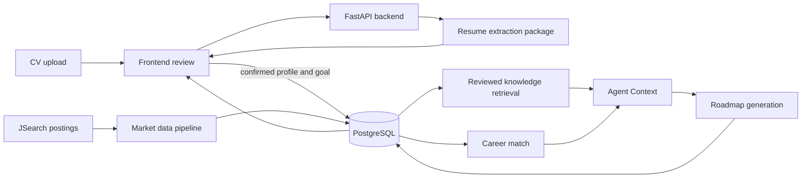

# Glow Job

Glow Job is a career-planning application that turns a learner's confirmed profile and current job-market data into a personalized learning roadmap. It combines a web app, a FastAPI backend, a job-market data pipeline, reviewed learning resources, and PostgreSQL.

## What the application does

1. A learner uploads a CV, reviews the extracted profile, and confirms the information to save.
2. The app compares confirmed skills with demand for a selected career and shows profile coverage and proficiency alignment.
3. The learner chooses a career goal and preferences. The backend uses reviewed learning evidence and market gaps to generate a roadmap with linked prerequisites and progress tracking.
4. The learner can track tasks, review roadmap history, and record job applications and outcomes.
5. The Market pipeline collects job postings, extracts and maps skills to the shared catalog, and refreshes career-demand summaries.

The product uses anonymous browser sessions for local development. A saved profile, goal, and roadmap are linked to the session and persisted in PostgreSQL when the database is configured.

## Project map

| Path | Responsibility |
|---|---|
| `frontend/` | React, TypeScript, and Vite web application for CV review, career matching, goals, roadmaps, and applications. |
| `backend/` | FastAPI routes, upload/job orchestration, profile and goal persistence, market matching, roadmap generation, and assessment APIs. |
| `ai/` | Roadmap contracts, prompt, provider adapters, validation, generation, and graph construction. |
| `rag/` | Read-only data preparation, skill-filtered document retrieval, evidence review, and Agent Context assembly for roadmap generation. |
| `data-pipeline/` | Git submodule with the Market and reusable Resume packages, document ingestion and embeddings, shared skill normalization, CLI tools, and pipeline migrations. |
| `migrations/` | Host-application database migrations, including profile, roadmap, application, and assessment tables. |
| `shared/contracts/` | API types, JSON schemas, and example roadmap responses shared with the frontend. |
| `compose.yaml` | Local PostgreSQL and backend services. Compose automatically loads `compose.override.yaml` for the local Nova profile. |

### Main data flow



## AI models and data boundaries

The current local configuration uses Amazon Nova 2 Lite for text-generation tasks through Bedrock Converse:

| Task | Current model |
|---|---|
| CV extraction | `us.amazon.nova-2-lite-v1:0` |
| Market job-skill extraction | `us.amazon.nova-2-lite-v1:0` |
| Learning-evidence review and on-demand assessment questions | `us.amazon.nova-2-lite-v1:0` |
| Roadmap generation | `us.amazon.nova-2-lite-v1:0` |
| Default document and query embeddings | Gemini Embedding 2, `gemini-embedding-2` (768 dimensions) |

Nova Multimodal Embeddings (`amazon.nova-2-multimodal-embeddings-v1:0`, 1,024 dimensions) is an optional separate embedding path. The normal retrieval flow uses Gemini vectors and needs `GEMINI_API_KEY`; changing embedding provider or dimensions requires matching document and query vectors.

Provider and model IDs are configurable through the root `.env`; the main settings are `RESUME_EXTRACTOR`, `ROADMAP_PROVIDER`, `BEDROCK_TEXT_MODEL`, `BEDROCK_EXTRACTION_MODEL`, and `BEDROCK_ROADMAP_MODEL`. Bedrock authentication can use `AWS_BEARER_TOKEN_BEDROCK`, standard AWS credentials, or an attached AWS role. Do not commit `.env` or credentials.

The app sends the selected profile context, career goal, market evidence, and cited public learning excerpts needed for the requested AI task. Raw CV files are temporary during extraction; the learner reviews and confirms extracted details before the saved profile is used for career matching and roadmaps. See the [CV API/data flow](docs/cv-extraction/README.md) and [Roadmap generation guide](docs/roadmap/roadmap-generation.md) for detailed contracts.

## Run the web app locally

### 1. Clone the project and its data-pipeline submodule

```bash
git clone --recurse-submodules <glow-job-repository-url>
cd glow-job
```

For an existing checkout:

```bash
git submodule update --init --recursive data-pipeline
```

The root repository pins a specific `data-pipeline` commit. Keep submodule work and commits in that repository; update the pinned commit in the root only through the project's submodule workflow.

### 2. Configure the environment

Copy `.env.example` to `.env` and set the database and provider credentials you intend to use:

```powershell
Copy-Item .env.example .env
```

On macOS/Linux, use `cp .env.example .env`.

The example is configured for an RDS connection through an SSH tunnel on the host at `127.0.0.1:15432`; the backend container reaches the host as `host.docker.internal`. Keep that tunnel open while using the app. To use the Compose PostgreSQL service instead, apply the local database override:

```bash
docker compose -f compose.yaml -f compose.local-db.yaml up --build -d
```

The local Postgres service uses the external named volume configured by `POSTGRES_VOLUME_NAME`. Set it to the existing volume that contains your database. Create a new volume only when you intentionally want a fresh, empty database. Avoid running the standalone `data-pipeline` PostgreSQL service against the same volume at the same time.

If Compose reports that the configured external volume does not exist and a new empty local database is intended, create the default volume explicitly:

```bash
docker volume create glow-job-data-pipeline_postgres_data
```

For live Bedrock and embedding calls, configure Bedrock access and `GEMINI_API_KEY`. The local Compose override selects Nova 2 Lite for text generation. To use the mock CV extractor for UI work, set `RESUME_EXTRACTOR=mock`; roadmap generation remains controlled separately by `ROADMAP_PROVIDER`.

### 3. Start the backend and database

From the repository root:

```bash
docker compose up --build -d
docker compose ps
```

This starts PostgreSQL and the FastAPI backend. The backend is available at `http://localhost:8787`; health is at `/api/health` and the interactive API docs are at `/docs`. `docker compose down` stops the services and retains their data volume. Do not use `docker compose down -v` unless deleting local database data is intended.

### 4. Apply database migrations when needed

For a new database or after a migration change, follow the [data-pipeline migration guide](data-pipeline/migrations/README.md) and the [host migration guide](migrations/README.md). The migration runner applies both the submodule's schema migrations and this repository's application migrations. It reads its connection settings from `data-pipeline/.env`; set those values to the same database selected by the backend (`DB_HOST=127.0.0.1` and the host-published port when running the CLI on Windows).

### 5. Start the frontend

In a second terminal:

```bash
cd frontend
npm install
npm run dev
```

Open the local URL printed by Vite, usually `http://localhost:5173`. If that port is occupied, Vite chooses the next available port. The frontend calls `http://localhost:8787/api` by default; set `VITE_API_BASE_URL` in `frontend/.env.local` if the backend uses a different address.

## Run individual parts

| Part | Guide |
|---|---|
| Backend API, settings, and tests | [backend/README.md](backend/README.md) |
| Frontend development | [frontend/README.md](frontend/README.md) |
| Market, Resume, and document pipeline | [data-pipeline/README.md](data-pipeline/README.md) |
| RAG and Agent Context preparation | [rag/README.md](rag/README.md), [Agent Context guide](docs/rag/agent-context-guide.md) |
| Roadmap API, generation, and graph | [Roadmap generation](docs/roadmap/roadmap-generation.md), [API contract](docs/roadmap/api-contract.md) |
| CV extraction API and database mapping | [CV extraction docs](docs/cv-extraction/README.md) |
| Database schemas | [Host migrations](migrations/README.md), [pipeline migrations](data-pipeline/migrations/README.md) |
| AWS/S3 market ingestion | [AWS infrastructure guide](infra/aws/README.md), [scheduled pipeline guide](data-pipeline/docs/market/scheduled-pipeline-guide.md) |

## Development checks

Run frontend checks from `frontend/`:

```bash
npm run build
```

Run backend tests from `backend/` using the development virtual environment described in [backend/README.md](backend/README.md):

```bash
python -m pytest
```

Run data-pipeline tests from `data-pipeline/`:

```bash
python -m pytest
```

Database integration tests require a disposable test database and are opt-in. Do not point destructive integration tests at a shared development or production database.

## Repository and data safety

- Never commit `.env`, API keys, AWS credentials, uploaded CVs, generated user profiles, or private market data.
- Preserve the root repository's pinned `data-pipeline` submodule revision unless a pipeline change is intentionally reviewed and committed in the submodule first.
- The Docker Postgres volume persists when containers stop. Keep a backup before destructive schema or catalog rebuilds.
- Local test fixtures are synthetic. Use the fixture and test guides rather than real CVs for development.
