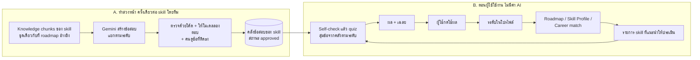
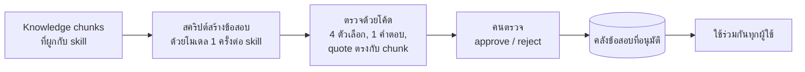

# Skill Assessments: แผนออกแบบ

**สถานะ:** implement แล้ว (design v3) บนบรานช์ `feature/assessments` · API: [api-contract.md](api-contract.md) · คลังข้อสอบ: [question-bank.md](question-bank.md) · ภาพจำลอง: [v3](https://claude.ai/artifact/6F8X95AAgG7Bkk12iuwWvq) · 2026-10-22

## 1. ปัญหาที่แก้

ระบบรู้ว่าผู้ใช้ "มี" skill ไหนจาก CV แต่ส่วนใหญ่ไม่รู้ว่า "ระดับไหน" เพราะ CV ไม่ค่อยเขียนระดับ และระบบสัญญาว่าจะไม่เดา

- สเปก ([skill-context-spec.md](../rag/skill-context-spec.md) ข้อ 339) กำหนดว่า `not_assessed` ต้อง "เสนอประเมิน/ยืนยัน ห้ามนับเป็นศูนย์"
- Roadmap ถามผู้ใช้ไว้แล้ว เช่น "How comfortable are you with Docker?" และสร้างขั้น `foundation_check` แต่ยังไม่มีที่ให้ตอบ
- Career match แสดง "ทักษะที่ประเมินระดับได้" (`assessmentCoveragePct`) ซึ่งตอนนี้ต่ำเพราะไม่มีช่องทางประเมิน
- โปรไฟล์ตัวอย่าง career changer มี 5 skill ที่ระดับเป็น unknown ทั้งหมด
- เมนู **Assessments** (`/app/assessments`) มีอยู่แล้วแต่เป็นหน้า placeholder และ Figma ยังไม่มี design ของหน้านี้

**เป้าหมาย:** ให้ผู้ใช้ยืนยันระดับ skill ได้ภายใน 5 นาทีต่อ skill โดยไม่มีค่า AI ต่อผู้ใช้ ผลที่ได้ต้องโปร่งใสว่าวัดอะไรได้และวัดอะไรไม่ได้ แล้วส่งต่อให้ career match และ roadmap ใช้ทันที

## 2. ขอบเขต

| MVP (ทำในบรานช์นี้) | ไว้ทีหลัง |
|---|---|
| Self-check: ตอบ 3–6 ข้อความ "I can..." ต่อ skill | ตรวจงานจริง เช่นลิงก์ GitHub ด้วย AI |
| Knowledge quiz: ปรนัย 6–9 ข้อแบบปรับระดับตามคำตอบ | Mock interview (ตาราง `app.interview_sessions` มีอยู่แล้ว) |
| คลังข้อสอบที่สร้างล่วงหน้าจากเอกสารใน RAG และผ่านการตรวจโดยคน | สร้างข้อสอบสด ๆ ต่อผู้ใช้ |
| ผู้ใช้กดยืนยันก่อนนำผลไปใช้กับโปรไฟล์ | ระดับ `expert` (ข้อสอบปรนัยวัดไม่ได้) |
| หน้า Assessments + ปุ่มจาก Roadmap และ Skill Profile | ใบรับรองหรือ badge |

## 3. หลักการ

1. **ซื่อตรงกับสิ่งที่วัด:** quiz วัดความรู้จากเอกสาร ไม่ใช่ความพร้อมทำงาน หน้าผลต้องบอกเสมอว่าวัดจากอะไร กี่ข้อ และความมั่นใจระดับไหน
2. **ไม่มีค่า AI ต่อผู้ใช้:** ข้อสอบสร้างครั้งเดียวต่อ skill แล้วใช้ร่วมกันทุกคน การให้คะแนนใช้โค้ด
3. **ทุกข้อสอบมีที่มา:** คำตอบที่ถูกต้องต้องอ้างข้อความจริงจาก knowledge chunk (เหมือน citation ของ roadmap) และต้องผ่านการตรวจโดยคนก่อนใช้
4. **ผู้ใช้เป็นเจ้าของผล:** ระบบไม่เปลี่ยนระดับในโปรไฟล์เองโดยอัตโนมัติ ผู้ใช้กด "Use this result" ก่อน และย้อนกลับได้
5. **ไม่ลบประวัติ:** ทุกครั้งที่ประเมินเก็บไว้ ระดับปัจจุบันมาจากผลล่าสุดที่ผู้ใช้ยอมรับ

## 4. User flow

```mermaid
flowchart TD
    E1[Roadmap: ขั้น foundation check<br/>หรือคำถาม "How comfortable..."] --> S
    E2[Roadmap panel: Current confidence<br/>Not assessed] --> S
    E3[Skill Profile: skill ที่ยังไม่รู้ระดับ] --> S
    E4[หน้า Assessments: รายการที่แนะนำ] --> S
    S[เลือก skill] --> SC[Self-check<br/>ตอบข้อความ I can...]
    SC --> HB{มีคลังข้อสอบ<br/>ที่อนุมัติแล้ว?}
    HB -- ไม่มี --> R1[ผลจาก self-check<br/>ความมั่นใจต่ำ]
    HB -- มี --> Q[Quiz 6-9 ข้อ<br/>ปรับระดับตามคำตอบ]
    Q --> R2[ผล: ระดับ + ความมั่นใจ<br/>+ เฉลยพร้อมแหล่งอ้างอิง]
    R1 --> A{ผู้ใช้ยอมรับผล?}
    R2 --> A
    A -- ยอมรับ --> P[อัปเดตระดับในโปรไฟล์]
    A -- ไม่ยอมรับ --> H[เก็บเป็นประวัติเท่านั้น]
    P --> RM[Roadmap แสดงแถบ<br/>Profile changed: Update roadmap?]
    P --> CM[Career match: assessment coverage เพิ่ม]
```

## 4.1 ที่มาของ skill และข้อสอบ (สองกระบวนการแยกกัน)

แบบประเมินผูกกับ **skill** (เช่น Apache Airflow, `skill_id` 103) ไม่ได้ผูกกับ roadmap ของใครคนหนึ่ง
Roadmap เป็นแค่หนึ่งในแหล่งที่บอกว่าควรแนะนำ skill ไหน และข้อสอบไม่ได้สร้างตอนผู้ใช้กด



**ทำไมไม่สร้างข้อสอบจาก roadmap ของแต่ละคน**
- ค่าใช้จ่าย: ต้องเรียก AI ทุกครั้งที่มีคนสอบ แบบคลังกลางเรียกครั้งเดียวต่อ skill
- คุณภาพ: ข้อสอบที่สร้างสดไม่มีใครตรวจ ข้อที่เฉลยผิดจะไปเปลี่ยนระดับในโปรไฟล์ของผู้ใช้
- เทียบกันได้: ทุกคนที่ได้ "intermediate" ใน Airflow ผ่านข้อสอบมาตรฐานเดียวกัน

**ระบบเลือก skill ที่แนะนำอย่างไร** (endpoint `suggestions`)

| แหล่ง | เงื่อนไข | ข้อความเหตุผลที่แสดง |
|---|---|---|
| Roadmap: คำถามยืนยันและขั้น foundation check | skill อยู่ในโปรไฟล์แต่ไม่รู้ระดับ | "Your roadmap asks: How comfortable are you with Docker?" |
| Roadmap: ขั้น skill | skill ยังไม่อยู่ในโปรไฟล์ | "In your roadmap · not in your profile yet" |
| Skill Profile | skill ในโปรไฟล์ที่ระดับเป็น unknown | "In your profile · level not assessed" |
| Career match | skill ที่ `not_assessed` เรียงตามน้ำหนักในตลาด | "Asked for in job posts · level not assessed" |

ไม่แนะนำ: ขั้น project และ career activity (ไม่ใช่ skill), skill ที่ถูกเลื่อนไป roadmap รอบหน้า, skill ที่รู้ระดับแล้ว (ผู้ใช้กดประเมินซ้ำเองได้จาก Skill Profile)

**ถ้า skill ยังไม่มีคลังข้อสอบ** ผู้ใช้ทำได้แค่ self-check (ความมั่นใจต่ำ) และระบบนับว่ามีคนต้องการ skill นี้ ทีมใช้รายการนี้จัดลำดับว่าจะสร้างคลังของ skill ไหนก่อน

**ตัวอย่างกับผู้เรียน demo** (roadmap: Docker check → Apache Airflow → RAG → portfolio project, Java เลื่อนไปรอบหน้า)

| Skill | แนะนำไหม | เพราะอะไร | รูปแบบ |
|---|---|---|---|
| Docker | แนะนำ | roadmap ถาม และระดับในโปรไฟล์ไม่รู้ | self-check + quiz (ถ้ามีคลังแล้ว) |
| Apache Airflow | แนะนำ | อยู่ใน roadmap แต่ไม่อยู่ในโปรไฟล์ | self-check + quiz |
| RAG | แนะนำ | อยู่ใน roadmap แต่ไม่อยู่ในโปรไฟล์ | น่าจะ self-check อย่างเดียว เพราะเอกสารมีแค่นิยาม |
| Python, SQL, Git, Pandas | ไม่แนะนำโดยอัตโนมัติ | CV ระบุระดับไว้แล้ว (beginner) | ประเมินซ้ำเองได้ |
| Portfolio project | ไม่ | ไม่ใช่ skill | - |
| Java | ไม่ | ถูกเลื่อนไป roadmap รอบหน้า | - |

**ข้อสอบได้ระดับมาจากไหน** ตอนสร้างคลัง ให้โมเดลแยกข้อตามเนื้อหาที่ใช้
- beginner = แนวคิดและนิยามจาก tutorial บทแรก ๆ เช่น "Dag คืออะไร"
- intermediate = วิธีใช้งานทั่วไป เช่น TaskFlow, การส่งข้อมูลระหว่าง task
- advanced = การตั้งค่าและการเชื่อมกับระบบอื่น เช่น connection, ไฟล์ .sql, Object Storage

คนตรวจปรับระดับของข้อได้ก่อน approve

## 4.2 Design v2: Step check ใน roadmap

ผู้ใช้ต้องการให้ Assessments ผูกกับ roadmap และ learning checklist มากขึ้น และเริ่มได้จาก roadmap โดยตรง design v2 จึงเปลี่ยนจุดศูนย์กลางจาก "ระดับ skill" เป็น "**task ใน checklist ของแต่ละ step**"

| เรื่อง | v1 (หน้าแยก) | v2 (ใน roadmap) |
|---|---|---|
| เริ่มจาก | หน้า Assessments | panel ของ step ใน roadmap (ปุ่มใน checklist และแท็ก CHECK บน canvas) |
| ข้อสอบเลือกจาก | คลังของ skill ตามระดับ (ขั้นบันได) | ข้อที่ผูกกับเอกสารเดียวกับ study task ของ step นั้น |
| ผลลัพธ์ | ระดับ skill | **ราย task**: verified หรือ review this task |
| ผลต่อ roadmap | แถบ "Update roadmap?" | ติ๊ก task ให้ทันที พร้อมป้าย "Verified by check" ความคืบหน้าเพิ่มจริง |
| หน้า Assessments | รายการแนะนำ + ประวัติ | รายการ check ตามลำดับ step ใน roadmap และปุ่ม "Open step" |

**กติกา**
- ข้อสอบผูกกับ task ด้วย `chunk_id`: ข้อสอบที่สร้างจาก chunk X ใช้กับ study task ที่อ้าง chunk X ไม่ต้องใช้ AI ตอนจับคู่
- Task ผ่าน (verified) เมื่อตอบถูกทุกข้อของ task นั้น ถ้าผิดแม้ข้อเดียวจะได้ "Review this task" พร้อมลิงก์ไปเอกสาร
- **Test out:** ถ้ายังไม่ได้เริ่ม study task ใดใน step จะมีกล่อง "Know some of this already?" ให้ทำ check ก่อน ข้อที่ตอบถูกจะติ๊ก task ให้ ช่วยคนที่มีเวลาน้อย
- เฉลยแสดงหลังจบ (ตามที่ตกลง) จากนั้นผู้ใช้กด "Tick N verified tasks" ระบบไม่ติ๊กเองโดยไม่ถาม
- Practice task และ project **ไม่ใช้ quiz** ผู้ใช้ติ๊กเองหรือเพิ่มหลักฐาน (Evidence modal ที่มีอยู่แล้ว)
- **Foundation check** (เช่น Docker): ตอบคำถามสั้น 3 ตัวเลือกใน panel ได้ทันที บันทึกเป็นระดับ `self_reported` ถ้ายังไม่มีคลังข้อสอบของ skill นั้น
- ถ้า verify ครบทุก study task ของ skill ที่ยังไม่อยู่ในโปรไฟล์ ระบบเสนอ "Add Apache Airflow to your profile as beginner?" (ผู้ใช้กดเอง) **ข้อเสนอนี้ยังต้องตัดสินใจ** ว่าการผ่านเนื้อหาพื้นฐานของ step ควรนับเป็น beginner หรือไม่

**ผลต่อแผนส่วนอื่น**

| ส่วน | เปลี่ยนจาก v1 |
|---|---|
| คลังข้อสอบ (ข้อ 6) | สร้างตาม **chunk** ที่ task ใน roadmap อ้างอิง (เรียงจาก chunk ที่ถูกอ้างบ่อยที่สุด) แทนการสร้างตามระดับของ skill ทุกข้อยังมี `chunk_id` และ quote |
| ข้อมูล (ข้อ 7) | `app.skill_assessments.kind` เพิ่ม `step_check` พร้อม `roadmap_id`, `step_key` และ `app.user_task_progress` เพิ่ม `verified_by_assessment_id` กับ `needs_review` |
| API (ข้อ 8) | เพิ่ม `POST /profiles/{id}/roadmaps/{rid}/steps/{stepKey}/check` (เริ่ม, ได้ข้อสอบที่ไม่มีเฉลย), `PUT .../answers/{itemId}`, `POST .../finish` (ผลราย task + เฉลย), `POST .../apply` (ติ๊ก task ที่ verified) |
| Roadmap view | แต่ละ node มี `check` (`questionCount`, `taskCount`, `verified`, `review`, `taken`) และ checklist item มี `verified`, `needsReview`, `questionCount` |
| วิธีให้คะแนนแบบขั้นบันได (ข้อ 5) | ไม่ใช้กับ step check เก็บไว้เป็น "Level check" สำหรับ skill นอก roadmap ที่เปิดจาก Skill Profile (ทำทีหลังได้) |

## 4.3 Design v3: รวม step check กับหน้า Assessments (ใช้ตัวนี้)

ผู้ใช้ต้องการให้หน้า Assessments ยังอยู่ v3 จึงใช้การประเมิน 2 แบบที่ตอบคนละคำถาม และใช้ข้อมูลชุดเดียวกัน

| | Step check | Level check |
|---|---|---|
| ตอบคำถาม | เรียน task เหล่านี้รู้เรื่องหรือยัง | skill นี้อยู่ระดับไหน |
| เริ่มจาก | panel ของ step ใน roadmap และหน้า Assessments | หน้า Assessments, Skill Profile และ step ที่ verify ครบแล้ว |
| ข้อสอบ | ผูกกับ study task ผ่าน `chunk_id` (ข้อ 4.2) | self-check + quiz ขั้นบันไดตามระดับ (ข้อ 5) หรือ self-check อย่างเดียวถ้าไม่มีคลัง |
| ผลลัพธ์ | ราย task: verified หรือ review | ระดับ + ความมั่นใจ |
| เปลี่ยนอะไร | ติ๊ก task ใน roadmap | ระดับในโปรไฟล์ (เมื่อผู้ใช้กด Use this result) |

**หน้า Assessments มี 3 ส่วน** และแถบสถิติ "study tasks verified" กับ "profile skills with a known level"
1. **Step checks in your roadmap:** เรียงตามลำดับ step มีสถานะ (Not taken / N verified · M to review / All verified) ปุ่ม "Take check" เปิด check ได้ในหน้านี้เลย และปุ่ม "Open step" ไปที่ roadmap
2. **Level checks:** การ์ดของ skill ที่ควรยืนยันระดับ บอกระดับปัจจุบันและที่มา (from your CV / self-reported / checked by quiz)
3. **Activity:** ประวัติการประเมินทุกแบบ (step check, level check, quick question) พร้อมบอกว่านำไปใช้หรือไม่

**จุดเชื่อมระหว่างสองแบบ**
- เมื่อ step check verify ครบทุก study task ของ skill ที่ยังไม่อยู่ในโปรไฟล์ ระบบเสนอ "Confirm your level with a 5-minute level check" **แทนการเดาว่าเป็น beginner** (ปิดประเด็นค้างจากข้อ 4.2)
- คำถามสั้นของ foundation check (Docker) ใน panel มีลิงก์ไป level check แบบเต็มของ skill เดียวกัน
- ผล level check ที่เก็บแล้วแสดงใน "Profile status" ของ step ใน roadmap

**ข้อมูลเพิ่มจาก v2:** `app.skill_assessments.kind` มี `step_check`, `level_check`, `quick_question` และหน้า Activity อ่านจากตารางนี้ตารางเดียว เพิ่ม `GET /profiles/{id}/assessments/activity` (หรือใช้ endpoint ประวัติเดิม)

## 5. วิธีให้คะแนน

ระดับในระบบมี `beginner`, `intermediate`, `advanced`, `expert` ข้อสอบแต่ละข้อจะติดป้ายระดับ (ยกเว้น `expert`)

**Self-check** มีข้อความ "I can..." ระดับละ 2 ข้อ ผู้ใช้ตอบ Yes / Not sure / No ระดับเริ่มต้น = ระดับสูงสุดที่ตอบ Yes ครบ

**Quiz แบบขั้นบันได:**
1. เริ่มที่ระดับจาก self-check ถาม 3 ข้อ
2. ถูก ≥ 2 ข้อ = ผ่านระดับนั้น แล้วขึ้นไปอีกระดับ (สูงสุด `advanced`)
3. ถ้าไม่ผ่านที่ระดับเริ่มต้น ให้ลงไปหนึ่งระดับ
4. หยุดเมื่อไม่ผ่าน ถึงระดับบนสุด หรือครบ 9 ข้อ
5. ผล = ระดับสูงสุดที่ผ่าน ถ้าไม่ผ่านแม้ `beginner` ให้ผลเป็น `beginner` พร้อมหมายเหตุ "basics not confirmed yet"

| ความมั่นใจ | เงื่อนไข |
|---|---|
| high | ผ่านระดับผลลัพธ์ด้วย 3/3 และตกระดับถัดไป (หรือระดับผลลัพธ์คือบนสุด) |
| medium | ผ่านด้วย 2/3 หรือผลต่างจาก self-check เกินหนึ่งระดับ |
| low | มีแค่ self-check (skill ที่ยังไม่มีคลังข้อสอบ) |

ตัวเลข (3 ข้อ, ≥ 2 ข้อ, 9 ข้อ) เป็นค่าเริ่มต้นที่ต้องปรับหลังลองกับผู้ใช้จริง และเก็บเป็น `scoring_version` ทุกครั้ง

## 6. คลังข้อสอบ (ทำแบบ offline)



- รูปแบบเดียวกับ dependency review ที่ทีมใช้อยู่ (เตรียมหลักฐาน → โมเดลเสนอ → ตรวจด้วยโค้ด → คน approve)
- **ข้อสอบเป็นแบบมีเฉลยตายตัวเท่านั้น** (ตัดสินใจแล้ว): ปรนัยคำตอบเดียว 4 ตัวเลือก ไม่มีคำถามปลายเปิด จึงให้คะแนนด้วยโค้ดได้และไม่ต้องใช้ AI ตอนผู้ใช้สอบ
- **การตรวจแบบเบาแรง** (เพราะยังไม่มีคนตรวจประจำ):
  1. โค้ดตรวจทุกข้อ: 4 ตัวเลือกไม่ซ้ำ, คำตอบเดียว, quote ต้องเป็นข้อความจริงใน chunk, คำตอบที่ถูกต้องต้องสอดคล้องกับ quote
  2. ให้โมเดลอีกรอบตอบข้อสอบเองโดยไม่เห็นเฉลย ถ้าตอบไม่ตรงเฉลย ให้ติดธงว่าข้อนี้อาจกำกวม
  3. คนในทีมดูเฉพาะข้อที่ติดธง และสุ่มดูข้อที่ผ่าน (เช่น 1 ใน 5) ก่อน approve ทั้งชุด
- ต่อ skill: ระดับละ 6–10 ข้อ (ใช้ 3 ข้อต่อครั้ง และสุ่มข้อไม่ซ้ำเมื่อสอบซ้ำ)
- ทุกข้อเก็บ `chunk_id`, quote ที่รองรับคำตอบ, `content_hash` ของ chunk ถ้า chunk เปลี่ยน ข้อสอบนั้นจะถูกพักจนกว่าจะตรวจใหม่
- skill ที่ไม่มี knowledge chunk จะมีแค่ self-check
- MVP ทำคลังให้ 5 skill ของ demo: Python, SQL, Git, Docker, Apache Airflow (ต้องตรวจก่อนว่ามี chunk พอ)

## 7. ข้อมูล (migration ใหม่เลข 017)

> บน `develop` มี migration เลข 016 สองไฟล์ (`016_add_roadmap_generation.sql` และ `016_profile_version_history.sql`) ชื่อไฟล์ไม่ซ้ำ จึงรันได้ทั้งคู่ แต่ควรแจ้งทีมให้ใช้เลขไม่ชนกันต่อจากนี้ งานนี้ใช้ 017

| ตาราง | หน้าที่ | คอลัมน์หลัก |
|---|---|---|
| `app.assessment_items` | คลังข้อสอบกลาง | `item_id`, `skill_id`, `level`, `stem`, `options` jsonb, `answer_index`, `explanation`, `chunk_id`, `quote`, `content_hash`, `status` (draft/approved/rejected/retired), `generated_by`, `reviewed_at` |
| `app.assessment_self_check_statements` | ข้อความ "I can..." | `skill_id` (null = ใช้ทั่วไป), `level`, `text` |
| `app.skill_assessments` | การประเมินแต่ละครั้ง | `assessment_id`, `user_id`, `skill_id`, `kind` (self_check / quiz), `status` (in_progress / completed / abandoned), `entry_point`, `roadmap_id`, `step_key`, `self_check_level`, `result_level`, `confidence`, `scoring_version`, `decision` (pending / accepted / declined), `started_at`, `completed_at`, `decided_at` |
| `app.skill_assessment_answers` | คำตอบรายข้อ | `assessment_id`, `item_id`, `choice`, `correct`, `answered_at` |

เปลี่ยนของเดิม:
- `app.user_skills.proficiency_basis`: เพิ่มค่า `self_reported` และ `assessed` (ตอนนี้ CHECK อนุญาตแค่ `explicit`, `inferred`, `unknown`)
- ใช้ `user_skills.source = 'assessment'` และ `user_skill_evidence.evidence_type = 'assessment'` ตามที่เอกสารฐานข้อมูลวางไว้แล้ว

### ปัญหาสำคัญ: การบันทึกโปรไฟล์ลบระดับ skill

`DatabaseProfilesRepo._replace_profile_items` ลบ `app.user_skills` ทั้งหมดแล้วสร้างใหม่จาก JSON ของโปรไฟล์ทุกครั้งที่บันทึก ถ้าเขียนผลประเมินลงแถวเหล่านี้ตรง ๆ จะหายเมื่อผู้ใช้แก้ CV

**ทางที่เสนอ:** ให้ `app.skill_assessments` (ผลล่าสุดที่ `accepted` ต่อ skill) เป็นแหล่งข้อมูลหลักของระดับที่ประเมินแล้ว มีฟังก์ชันเดียว `apply_accepted_assessments(connection, user_id)` ที่ถูกเรียกใน transaction เดียวกับ

1. การบันทึกโปรไฟล์ (หลังสร้างแถว skill ใหม่)
2. การยอมรับผลประเมิน

ฟังก์ชันนี้อัปเดตระดับ, basis, source และหลักฐานของ skill ที่มีอยู่ และเพิ่มแถวให้ skill ที่ประเมินแล้วแต่ไม่อยู่ใน CV (เช่น ผู้ใช้สอบ Airflow ผ่าน) ข้อดีคือ**ไม่ต้องแก้ schema `CvProfile` ใน submodule data-pipeline** ซึ่งเราห้ามแก้จาก repo นี้

## 8. API (ต่อจาก `/api`, ต้องมี `X-Session-Id` เหมือน roadmap)

| Method | Path | ใช้ทำอะไร |
|---|---|---|
| GET | `/profiles/{id}/assessments/suggestions` | skill ที่ควรประเมิน พร้อมเหตุผล (roadmap ถาม, ระดับไม่รู้, น้ำหนักในตลาด) และบอกว่ามี quiz หรือมีแค่ self-check |
| GET | `/profiles/{id}/assessments` | ประวัติ |
| POST | `/profiles/{id}/assessments` | เริ่ม `{skillId, entryPoint, roadmapId?, stepKey?}` คืนข้อความ self-check |
| PUT | `/profiles/{id}/assessments/{aid}/self-check` | ส่งคำตอบ self-check คืนข้อสอบข้อแรก (หรือผลถ้าไม่มี quiz) |
| PUT | `/profiles/{id}/assessments/{aid}/answers/{itemId}` | ส่งคำตอบ คืนข้อถัดไป หรือ `done` **ไม่ส่งเฉลยระหว่างสอบ** |
| GET | `/profiles/{id}/assessments/{aid}` | ผล + เฉลยพร้อมแหล่งอ้างอิง (หลังสอบเสร็จ) |
| POST | `/profiles/{id}/assessments/{aid}/decision` | `{decision: accepted / declined}` ถ้า accepted ระบบอัปเดตโปรไฟล์ |

ข้อความในข้อสอบที่ส่งให้ client ห้ามมี `answer_index` จนกว่าการประเมินจะจบ

## 9. ผลต่อส่วนอื่นของระบบ

| ที่ | เปลี่ยนอะไร |
|---|---|
| `rag/context/models.py`, `agent_models.py` | เพิ่ม `self_reported`, `assessed` ใน `proficiency_basis` |
| `rag/context/assemble.py` `assess_gap` | ระดับจาก quiz ไม่ต้องติดข้อจำกัด `USER_LEVEL_NOT_EXPLICIT` แต่ใส่ `LEVEL_FROM_QUIZ` / `LEVEL_FROM_SELF_CHECK` เพื่อให้ Agent รู้ที่มา |
| `backend/.../career_matching.py` | logic `proficiency_basis != "explicit"` ต้องรู้จักค่าใหม่ ส่วน assessment coverage จะเพิ่มขึ้นเอง |
| Roadmap view | `profileLabel` แสดง "Checked by quiz: intermediate" ปุ่ม "Check this skill" ใน panel ของขั้น `foundation_check` และ skill ที่ระดับไม่รู้ |
| Roadmap | หลังยอมรับผล ถ้า input hash ไม่ตรงกับแผนล่าสุด ให้แสดงแถบ "Your profile changed. Update roadmap?" (กดแล้วสร้างใหม่ ซึ่งมีค่าใช้จ่าย จึงไม่สร้างเอง) |
| `backend/.../profiles.py` | เรียก `apply_accepted_assessments` หลังสร้างแถว skill ใหม่ |

## 10. Frontend

| ส่วน | รายละเอียด |
|---|---|
| `features/assessments/` (ใหม่) | `api.ts`, `type.ts`, `pages/AssessmentsPage.tsx` (รายการแนะนำ + ประวัติ), `pages/AssessmentRunPage.tsx` (self-check → quiz → ผล), components: `SuggestionCard`, `SelfCheckForm`, `QuestionCard`, `ResultSummary`, `AnswerReview` |
| Router | แทน placeholder ที่ `/app/assessments` และเพิ่ม `/app/assessments/:assessmentId` (เมนูมีอยู่แล้ว) |
| จุดเข้าจากหน้าอื่น | Roadmap `NodeDetailPanel` (ส่วน "Current confidence"), การ์ดคำถามยืนยัน, หน้า Skill Profile |
| Design | **ยังไม่มีใน Figma** เสนอให้ทำภาพจำลองแบบ clickable ด้วยสไตล์ของ component ปัจจุบันให้ดูก่อนเขียนโค้ด เหมือนที่ทำกับ Roadmap |

ข้อความบนหน้าจอเป็นภาษาอังกฤษตาม UI เดิม

## 11. ค่าใช้จ่าย

| ส่วน | ค่าใช้จ่าย |
|---|---|
| ผู้ใช้ทำ self-check / quiz | ไม่เรียก AI ($0) |
| สร้างคลังข้อสอบ | เรียกโมเดลครั้งเดียวต่อ skill-ระดับ ยังไม่ได้วัด คาดว่าหลักเซนต์ต่อ skill รวม 5 skill น่าจะไม่เกินไม่กี่ดอลลาร์ |
| AWS | ไม่มีส่วนเพิ่ม (ใช้ DB และ backend เดิม) |

## 12. ลำดับงาน

| ขั้น | งาน | ขนาด |
|---|---|---|
| 0 | ตัดสินใจ (ข้อ 14) + ภาพจำลอง UI ให้ดู | S |
| 1 | Migration 017 + โค้ดให้คะแนน (pure functions) + unit test | M |
| 2 | สคริปต์สร้างข้อสอบ + ตัวตรวจด้วยโค้ด + CLI ตรวจโดยคน, สร้างคลัง 5 skill | M |
| 3 | API การประเมิน + `apply_accepted_assessments` + ต่อเข้ากับการบันทึกโปรไฟล์ | M |
| 4 | ปรับ rag / career match / roadmap ให้รู้จัก basis ใหม่ + ปุ่มจาก roadmap | S |
| 5 | Frontend หน้า Assessments + จุดเข้าจากหน้าอื่น | L |
| 6 | Test (unit, API, DB จริงด้วย container ชั่วคราว, E2E ผ่าน Docker), เอกสาร, PR | M |

## 13. การทดสอบ

- Unit: ขั้นบันไดของ quiz ทุกเส้นทาง (ขึ้น, ลง, ตกตั้งแต่ beginner, ครบ 9 ข้อ), ความมั่นใจ, ตัวตรวจข้อสอบ (quote ไม่ตรง, ตัวเลือกซ้ำ, คำตอบไม่อยู่ในตัวเลือก)
- API: ห้ามได้เฉลยระหว่างสอบ, session อื่นเข้าไม่ได้, ตอบข้อเดิมซ้ำไม่ได้, การประเมินที่ยังไม่จบยอมรับไม่ได้
- DB: บันทึกโปรไฟล์ใหม่แล้วระดับที่ประเมินยังอยู่, skill ที่ไม่อยู่ใน CV ถูกเพิ่ม, decline แล้วโปรไฟล์ไม่เปลี่ยน
- Integration: หลังยอมรับผล Agent Context เห็นระดับใหม่, career match assessment coverage เพิ่ม, roadmap แสดงแถบ "Update roadmap?"
- ใช้ `scripts/roadmap/visual_test_report.py` เป็นแบบในการทำรายงานภาพ

## 14. การตัดสินใจ

| # | เรื่อง | ข้อสรุป |
|---|---|---|
| 1 | MVP มีทั้ง self-check และ quiz | **ตกลง** ทั้งคู่ |
| 2 | โมเดลสร้างข้อสอบ | **ตกลง** Gemini ที่ pipeline ใช้อยู่แล้ว ถ้าคุณภาพไม่พอค่อยใช้ Claude |
| 3 | รูปแบบข้อสอบและการตรวจ | **ตกลง** แบบมีเฉลยตายตัว (ปรนัยคำตอบเดียว) ยังไม่มีคนตรวจประจำ จึงใช้การตรวจแบบเบาแรงในข้อ 6 |
| 4 | แสดงเฉลยเมื่อไร | **ตกลง** หลังสอบจบ |
| 5 | สอบซ้ำ | ได้ทันที ใช้ข้อที่ยังไม่เคยเห็นก่อน |
| 6 | ผล quiz ต่ำกว่าระดับที่เขียนใน CV | ยังไม่ตัดสินใจ หมายถึงกรณีที่ CV เขียนระดับไว้เอง เช่น "Python (advanced)" แล้ว quiz ได้ intermediate ข้อเสนอ: แสดงทั้งสองค่าและให้ผู้ใช้เลือก ไม่ลดให้เอง |
| 7 | คลังข้อสอบอยู่ schema ไหน | `app` (repo นี้) ย้ายไปฝั่ง data ภายหลังได้ |
| 8 | Design | **ทำแล้ว** ดูภาพจำลองที่ลิงก์ด้านบน รอความเห็นก่อนเขียน frontend |

## 15. ความเสี่ยง

- **ข้อสอบผิด:** โมเดลอาจเฉลยผิด จึงต้องมี quote ที่รองรับคำตอบ และต้องมีคนตรวจทุกข้อก่อนใช้
- **knowledge ไม่พอ:** บาง skill มี chunk น้อยหรือมีแค่สารบัญ (เช่น Java ใน demo) จะมีแค่ self-check
- **ผู้ใช้ตอบไม่ตรงความจริง:** การประเมินนี้ไม่มีการคุมสอบ และเป็นการประเมินที่ไม่มีผลได้เสียสูง จึงยอมรับได้ แต่ต้องแสดงความมั่นใจของผลตามจริง
- **ระดับในตลาดส่วนใหญ่ยังเป็น unknown** (176 จาก 209 skill ใน Data Engineer) ผลประเมินจึงช่วยเรื่องโปรไฟล์และ roadmap มากกว่าคะแนน proficiency alignment ในช่วงแรก
- **การบันทึกโปรไฟล์ลบแถว skill:** แก้ด้วยการทาบผลตามข้อ 7 และต้องมี test ครอบคลุม

## 16. สิ่งที่ implement แล้ว (2026-10-22)

| ส่วน | ไฟล์ |
|---|---|
| กติกาให้คะแนนและตรวจข้อสอบ (ไม่เรียก AI) | `ai/assessments/scoring.py`, `bank.py`, `generate.py` |
| คลังข้อสอบเริ่มต้น 13 ข้อ + ข้อความ self-check | `ai/assessments/seed/demo_bank.json` |
| Migration | `migrations/versions/017_add_skill_assessments.sql` |
| Backend API | `backend/app/features/assessments/` (router, service, repository, overlay) |
| ทาบระดับลงโปรไฟล์หลังบันทึก CV | `overlay.py` เรียกจาก `profiles.py` |
| Roadmap ที่บันทึกแล้ว: task ที่ verified | `roadmap/repository.py` (`apply_check`), view fields `verified`, `needsReview`, `questionCount` |
| Agent Context / career match รู้จัก `assessed`, `self_reported` | `rag/context/*`, `career_matching.py` |
| สคริปต์ | `scripts/assessments/load_bank.py`, `generate_items.py` |
| Frontend | `frontend/src/features/assessments/`, ส่วน "Skill checks" ใน panel ของ roadmap, route `/app/assessments` |

**ข้อจำกัดตอนนี้:** หน้า Roadmap ใน frontend ยังเป็น mock จึงใช้ `roadmapLink.ts` เชื่อม task ของ mock
กับ chunk จริง (มีแค่ Airflow 3 task) เมื่อหน้า Roadmap ต่อ Roadmap API ให้ส่ง `roadmapId` แทน `tasks`
แล้วลบไฟล์นั้น ข้อสอบมีเฉพาะ Airflow และ RAG ต้องสร้างเพิ่มด้วย `generate_items` แล้วตรวจก่อนโหลด

## 17. ข้อสอบจาก AI ตอนผู้ใช้กดทำ (ทาง C, 2026-10-23)

คลังข้อสอบที่คนตรวจแล้วยังเป็นหลัก ถ้า task ใน step check ยังไม่มีข้อสอบ Gemini จะเขียนให้ทันที
เก็บเป็น `provisional` ใช้ร่วมกันทุกคน ใช้ได้เฉพาะ step check (ไม่ใช้ตัดสินระดับ) จนกว่าคนจะตรวจ
ไม่แสดงป้าย "AI-generated" ให้ผู้ใช้ (ตามที่ตกลง) ปิดไว้เป็นค่าเริ่มต้น รายละเอียดและวิธีเปิด:
[question-bank.md](question-bank.md) · migration 018 · `backend/app/features/assessments/generator.py`

## 18. ฐานข้อมูล mock สำหรับเทสต์ดีไซน์ (ชั่วคราว)

`scripts/assessments/demo_db.py` สร้าง Postgres ใน Docker แยก (container `glowjob-assessments-demo`, port 55433)
พร้อมโปรไฟล์ตัวอย่าง `prf_demo_design` (skill 5 ตัวในสถานะต่างกัน), ข้อสอบ 13 ข้อ และ activity 2 รายการ
ไม่แตะฐานข้อมูลทีม ไม่เรียก AI

```cmd
set PYTHONPATH=.;data-pipeline
backend\.venv\Scripts\python -m scripts.assessments.demo_db up      :: สร้าง + seed (reset = ล้างแล้วสร้างใหม่)
backend\.venv\Scripts\python -m scripts.assessments.demo_db serve   :: backend :8787 ต่อกับ DB นี้
backend\.venv\Scripts\python -m scripts.assessments.demo_db down    :: ลบ container และข้อมูลทั้งหมด
```

ในเบราว์เซอร์ (console ที่ http://localhost:5173) ตั้ง session ให้ตรงกับโปรไฟล์ตัวอย่าง ตามคำสั่งที่ `up` พิมพ์ออกมา
`up --no-bank` สร้างแบบไม่มีข้อสอบเลย ไว้ลองให้ Gemini เขียนข้อสอบตอนกด Take check ใน step Airflow
(ต้องตั้ง `ASSESSMENT_AI_GENERATION=gemini` และ `GEMINI_API_KEY` ใน `backend/.env`)
**ตอนเตรียมเชื่อมของจริง:** รัน `down` แล้วลบไฟล์ `demo_db.py` และหัวข้อนี้
