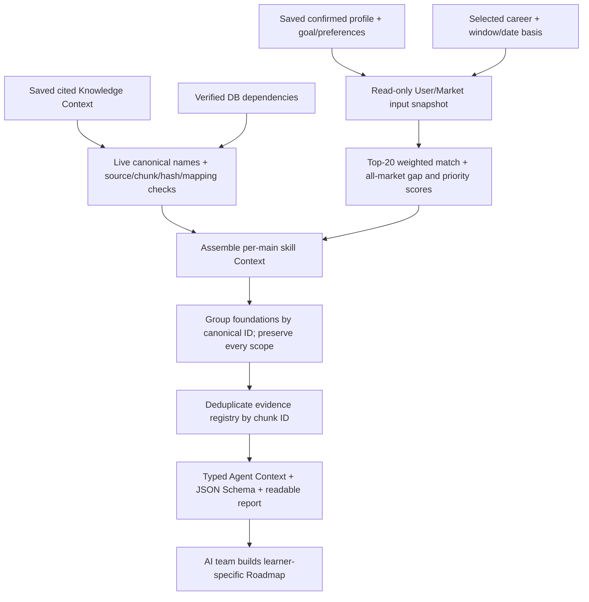

# Agent Context assembly and AI handoff

## What is ready

The host-owned assembler combines a saved confirmed profile and goal, one explicit
Market cohort, cited Skill Knowledge Context, and live verified dependencies into
Agent Context. It performs no model calls or database writes.

Agent Context schema `0.5` adds user-confirmed project summaries with canonical skill
links. The Roadmap AI can use these to avoid proposing the same project again. Schema
`0.5` also calculates Core skill match, full-market coverage,
proficiency alignment, assessment coverage, per-skill gap scores and priority scores.
Its Top 20 denominator, quality gates and formulas share the same versioned helper
as the Resume Career Match calculation. `ready`, `estimated`, and
`insufficient_market_data` describe score input quality. They are not probabilities
of getting a job. The local CLI accepts explicit main skills; the Roadmap API selects
ranked core gaps with embedded documents. The output in both cases
includes scores for the complete market snapshot so the downstream Roadmap Agent can
inspect gaps beyond the retrieved subset.



## Run in CMD from the glow-job root

Prepare the [Skill Knowledge Context](skill-knowledge-context-guide.md) first, or use
the current local `rag/data/knowledge/examples/knowledge-context-demo-v3.json` example.

```cmd
docker compose run --rm --no-deps -T -e PYTHONDONTWRITEBYTECODE=1 -e PYTHONPATH=/workspace ^
  -v "%CD%:/workspace:ro" ^
  -v "%CD%/rag/data:/output" -w /workspace backend ^
  python -m scripts.rag.build_agent_context ^
  --profile-id prf_demo_student_data --career-profile-id 1 ^
  --date-basis first_seen_at ^
  --knowledge /output/knowledge/examples/knowledge-context-demo-v3.json ^
  --output /output/agent-context/users/prf_demo_student_data/agent-context.json
```

The example profile is a synthetic seed, not an uploaded real CV. The profile's
saved goal must match the selected career/profile IDs. For another saved profile,
use its actual `prf_...` ID and the corresponding goal's career profile ID.
A missing saved goal remains null with a warning; preferences/deadlines are not invented.
There is no need to re-extract a Resume or call Gemini during this assembly.

For local Python with the existing pipeline dependencies:

```cmd
python -m scripts.rag.build_agent_context --profile-id prf_demo_student_data --career-profile-id 1 --date-basis first_seen_at --knowledge rag/data/knowledge/examples/knowledge-context-demo-v3.json --output rag/data/agent-context/users/prf_demo_student_data/agent-context.json
```

Use a new JSON filename if an output already exists. Results include `.json`, `.md`
and `.schema.json`. Local `rag/data` results are Git-ignored and may include private
profile IDs, evidence excerpts and optional answers. Share only the intended profile
snapshot with authorized teammates; the published schema contains no profile values.

## Output sections

| Section | Meaning |
|---|---|
| `user_context` | Background, saved goal/preferences/deadline, canonical confirmed skills, separate unresolved names, and confirmed projects with evidence-linked skills |
| `career_context` | Selected career/profile, one Market window/date basis, cohort job count, score metrics, policy versions and quality gates |
| `skill_gap_summary` | Disjoint statuses across all skills in that Market snapshot |
| `selected_skill_gap_summary` | Disjoint statuses for explicitly selected main skills only |
| `market_skill_assessments` | Per-skill status and evidence for every market row; core rank, gap score and priority score when eligible |
| `roadmap_candidates` | RAG-selected skills with the same gap/priority scores plus cited learning claims and foundation references |
| `foundation_mentions` | One item per canonical foundation ID with all relationship scopes and learner conditions retained |
| `evidence_registry` | One full active chunk per ID, source URL/title/hash, roles and consuming main IDs |
| `policy_versions`, `provenance`, `warnings` | Pending decisions, model/config versions, input hashes/times and assembly limitations |

Career score metrics are percentages rounded to two decimals:

- `core_skill_match_pct`: confirmed skill presence among the 20 highest-weighted
  skills, including all ties at the cutoff.
- `market_skill_coverage_pct`: confirmed skill presence across all positive-weight
  market skills.
- `proficiency_alignment_pct`: weighted level fit only where both user and market
  levels pass the configured quality gates.
- `assessment_coverage_pct`: share of total positive market weight with assessable
  user and target levels. A score of `0` means no level comparison could be made;
  `null` means the denominator itself is unavailable.

For Core skills, missing profile evidence gets `gap_score=1.0`; a known level gap is
`level_gap / 3`; known covered skills get `0.0`. Unknown user levels, unreliable
market targets, and skills outside Core keep `gap_score=null`. Priority is
`100 × gap_score × skill_weight / total_core_weight`; only positive gaps get a rank.
Missing skills set `requires_confirmation=true` because absence from a profile does
not prove inability. The complete `market_skill_assessments` list retains each
market row and its reason code.

Availability ranges are not converted to invented exact hours. Context does not
estimate activity durations, create shared learning modules or save a Roadmap. The
current contract is [agent-context.schema.json](agent-context.schema.json).

## Gap interpretation

Comparison uses canonical IDs only. Unresolved names never count as matched skills.

1. A selected skill outside the cohort is `market_data_insufficient`, not assumed
   relevant to that career merely because it was manually selected.
2. A cohort skill absent from confirmed canonical profile skills is
   `missing_from_profile`; this means no profile evidence, not proven inability.
3. A present skill with unknown user level is `not_assessed`, never level zero.
4. Known user level with unknown/low-confidence market-level observations is
   `market_data_insufficient` under the quality gates in `career_context.scores`.
5. Reliable known levels are compared ordinally into `covered` or `proficiency_gap`.

`observed_level_gap` is an index difference, not a numeric priority, estimated study
duration or calibrated proficiency measurement. The four known levels are ordinal;
equal index steps do not establish equal learning effort. `covered` describes the
observed comparison only. `reference_only` prevents adding that comparison as a
new activity; inferred inputs and reliability limitations remain visible.

Market summaries and Career Match scores cover the entire cohort rather than changing
the denominator to the selected Roadmap mains. Candidate priority ranks are global
to positive Core gap scores; the selected RAG subset remains caller-controlled and
does not change those scores.

## Evidence, foundations and stale data

The assembler rechecks live approved canonical names, active source metadata,
full-content SHA-256, exact quotes and main skill/chunk mappings. Changed evidence
fails assembly rather than inheriting old citations. The evidence registry also
includes dependency-proof chunks tagged `dependency_evidence`; these do not become
teaching content for the foundation merely because a relationship quote exists.

All learning citations must resolve to registry chunks marked `learning_content`
and to the corresponding main ID. JSON Schema cannot enforce quote substring/hash
checks or all cross-record invariants; keep the Python models/builder validation or
equivalent checks in a non-Python consumer.

Foundations are grouped by ID, preserving multiple source/learner conditions. They
remain mentions with `creates_learning_activity=false` and satisfaction
`not_assessed`, even when the user's profile contains the name. No minimum-level
or applicability evaluator has been approved. Related is informational; scoped
advice remains context-only. General hard prerequisites retain their progress-blocking
flag until the AI/Backend team confirms the learner's foundation.

JSON, Database Systems, vector databases and object-oriented design currently
have no own mapped teaching chunks. Their notice remains:
**พบพื้นฐานที่เกี่ยวข้อง แต่เนื้อหายังไม่พร้อม**.
Missing material does not fabricate a lesson or block unrelated main skills.

Unknown retrieval levels remain distinct from the actual profile/market levels.
Generic saved knowledge can be reused, with a warning that it does not establish a
personalized level transition. Explicit conflicting level requests fail validation.
The assembly uses several read-only snapshots, not one global transaction across
all queries and the earlier model run.

User skill evidence is capped at three excerpts per skill and 500 characters per
excerpt, with a truncation flag/warning. Full document chunks are not silently
truncated: `--max-registry-chars` defaults to 40,000 and `--max-payload-chars` to
500,000 (characters, not exact tokens). These limits can be raised explicitly up to
120,000 registry characters and 1,000,000 payload characters; citations are not
silently dropped.

## Local examples and integration ownership

Current scored examples use schema `0.5`:

- `rag/data/agent-context/examples/agent-context-demo-student-v3.json` / `.md`: synthetic seed profile,
  tracked for the Roadmap consumer contract.
- `ai/roadmap/fixtures/agent-context-demo-student.json`: tracked consumer fixture copied from that example.
- `rag/data/agent-context/users/prf_bddf4db6/agent-context-user-bddf4db6-v0.4-final.json` / `.md`: output
  generated from the latest saved onboarding profile in this workspace.

The real-profile output is local and Git-ignored because it contains a profile ID,
background, project summaries and skill evidence. It has 209 market assessments; the selected RAG
subset has four potential gaps. Its status is `estimated`: the profile does not
contain enough proficiency-level evidence to calculate proficiency alignment.
Superseded schema `0.3` previews were removed; only the latest v0.4 user snapshot is
kept in the profile folder.

`rag.context.assemble.assemble_context(connection, inputs, knowledge, ...)` is the
host-owned integration boundary. Root CLI `scripts.rag.build_agent_context` wraps
the existing input repository and pipeline-owned evidence/dependency readers.
Backend must authorize the profile before calling the internal function; the local
CLI is for the database owner and does not implement a login/auth boundary.

The typed JSON can be consumed by the Roadmap Agent. The roadmap-generation job
selects ranked core gaps, retrieves and reviews their document evidence, calls this
assembler, and stores the resulting Agent Context with the generated roadmap. It is
not triggered automatically by onboarding. The API does not read a prepared
career-profile knowledge file. Live retrieval needs mapped, embedded documents and
Gemini access; outlines, coverage gaps, score warnings, untrusted text and scoped
conditions must remain visible to the consuming Agent.
