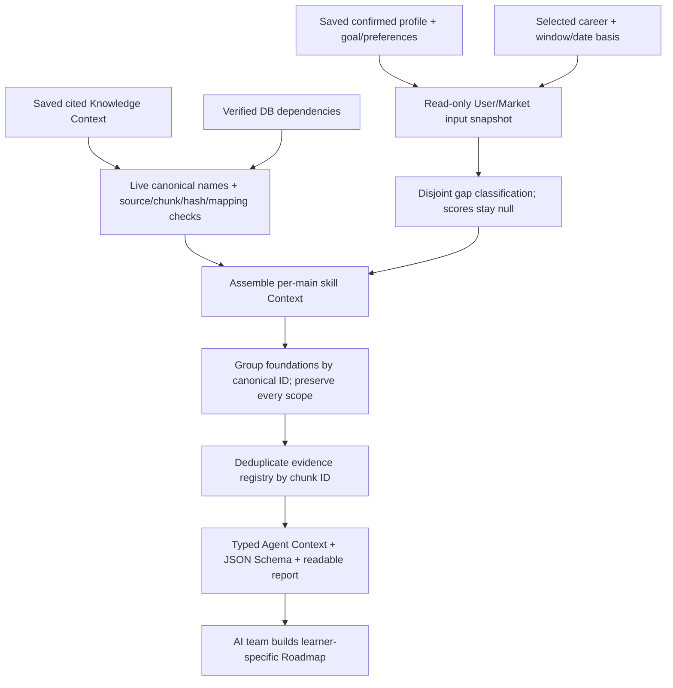

# Agent Context assembly and AI handoff

## What is ready

The host-owned assembler combines a saved confirmed profile and goal, one explicit
Market cohort, cited Skill Knowledge Context, and live verified dependencies into
the final **shape** of Agent Context. It performs no model calls or database writes.

The current status is `preview_pending_policies`: the data contract and assembly
are available for AI integration, while production Career Match, automated main-skill
selection, reliability thresholds and numeric gap/priority scores remain undecided.
Consumers must not present this preview as a production readiness score or generated
Roadmap. Candidate order comes from the knowledge file's explicit main-skill order.



## Run in CMD from the glow-job root

Prepare the [Skill Knowledge Context](skill-knowledge-context-guide.md) first, or use
the current local `rag/data/knowledge/knowledge-context-demo-v3.json` example.

```cmd
docker compose run --rm --no-deps -T -e PYTHONDONTWRITEBYTECODE=1 -e PYTHONPATH=/workspace ^
  -v "%CD%:/workspace:ro" ^
  -v "%CD%/rag/data:/output" -w /workspace backend ^
  python -m scripts.rag.build_agent_context ^
  --profile-id prf_demo_student_data --career-profile-id 1 ^
  --date-basis first_seen_at ^
  --knowledge /output/knowledge/knowledge-context-demo-v3.json ^
  --output /output/agent-context/my-agent-context.json
```

The example profile is a synthetic seed, not an uploaded real CV. The profile's
saved goal must match the selected career/profile IDs. For another saved profile,
use its actual `prf_...` ID and the corresponding goal's career profile ID.
A missing saved goal remains null with a warning; preferences/deadlines are not invented.
There is no need to re-extract a Resume or call Gemini during this assembly.

For local Python with the existing pipeline dependencies:

```cmd
python -m scripts.rag.build_agent_context --profile-id prf_demo_student_data --career-profile-id 1 --date-basis first_seen_at --knowledge rag/data/knowledge/knowledge-context-demo-v3.json --output rag/data/agent-context/my-agent-context.json
```

Use a new JSON filename if an output already exists. Results include `.json`, `.md`
and `.schema.json`. Local `rag/data` results are Git-ignored and may include private
profile IDs, evidence excerpts and optional answers. Share only the intended profile
snapshot with authorized teammates; the published schema contains no profile values.

## Output sections

| Section | Meaning |
|---|---|
| `user_context` | Background, saved goal/preferences/deadline, canonical confirmed skills and separate unresolved names |
| `career_context` | Selected career/profile, one Market window/date basis, cohort job count and pending score state |
| `skill_gap_summary` | Disjoint statuses across all skills in that Market snapshot |
| `selected_skill_gap_summary` | Disjoint statuses for explicitly selected main skills only |
| `roadmap_candidates` | Per-main gap/market/provenance, caller rank, cited learning claims and foundation references |
| `foundation_mentions` | One item per canonical foundation ID with all relationship scopes and learner conditions retained |
| `evidence_registry` | One full active chunk per ID, source URL/title/hash, roles and consuming main IDs |
| `policy_versions`, `provenance`, `warnings` | Pending decisions, model/config versions, input hashes/times and assembly limitations |

`career_context.scores.metrics` is empty; policy and numeric gap/priority scores
are null. Availability ranges are not converted to invented exact hours. Context
does not estimate activity durations, create shared learning modules or save a Roadmap.
The current contract is [agent-context.schema.json](agent-context.schema.json).

## Gap interpretation

Comparison uses canonical IDs only. Unresolved names never count as matched skills.

1. A selected skill outside the cohort is `market_data_insufficient`, not assumed
   relevant to that career merely because it was manually selected.
2. A cohort skill absent from confirmed canonical profile skills is
   `missing_from_profile`; this means no profile evidence, not proven inability.
3. A present skill with unknown user level is `not_assessed`, never level zero.
4. Known user level with unknown/absent market-level observations is
   `market_data_insufficient`.
5. Available known levels are compared ordinally into `covered` or `proficiency_gap`,
   preserving basis and a warning that reliability policy is still pending.

`observed_level_gap` is an index difference, not a numeric priority, estimated study
duration or calibrated proficiency measurement. The four known levels are ordinal;
equal index steps do not establish equal learning effort. `covered` describes the
observed comparison only. `reference_only` prevents adding that comparison as a
new activity; inferred inputs and reliability limitations remain visible.

Market summaries cover the entire cohort rather than changing a Career Match
denominator to the selected Roadmap mains. Main rank is explicit caller order,
not a new demand/gap formula. An automatically selected policy remains future work.

## Evidence, foundations and stale data

The assembler rechecks live approved canonical names, active source metadata,
full-content SHA-256, exact quotes and main skill/chunk mappings. Changed evidence
fails assembly rather than inheriting old citations. The evidence registry also
includes dependency-proof chunks tagged `dependency_evidence`; these do not become
teaching content for the foundation merely because a relationship quote exists.

All learning citations must resolve to registry chunks marked `learning_content`
and to the corresponding main ID. JSON Schema cannot enforce quote substring/hash
checks or all cross-record invariants; keep the Python models/builder validation or
equivalent checks in a non-Python consumer.

Foundations are grouped by ID, preserving multiple source/learner conditions. They
remain mentions with `creates_learning_activity=false` and satisfaction
`not_assessed`, even when the user's profile contains the name. No minimum-level
or applicability evaluator has been approved. Related is informational; scoped
advice remains context-only. General hard prerequisites retain their progress-blocking
flag until the AI/Backend team confirms the learner's foundation.

JSON, Database Systems, vector databases and object-oriented design currently
have no own mapped teaching chunks. Their notice remains:
**พบพื้นฐานที่เกี่ยวข้อง แต่เนื้อหายังไม่พร้อม**.
Missing material does not fabricate a lesson or block unrelated main skills.

Unknown retrieval levels remain distinct from the actual profile/market levels.
Generic saved knowledge can be reused, with a warning that it does not establish a
personalized level transition. Explicit conflicting level requests fail validation.
The assembly uses several read-only snapshots, not one global transaction across
all queries and the earlier model run.

User skill evidence is capped at three excerpts per skill and 500 characters per
excerpt, with a truncation flag/warning. Full document chunks are not silently
truncated: `--max-registry-chars` defaults to 40,000 and `--max-payload-chars` to
80,000 (characters, not exact tokens). Exceeding a preview budget requires fewer
selected mains or an explicitly higher bound; citations are not silently dropped.

## Local examples and integration ownership

Current saved examples:

- `rag/data/agent-context/agent-context-demo-student-v2.json` / `.md`: seed student.
- `rag/data/agent-context/agent-context-demo-unknown-v1.json` / `.md`: seed career changer with
  confirmed skill names but unknown levels.

Both reuse the same three-main document preview (Airflow/RAG/Java), with 8 grouped
foundation IDs and 16 unique evidence chunks. Their user/goal/gap sections differ.
For the career changer, four cohort skills are `not_assessed`; no unknown level
is turned into covered, zero proficiency or satisfied prerequisites.
These examples contain real local seed/cohort reads, not hypothetical counts.

`rag.context.assemble.assemble_context(connection, inputs, knowledge, ...)` is the
host-owned integration boundary. Root CLI `scripts.rag.build_agent_context` wraps
the existing input repository and pipeline-owned evidence/dependency readers.
Backend must authorize the profile before calling the internal function; the local
CLI is for the database owner and does not implement a login/auth boundary.

The AI team can consume the typed JSON and build learner-specific activities from
instructional evidence. Outlines, coverage gaps, pending policy flags, untrusted
document/user text and scoped conditions must be respected. Backend persistence,
Agent/UI implementation, automated selection and policy approval remain separate.
