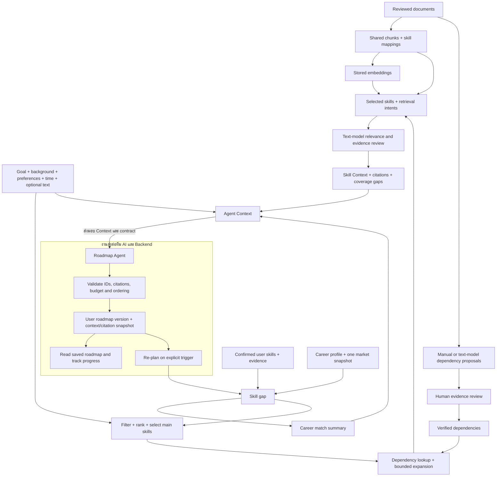

# Glow-Job RAG & Skill Context Specification

**Version:** v0.5 — Agent Context เพิ่ม user-confirmed projects; scoring policy remains v0.4<br>
**Updated:** 2026-10-22<br>
**Scope:** Skill Gap, Career Match, Roadmap Skill Selection, Document-grounded Dependencies, RAG และ Agent Context<br>
**Language:** Thai

เอกสารนี้ต่อยอดจาก draft v0.3 และระบุ scoring policy v0.4 กับ Agent Context contract v0.5 ที่ implement แล้ว โดยเพิ่มประสบการณ์ project ที่ผู้ใช้ยืนยันและ canonical skills ที่เชื่อมผ่าน evidence table Backend มี roadmap-generation job ที่ประกอบและบันทึก Context ไปกับ generation แล้ว แต่ยังไม่ trigger อัตโนมัติหลัง onboarding และยังต้องเตรียม Knowledge Context ที่ครอบคลุม gap กับเชื่อม UI ก่อน production rollout

คำว่า **ข้อกำหนด** หมายถึงแนวทางที่ตกลงกันแล้ว ส่วน **ข้อเสนอรอตรวจ** และ **TBD** หมายถึงรายละเอียดที่ยังต้องเลือกหรือวัดผลก่อน implementation ค่าตัวอย่างใน JSON เป็นข้อมูลสมมติ ไม่ใช่ผล query จาก DB หรือหลักฐาน prerequisite จริง

ดู [สถานะงานและผลตรวจ](implementation-progress.md), [Agent Context v0.5](agent-context-guide.md), [คู่มือ input preview](context-data-guide.md) และ [ผลทดลองคะแนนชุดแรก](market-score-comparison.md) รายงานเปรียบเทียบเป็นประวัติการทดลอง; policy คะแนนที่เลือกใช้ปัจจุบันระบุในหัวข้อ 18–21 และ contract ของ Agent Context ระบุใน schema รุ่นล่าสุด

ข้อสรุปที่ผู้ใช้ยืนยันหลังตรวจซ้ำ: R1 งานรอบนี้จบที่การเตรียมข้อมูล/RAG/Agent Context และ contract ส่งต่อทีม AI/Backend; R2 เลื่อน reusable learning modules กลางออกไป; R3 ใช้ weighted Core Top 20, full-market coverage แยกต่างหาก และ versioned gap/priority scores ตามผลทบทวนในหัวข้อ 18–21 ส่วน Roadmap Agent, หน้าจอ และการบันทึกแผนใน Backend อยู่ใน repo แล้ว แต่การ trigger จาก onboarding และการเชื่อม UI เป็นงานต่อ

## เอกสารอ้างอิงและสถานะปัจจุบัน

สเปกนี้อยู่ใน repo หลักเพราะครอบคลุมผู้ใช้และ Roadmap ส่วนข้อกำหนดการเก็บเอกสารและ Knowledge อยู่ใน sub repo:

- [Knowledge ingestion และ RAG baseline](../../data-pipeline/docs/documents/skill-knowledge-rag-spec.md)
- [Document extraction flow](../../data-pipeline/docs/documents/document-extraction-flow.md)
- [Pipeline schema](../../data-pipeline/docs/database/schemas/pipeline-schema.dbml)
- [Knowledge schema และสถานะตารางที่ยังเป็นแผน](../../data-pipeline/docs/database/schemas/knowledge-schema.dbml)
- [App schema](../schemas/app-schema.dbml)
- [Migration guide](../../migrations/README.md)
- [Career matching implementation ปัจจุบัน](../../backend/app/features/resume/career_matching.py)

สถานะต่อไปนี้อ้างอิงไฟล์ migration และโค้ดใน checkout ขณะเขียน ไม่ใช่การตรวจ live database:

| ส่วน | มีอยู่แล้ว | งานที่จะเพิ่มหรือปรับตามสเปกนี้ |
|---|---|---|
| Catalog | `core.skills`, `core.skill_aliases` | ใช้ canonical ID เดิมร่วมกัน |
| Resume | สกัด CV, จับคู่ catalog, บันทึกโปรไฟล์ที่ยืนยันและ skill evidence | เตรียมข้อมูลที่จำเป็นให้ Agent |
| Market | `market.career_skill_stats` แยกตาม career profile และช่วงเวลา | กำหนดชุด skill ที่ใช้คิดคะแนนใหม่และคัดเข้า Roadmap |
| Career match | มีโค้ดเดิมและรายงานทดลองตัวหารชุดแรก | ตรวจตัวอย่างก่อนเลือก scoring/selection policies |
| Knowledge | source/chunk tables, chunk-to-skill mapping, embedding และ CLI search | เพิ่ม runtime retrieval, text-model review และ Context assembly |
| Dependencies | เตรียม migration 014 และทดสอบแบบ rollback แล้ว ยังไม่ apply | ทำขั้นเสนอ/ตรวจความสัมพันธ์, cycle checks และ verified lookup |
| Learning modules | มีแบบใน DBML | เลื่อนออกจากงานรอบนี้ ไม่สร้างตารางหรือ curate modules กลาง |
| Preferences/goal | มีคอลัมน์หลักใน App schema | ระบุ input contract และ schema ที่ทีม Backend ต้องรองรับ; งานนี้อ่าน/เตรียมข้อมูลให้ Context |
| Roadmap | มีตาราง roadmap, steps, tasks และ progress | ระบุ contract ของ Context/citations ให้ทีม AI/Backend พัฒนา Agent และ persistence ต่อ |

เมื่อ DBML รวมกับ schema เฉพาะส่วนไม่ตรงกัน ให้ตรวจ migrations ตามลำดับก่อน ตัวอย่างสำคัญคือ migration `013` ย้าย skill mapping ออกจาก chunks ไปตารางกลางแล้ว งาน implementation ต้องปรับ DBML ที่เกี่ยวข้องให้ตรงกันด้วย

## 1. เป้าหมายของระบบ

เตรียมข้อมูลให้ Roadmap Agent ของทีม AI ใช้สร้างลำดับการเรียน กิจกรรมฝึก Best Next Action และคำอธิบายที่เหมาะกับผู้เรียน โดยอาศัยทักษะที่ยืนยันแล้ว ข้อมูลตลาด เอกสารอ้างอิง เป้าหมาย และเวลาที่มี

```text
Confirmed User Skills + Career/Market Skills
→ Skill Gap
→ Career Match Summary และ Roadmap Candidate Selection
→ Priority Ranking
→ Verified Dependency Expansion
→ Embedding Retrieval + Text-model Review
→ Skill Context

Background + Goal + Preferences + Availability + Optional Information
→ User Context

Skill Context + User Context + Career Context
→ Agent Context
→ Personalized Roadmap
→ บันทึก Roadmap ของผู้ใช้พร้อมหลักฐานที่ใช้สร้าง
```

ระบบต้องส่งข้อมูลที่จำเป็นและอ้างอิงได้ให้ Agent ภายใน Context budget ที่กำหนด

## 2. Scope

### 2.1 งานเตรียมข้อมูลและ Context

- เตรียม User Context จากข้อมูลที่ยืนยันและ input ตาม UI
- เปรียบเทียบ Career Match policies ด้วยโปรไฟล์ตัวอย่างก่อนเลือกสูตร/รูปแบบคะแนน และแยกจาก Roadmap skill selection
- คำนวณ gap, กรอง candidates, rank และควบคุมจำนวนตามเวลาที่มี
- สร้างตาราง dependency และ workflow หลักฐานตาม migration ใหม่
- เสนอ dependency จากเอกสารด้วยคนหรือ text model และตรวจยืนยันก่อนใช้
- Retrieval จาก pgvector ตาม skill/intent แล้วให้ text model อ่านและคัดหลักฐาน
- สร้าง Skill Context, Agent Context และ contract ที่ตรวจสอบรูปแบบได้
- ส่งมอบ Context/citations พร้อม input/output contract ให้ทีม AI/Backend รวมถึงข้อกำหนดการเก็บผลเฉพาะผู้ใช้

การพัฒนา Roadmap Agent, หน้า UI, user/goal APIs และ Roadmap persistence เป็นงานทีมปลายทาง ส่วน reusable learning modules กลางเลื่อนออกไป งานนี้ต้องสร้าง Context ที่ใช้งานและประเมินคุณภาพได้โดยไม่พึ่งตาราง learning modules

### 2.2 ใช้ต่อจาก Document pipeline

Document collection, parsing, chunking, embedding และ vector storage ใช้ workflow เดิม ไม่สร้าง ingestion ใหม่ใน runtime ของ Roadmap โดยต้องมี:

| ตาราง | ข้อมูลที่ใช้ |
|---|---|
| `knowledge.knowledge_sources` | `source_id`, title, URL, publisher, active status |
| `knowledge.knowledge_chunks` | `chunk_id`, `source_id`, content, topic, metadata, embedding model/vector |
| `knowledge.knowledge_chunk_skills` | `chunk_id`, `skill_id` แบบ many-to-many |

**ไม่มี `skill_id` ใน `knowledge.knowledge_chunks` หลัง migration 013** การกรอง skill ต้องใช้ตารางกลาง ชุดข้อมูลที่ค้นร่วมกันต้องใช้ embedding model และมิติที่เข้ากัน ปัจจุบัน retrieval ใช้ Amazon Nova Multimodal Embeddings และ `vector(1024)`; Gemini `vector(768)` เดิมเก็บไว้เป็น fallback.

การมี embedding ไม่ได้แปลว่า skill นั้นมีเอกสารครอบคลุมทุกหัวข้อ หรือมี dependency พร้อมใช้ ต้องรายงาน coverage แยกกัน

## 3. ข้อมูลหลักและขอบเขตความรับผิดชอบ

Context ประกอบด้วย User Context, Career/Market Context และ Knowledge/Skill Context

| งาน | ที่รับผิดชอบ |
|---|---|
| JD/Market ingestion, catalog normalization, aggregation | `data-pipeline/src/market` |
| CV parsing/extraction/normalization | `data-pipeline/src/resume` |
| เอกสาร, chunks, embeddings และการเตรียม Knowledge ที่ใช้ร่วมกัน | `data-pipeline/src/documents` และ scripts ของโดเมน |
| Canonical skill matching และ Gemini infrastructure ที่ใช้ร่วมกัน | `data-pipeline/src/shared` |
| อ่าน/บันทึกผู้ใช้และ goal, request orchestration, career match, Roadmap persistence | Backend ใน repo หลัก |
| จัดลำดับกิจกรรมและสร้างแผนเฉพาะผู้เรียน | Roadmap Agent ผ่าน contract ในเอกสารนี้ |

Runtime retrieval ควรเรียกฟังก์ชัน/package ที่ใช้ซ้ำได้ การนำ CLI search มารันเป็น subprocess ต่อ request เป็นเพียงทางทดลอง ไม่ใช่รูปแบบ runtime ที่กำหนดไว้

ตารางนี้บอกหน้าที่ของแต่ละส่วนในระบบ งานรอบนี้รับผิดชอบการเตรียมข้อมูล, dependency workflow, scoring evaluation, retrieval และ Context contract ส่วนการสร้างแผน/UI และการจัดเก็บแผนเป็นงานส่งต่อทีม AI/Backend

## 4. User Skill Data

ใช้ `app.user_skills` ร่วมกับ `app.user_skill_evidence` โดย skill ที่นำมานับว่ามีใน catalog ต้องมี `skill_id`, `match_status='matched'` และ `user_confirmed=true`

```json
{
  "user_id": 42,
  "profile_id": "prf_example",
  "skills": [
    {
      "skill_id": 1,
      "skill_name": "Python",
      "proficiency_level": "intermediate",
      "proficiency_basis": "explicit",
      "match_status": "matched",
      "user_confirmed": true,
      "confidence": 0.9
    }
  ]
}
```

รายการที่จับคู่ไม่ได้ต้องแยกเป็น unresolved user skills ไม่ทิ้งข้อมูลและไม่สร้าง `core.skills` หรือ alias อัตโนมัติ Confidence ของการสกัดข้อมูลไม่ใช่คะแนนพิสูจน์ระดับความสามารถ

## 5. User Context

ประกอบด้วยข้อมูลพื้นฐานที่จำเป็น เป้าหมายอาชีพ วันที่เป้าหมาย วิธีเรียน เวลาต่อสัปดาห์ สถานะปัจจุบัน และ Optional information

ตามข้อสรุปนี้ **ไม่เพิ่มฟิลด์ preferred days, avoid list, preferred language, domains exposed หรือ structured signals ที่สกัดจาก Optional information**

## 6. User Background และ Current Situation

ใช้ข้อมูลการศึกษา สถานะปัจจุบัน ประสบการณ์ และข้อความสรุปที่จำเป็นจาก `app.user_profiles` และข้อมูลโปรไฟล์ที่ยืนยันแล้ว ตัวอย่าง:

```json
{
  "background": {
    "field_of_study": "Computer Engineering",
    "years_experience": 0,
    "current_status": "student",
    "current_situation_detail": null
  }
}
```

`current_status` ใช้ค่าของ schema เดิม: `student`, `employed_full_time`, `employed_part_time`, `between_opportunities`, `other`

เมื่อเลือก Other ให้มีช่องรายละเอียดสั้นแบบไม่บังคับ เสนอเพิ่ม `app.user_profiles.current_situation_detail` เป็นคอลัมน์ใหม่ รับเฉพาะกรณี `current_status='other'`; หากเปลี่ยนเป็นสถานะอื่นให้ล้างค่ารายละเอียดเดิม ขอบเขตความยาวรอตกลงใน validation contract

Background ช่วยเลือกคำอธิบายและกิจกรรม แต่ไม่ใช้วุฒิหรืออายุงานแทนระดับ skill และไม่ส่งข้อมูลระบุตัวบุคคลที่ไม่เกี่ยวกับการสร้างแผนให้ Agent

## 7. Background ที่เป็น Skill Evidence

ประโยคเช่น “Built an ETL pipeline using Apache Airflow” เป็นหลักฐานการใช้เทคโนโลยี จึงต้องเชื่อมผ่าน `app.user_skills` และ `app.user_skill_evidence` กับ experience/project ที่พบ

การพบชื่อใน project ยืนยันได้ว่ามีการกล่าวถึงทักษะ แต่ไม่เพียงพอให้ตั้งระดับ beginner/intermediate เอง ต้องเก็บ `proficiency_basis` และให้ระดับเป็น `unknown` เมื่อไม่มีข้อมูลรองรับ

ทักษะใน `technicalSkills`, `tools` และ technologies ของ project/experience ใช้ catalog เดียวกัน หากชี้ไป `skill_id` เดียวกัน ให้รวมตัวตนของ user skill และเก็บหลักฐานแต่ละที่แยกกัน

## 8. Career Goal Context และวันที่สิ้นสุดเป้าหมาย

เลือกเป้าหมายด้วย `career_profile_id` ซึ่งระบุ career และ seniority จาก `core.career_profiles` ส่วน `career_id` เป็นอาชีพแม่ ต้องตรวจว่าคู่ ID สอดคล้องกัน

```json
{
  "career_goal": {
    "goal_id": 7,
    "career_id": 10,
    "career_profile_id": 12,
    "target_role_title": "Junior Data Engineer",
    "readiness_timeframe": null,
    "target_date": "2027-04-15"
  }
}
```

กำหนด UI ให้เลือกช่วงเวลาเดิมหรือกำหนดวันเองได้:

- Preset: ใช้ `three_months`, `six_months`, `one_year` และบันทึก `target_date` ที่คำนวณ ณ วันที่ยืนยัน goal
- วันกำหนดเอง: ใช้ `target_date` ที่ผู้ใช้เลือกและให้ `readiness_timeframe=null` ไม่ต้องเพิ่ม enum เพื่อแทนวันที่
- ไม่กำหนด: ใช้ `no_fixed_deadline` และ `target_date=null`

กำหนด timezone ที่ใช้คำนวณวันให้สอดคล้องกัน และรับวันที่อนาคตตอนตั้งเป้าหมายใหม่ หากเป้าหมายเดิมหมดอายุแล้วให้รายงานและเสนอปรับแผน ไม่เลื่อนวันอัตโนมัติ

จำนวนสัปดาห์ที่เหลือคำนวณจากวันที่สร้าง Context กับ `target_date` ไม่เก็บ timeframe หลายค่าแข่งกัน วันเป้าหมายใช้ประเมิน scope; ไม่ใช่คำรับรองว่าจะเรียนจบตามกำหนด

## 9. Learning Preferences

คงการเลือกหนึ่งค่าตาม UI และ enum ใน DB:

```text
structured_courses
hands_on_projects
reading_articles
videos_tutorials
```

เก็บใน `app.user_career_goals.preferred_learning_style` และใช้ปรับรูปแบบกิจกรรมหรือแหล่งเรียนรู้ ความชอบไม่ทำให้ตัด prerequisite ที่จำเป็นออก และไม่เปลี่ยนหลักฐาน Market/Skill Gap

## 10. Weekly Availability และข้อจำกัดเวลา

ใช้ `weekly_availability` ตามตัวเลือกเดิม: `under_2_hours`, `hours_2_to_5`, `hours_5_to_10`, `hours_10_plus` ส่วน `available_hours_per_week` เป็นค่า exact ที่มีได้เมื่อผู้ใช้ระบุจริง

```json
{
  "constraints": {
    "weekly_availability": "hours_2_to_5",
    "available_hours_per_week": null,
    "target_date": "2027-04-15"
  }
}
```

ถ้ารับเพียงช่วงเวลา ต้องเก็บช่วงเดิม ไม่แปลงเป็นค่ากลางแล้วอ้างว่าเป็นเวลาที่ผู้ใช้ระบุ หาก planner ต้องใช้ตัวเลข ให้ประกาศ planning assumption และอธิบายได้ โดยต้องกำหนดนโยบายสำหรับช่วงปลายเปิด `<2` และ `10+` ด้วย

Time budget ต้องนับเวลาของ prerequisite และกิจกรรมประเมินเพิ่มด้วย หากไม่พอให้ลดขอบเขตหรือเสนอปรับเป้าหมาย

## 11. Optional Information

ใช้ช่อง Optional information เดิมและเก็บข้อความที่ผู้ใช้กรอกใน `app.user_career_goals.additional_context` สูงสุด 500 ตัวอักษร

```json
{
  "additional_context": "อยากเตรียมสมัครฝึกงานและอยากมีโปรเจกต์ประกอบพอร์ต"
}
```

ส่งข้อความนี้ให้ Agent ใน User Context เพียงครั้งเดียว ไม่สร้าง field แยกสำหรับข้อมูลที่ตกลงตัดออก ผู้ใช้ยังสามารถเล่าข้อจำกัดหรือความต้องการในช่องนี้ได้

## 12. การตีความ Optional Information

MVP ไม่เพิ่มขั้น LLM extraction เพื่อบันทึก structured signals จากข้อความนี้ Agent สามารถอ่านเป็นข้อมูลประกอบได้ แต่การแก้ goal, วันที่, availability หรือ skill record ต้องผ่าน input/confirmation flow ที่กำหนด

ถ้าข้อความขัดกับฟอร์มที่ยืนยัน ให้ยึดฟอร์มและแจ้งความขัดแย้งเป็น warning ไม่ให้ข้อความปลายเปิดเปลี่ยนค่าหลักเงียบ ๆ ข้อความที่ดูเหมือนประสบการณ์ไม่สร้าง canonical skill หรือ user skill ใหม่โดยทันที

## 13. User Context กับ Skill Priority

Market และ gap ใช้บอกว่าทักษะใดควรพัฒนา เป้าหมายและ Background ใช้ปรับความเหมาะสม วิธีเรียนใช้ปรับรูปแบบกิจกรรม ส่วนเวลาและ deadline ใช้จำกัด scope

ข้อจำกัดเวลาเป็นเงื่อนไขที่ planner ต้องเคารพ แม้ skill จะสำคัญมากก็ไม่ควรสร้างแผนเกินเวลาที่มีโดยไม่แจ้งผู้ใช้

## 14. Career / Market Context

อ่านจาก `market.career_skill_stats` ของ career profile ที่เลือก โดยยึด snapshot เดียวกันทั้งชุด:

```text
career_profile_id
analysis_start_date
analysis_end_date
analysis_date_basis
```

ต้องไม่ผสม `posted_at` กับ `first_seen_at` หรือคนละช่วงวิเคราะห์ใน score เดียวกัน

```json
{
  "career_id": 10,
  "career_profile_id": 12,
  "career_name": "Data Engineer",
  "seniority_level": "junior",
  "market_window": {
    "analysis_start_date": "2026-09-01",
    "analysis_end_date": "2026-10-01",
    "analysis_date_basis": "posted_at"
  },
  "skills": [
    {
      "skill_id": 5,
      "skill_name": "Apache Airflow",
      "demand_count": 67,
      "total_jobs": 100,
      "demand_percentage": 67.0,
      "required_count": 43,
      "preferred_count": 20,
      "optional_count": 4,
      "weighted_demand_score": 0.438,
      "target_level": "beginner",
      "target_level_confidence": 0.88,
      "level_observation_count": 25,
      "importance_tier": "unknown"
    }
  ]
}
```

ข้อกำหนดเรื่องหน่วยและความหมาย:

- `demand_percentage` เป็น 0–100; `weighted_demand_score` เป็น 0–1
- Career aggregate มี required/preferred/optional **counts** ไม่ใช่ `requirement_type` เดียว หากต้องการ share ต้องกำหนด denominator ให้ชัด เช่น `required_count / demand_count`
- ใช้ `weighted_demand_score` ตาม DB ไม่เรียกเป็น `importance_weight` โดยไม่มี adapter/นิยาม
- `target_level_confidence` ใน aggregation ปัจจุบันเป็นสัดส่วนการพบระดับที่เป็น mode ใน known levels ไม่ใช่ confidence รวมของ skill
- `importance_tier` มีใน schema แต่ห้ามสมมติว่าทุกแถวถูกจัด tier แล้ว ต้องมีนโยบายสำหรับ `unknown`
- `weighted_demand_score` รวมผลของน้ำหนักระดับ job มาแล้ว การให้น้ำหนัก requirement ซ้ำต้องอธิบายและประเมินผล

## 15. Skill Matching

เปรียบเทียบด้วย canonical `skill_id` หลัง shared normalization/catalog matching การจับคู่ชื่อที่เกิดก่อนหน้านี้ใช้ชื่อหลักและ aliases ที่ยืนยัน ไม่ใช้ fuzzy similarity เป็นหลักฐานว่าผู้ใช้มี skill

หมวด tool/technical skill ใน Resume ไม่สร้าง catalog คนละชุด และไม่เปลี่ยน `core.skills.skill_category` ระหว่างสร้าง Context หาก user skill ยัง unresolved ต้องรายงานแยก ไม่จับไป canonical ID ด้วยการเดาของ Agent

## 16. Skill Level Mapping

DB ใช้ `beginner`, `intermediate`, `advanced`, `expert`, `unknown` เท่านั้น ไม่มีค่า `none` สำหรับระดับที่บันทึก

เพื่อให้สอดคล้องกับดัชนีใน matching code ปัจจุบัน:

| ระดับ | ดัชนีสำหรับเปรียบเทียบ |
|---|---:|
| beginner | 0 |
| intermediate | 1 |
| advanced | 2 |
| expert | 3 |
| unknown / ไม่มีข้อมูล | null — คำนวณ level comparison ไม่ได้ |

การไม่พบ skill ใน confirmed profile แยกจากระดับ `unknown` ของ skill ที่มีอยู่ ความเป็น ordinal ไม่ได้ยืนยันว่าระยะการเรียนระหว่างแต่ละระดับเท่ากัน

## 17. Skill Gap Classification

ใช้ชื่อสถานะที่เชื่อมกับ matching service ปัจจุบันได้ และแยกจาก `app.user_skills.match_status` ซึ่งเป็นสถานะ catalog matching:

| สถานะ gap | ความหมาย | การจัดการ |
|---|---|---|
| `covered` | มี skill และระดับถึงเป้าหมายที่ประเมินได้ | ไม่เพิ่มเป็นงานเรียนซ้ำ |
| `proficiency_gap` | มี skill แต่ known level ต่ำกว่า target ที่เชื่อถือได้ | candidate สำหรับพัฒนา |
| `missing_from_profile` | ไม่พบ canonical skill ใน confirmed profile | candidate ที่เสนอให้เรียน/ยืนยันพื้นฐาน |
| `not_assessed` | มี skill แต่ไม่ทราบระดับ | เสนอประเมิน/ยืนยัน ห้ามนับเป็นศูนย์ |
| `market_data_insufficient` | ข้อมูลตลาด/น้ำหนัก/target ไม่พอ | แสดงข้อจำกัด ไม่แต่ง target level |

`missing_from_profile` หมายถึงขาดหลักฐานในโปรไฟล์ ไม่ใช่ข้อพิสูจน์ว่าไม่มีความสามารถจริง การเสนอ Roadmap ต้องใช้ถ้อยคำสอดคล้องกับความไม่แน่นอนนี้

Summary ของ Context ใหม่ต้องนับจาก final gap status แบบไม่ซ้ำกัน โค้ดเดิมมี counter `covered` ที่นับการมี skill ก่อนประเมินระดับ จึงไม่ควรคัดลอก counter เดิมมาใช้เป็นจำนวน skill ที่ระดับถึงเป้าหมายทันที Adapter ต้องแยก skill presence กับ proficiency coverage ตามความหมายข้างต้น

## 18. Gap Score

**นโยบายที่ implement ใน Agent Context v0.4:** สำหรับ known user/target levels ใช้ความต่างของดัชนีและ normalize ตามช่วงสี่ระดับ:

```text
level_gap = max(0, target_index - user_index)
gap_score = level_gap / 3
```

กำหนด `missing_from_profile` เป็น gap priority signal 1.0 ได้โดยระบุเหตุผลว่าไม่มีหลักฐานในโปรไฟล์ ส่วน `not_assessed` และ target ที่ประเมินไม่ได้ให้เป็น null ไม่ใช้ 0 แทนข้อมูลที่หาย

ใช้เฉพาะ Core skills ตาม policy Top 20 (รวม cutoff ties); `missing_from_profile=1.0`, `covered=0.0`,
และ status `not_assessed`, `market_data_insufficient` รวมถึง skill นอก Core เป็น null.
สูตรนี้ไม่ใช่ estimated learning hours และไม่ใช่ calibrated measure of ability.

## 19. Career Match และเหตุผลที่ปรับสูตรใหม่

ต้องปรับเพื่อลดผลของ skill รอง/เฉพาะทางจำนวนมากในตัวหารของคะแนน โดยออกแบบเป็นคนละงานกับการเลือก skill เข้า Roadmap

ปัจจุบันโค้ดใช้ `weighted_demand_score` ไม่ได้นับทุก skill เท่ากัน แต่ยังพิจารณา market skills ที่มีน้ำหนักบวกทั้งหมด จึงต้องมี eligibility policy เพิ่ม ไม่เปลี่ยนเพียงชื่อคะแนน

**นโยบายที่ implement ใน Agent Context v0.4:** รายงาน Core skill match และ full-market coverage แยกกัน:

```text
eligible_market_skills = ทักษะที่มี weighted_demand_score > 0
core_market_skills = Top 20 eligible skills โดย weighted_demand_score รวม ties ที่ cutoff

coverage(S) = 100 × sum(weight_i × user_has_confirmed_skill_i) / sum(weight_i)
```

เกณฑ์ Top 20 ใช้ `weighted-top-20-with-cutoff-ties-v1`; ข้อมูล sample/freshness ไม่ตัดตัวหาร coverage
เงียบ ๆ แต่ทำให้ status เป็น `estimated` พร้อม warning. Profile score ใช้เฉพาะ matched และ
user-confirmed canonical IDs; unresolved names ไม่เข้า numerator.

Coverage สูตรนี้วัดการมี skill ส่วน proficiency alignment ต้องรายงานแยกพร้อม assessment coverage เพราะระดับบางส่วนอาจ unknown เมื่อ denominator เป็นศูนย์ให้คืน null พร้อมเหตุผล

ห้ามคำนวณ Career Match จาก Top-N Roadmap candidates เพราะจำนวน skill ที่เลือกและเวลาของผู้ใช้จะเปลี่ยนตัวหารของคะแนน ควรส่ง window, sample size, จำนวน skills ที่ใช้/ตัดออก และ warnings พร้อมคะแนนเสมอ

ระบบรายงาน `proficiency_alignment_pct` และ `assessment_coverage_pct` แยกจาก presence score.
ระดับ unknown ไม่ถูกแปลงเป็น beginner; หากระดับตลาดมี observation < 3 หรือ confidence < 0.6
จะไม่นำคู่นั้นมาคำนวณ proficiency. ค่าเริ่มต้น quality gates คือ sample 10 jobs, อายุ Market
สูงสุด 180 วัน, observations 3 และ target confidence 0.6; ตั้งค่าได้จาก Backend configuration.

## 20. Roadmap Skill Candidate Filtering

```text
Market skills ที่เกี่ยวข้องและผ่านเกณฑ์ข้อมูล
→ Skill Gap
→ เลือก missing_from_profile / proficiency_gap
→ แยก not_assessed เป็นรายการที่ต้องยืนยัน
→ กรอง skill ที่คุณค่าต่ำตาม policy ที่ตรวจสอบได้
→ Rank
→ เลือก scope ของ Roadmap
```

Roadmap selection ใช้ gap และข้อมูลตลาดชุดเดียวกับการสรุป Career Match แต่มีเป้าหมายต่างกัน: เลือกสิ่งที่ควรเรียนในรอบนี้ ไม่ใช่สรุปความครอบคลุมทั้งหมด

รายการที่ตัดออกต้องมี reason code เพื่อดูย้อนหลังได้ เช่น `ALREADY_COVERED`, `LOW_MARKET_SIGNAL`, `LEVEL_NOT_ASSESSED`, `OUTSIDE_TIME_BUDGET`

## 21. Skill Priority Score

สูตรที่ใช้อยู่คือ `100 × gap_score × (skill_weight / total_core_weight)` สำหรับ Core skill;
version `core-weighted-gap-share-v1`. คำนวณเฉพาะ positive gap ที่มีข้อมูลพอ:
missing profile evidence ใช้ gap 1.0, known proficiency gap ใช้ `level_gap/3`, ส่วน unknown
คงเป็น null และไม่มี priority rank. Tie-break ใช้น้ำหนักตลาด, ชื่อ skill แบบ case-insensitive,
แล้ว canonical `skill_id`. นโยบายนี้จัดลำดับสัญญาณตลาดและ gap เท่านั้น ไม่ประเมินเวลาเรียนหรือความยาก.

## 22. จำนวน Skill ที่ส่งเข้า Roadmap

ใช้ 5–8 main skills เป็นช่วงเริ่มทดลอง ไม่ใช่จำนวนบังคับทุกคน จำนวนจริงขึ้นกับ gap, deadline และ availability

Dependency ไม่จำเป็นต้องใช้ slot ของ main skill แต่ต้องนับรวม time/content budget หาก dependency ทำให้ scope ใหญ่เกิน ให้ลด main skills หรือเสนอเปลี่ยนแผน ไม่ตัด prerequisite ที่จำเป็นเพื่อรักษาจำนวน Top-N

กรณีข้อมูลชั่วโมงเป็นช่วงหรือกิจกรรมยังไม่มีเวลาเรียนที่ยืนยัน ต้องระบุว่าประมาณการและใช้ planning assumptions ใด การประเมินนี้ไม่ต้องพึ่ง learning modules กลาง

## 23. Initial Candidate Selection

หลัง ranking เก็บ skill ที่เลือกพร้อม `selection_role='main'` และเหตุผล ยังไม่ถือว่าเป็น scope สุดท้ายจนตรวจ dependency, knowledge coverage และ time budget

Candidate สำหรับ prerequisite ที่เพิ่มภายหลังใช้ `selection_role='prerequisite'` และอ้างถึง main skill ที่ต้องใช้ skill นั้น หากหลายเป้าหมายมี prerequisite เดียวกัน ให้รวมเป็นรายการเดียว

## 24. การสร้างและ Lookup Skill Dependency

**ขอบเขตที่ผู้ใช้ยืนยัน 2026-10-18: ใช้เฉพาะเอกสารที่เตรียมไว้** อ่าน active corpus
48 sources / 525 chunks ซึ่ง mapped กับ 24 target skills ไม่สร้างกราฟจากความรู้ทั่วไป
ของ Gemini สำหรับทั้ง 539 skills ใน catalog ชุด catalog-bootstrap 491 คู่ที่สร้างก่อน
การยืนยันนี้อยู่นอกขอบเขตและไม่ใช้เป็นคิวรีวิวหรือส่งต่อทีม AI

ให้ Gemini เสนอความสัมพันธ์พร้อมคำอธิบายภาษาไทยและ quote/source จากเอกสารชุดนี้
แล้วคนกด approve/reject อย่างเดียว ไม่ต้องกรอกเหตุผล/เลือก scope เอง โมเดลกรอก
type/scope/เงื่อนไขก่อนรีวิว ใช้ catalog เพื่อเทียบ canonical IDs ของแนวคิดที่เอกสาร
กล่าวถึงเท่านั้น คู่ที่เป็นคำแนะนำอนุมานจากเนื้อหาใช้ `basis=inferred` และห้ามเป็น
hard prerequisite ส่วนข้อความที่รองรับความสัมพันธ์โดยตรงใช้ `basis=explicit`
ไม่ใช้ชื่อเอกสาร เมนู หรือคำแนะนำหนังสืออย่างเดียวเป็นหลักฐานความสัมพันธ์

Export เฉพาะคู่ที่อนุมัติพร้อมหลักฐานและ basis ให้ทีม AI ใช้ได้ก่อนการ apply DB
โดยรักษา scope/ข้อจำกัด ไม่สรุปว่าผู้เรียนผ่าน prerequisite แล้ว ดู
[คู่มือ document dependency](../../data-pipeline/docs/documents/skill-dependency-review-guide.md)

สร้าง `knowledge.skill_dependencies` ผ่าน migration ใหม่ใน feature นี้ โดยใช้ canonical skills, relationship type, strength, source/evidence และ `is_verified`

Migration 015 เพิ่ม `scope_type` (`general`, `document_specific`, `conditional`, `unknown`),
`scope_note`, `chunk_id`, `evidence_content_hash` และข้อมูลผู้ตรวจ/เวลา/เหตุผล
การยืนยันแปลว่าข้ออ้างได้รับการตรวจในขอบเขตที่บันทึก ไม่ได้แปลว่าใช้กับผู้เรียนทุกคน
รายการ scoped ต้องมีเงื่อนไขที่คนตรวจยืนยัน ส่วน unknown ยังอนุมัติใช้งานไม่ได้

Embedding เป็นเครื่องมือค้นข้อความ ไม่สร้างหรือพิสูจน์ dependency การยืนยันความสัมพันธ์แบบ document-backed ใช้ขั้นตอน:

```text
เลือก target skill จาก catalog
→ อ่านเอกสารต้นทาง/ข้อความหลักฐาน
→ คนระบุความสัมพันธ์ หรือ Gemini text model เสนอความสัมพันธ์
→ ตรวจชื่อทั้งสองฝั่งกับ catalog และบันทึก evidence/source
→ proposal: is_verified=false
→ คนตรวจความสัมพันธ์และทิศทาง
→ verified dependency ที่ runtime ใช้ได้
```

พิจารณา target skills ที่ mapped กับเอกสารที่เตรียมไว้เท่านั้น ไม่ต้องสร้าง embedding ก่อนจึงจะเสนอ dependency ได้ การอ่านครบ corpus ไม่ได้พิสูจน์ว่ากราฟ prerequisite ครบทุกความสัมพันธ์

ใช้ `prerequisite`, `recommended_before`, `related` ตามแบบ schema การปรากฏร่วมใน JD, ความคล้ายเวกเตอร์ และลำดับหัวข้อในหน้าเว็บไม่เพียงพอเป็นหลักฐาน prerequisite

Skill ที่ยังไม่มี canonical ID หรือประโยคที่จำกัดความสัมพันธ์เฉพาะ role/level ต้องส่งตรวจ ไม่สร้างความสัมพันธ์สากลโดยอัตโนมัติ หัวข้อย่อยในเอกสารอาจเป็น learning topic ไม่ต้องสร้าง `core.skills` ทุกหัวข้อ

## 25. Dependency Expansion

ทีม AI อ่าน document export โดยอ่าน edges จาก `dependencies` เท่านั้น ไม่ดึงคู่ที่
pending/rejected กลับมา ต้องรักษา scope และ explicit/inferred basis ของคู่ที่อนุมัติ
Export อ้าง source snapshot ที่ใช้รีวิว ส่วน DB apply ตรวจเนื้อหาสดอีกครั้ง
ยังไม่ทำ expansion/ประเมินว่าผู้เรียนผ่าน prerequisite ให้โดยอัตโนมัติ

Runtime อ่านเฉพาะ verified relationships ที่ scope/หลักฐาน/ข้อมูลการตรวจครบ
โดยใช้เฉพาะ `general` เป็น global ordering ส่วน `document_specific` และ `conditional`
ส่งเป็น `context_only` พร้อม scope note ไม่เพิ่มเป็นข้อบังคับทั่วไปหรือสมมติว่าเงื่อนไขตรงกับผู้ใช้
แล้วแยกความหมายของประเภทความสัมพันธ์:

- `prerequisite` เป็นข้อกำหนดลำดับตามหลักฐาน
- `recommended_before` เป็นคำแนะนำที่อาจใช้จัดลำดับ
- `related` เป็นข้อมูลประกอบ ไม่เพิ่มงานที่บังคับเรียนก่อน

เทียบ prerequisite กับ user skills และหลักฐาน หากมีพื้นฐานเพียงพอตามเกณฑ์ที่ยืนยันแล้ว ให้ใช้เป็น Context โดยไม่เพิ่มงานเรียนซ้ำ หากยังไม่พบในโปรไฟล์ให้พิจารณาเพิ่ม หากมี skill แต่ระดับไม่ทราบหรือไม่มีเกณฑ์ขั้นต่ำ ให้ใช้สถานะ `needs_confirmation` ไม่เดาว่า satisfied

แบบ dependency ปัจจุบันมี scope/เงื่อนไขแบบข้อความ แต่ยังไม่มี minimum proficiency,
career ID scope หรือเครื่องประเมินเงื่อนไขอัตโนมัติ จึงยังไม่อ้างว่าตรวจว่า prerequisite
satisfied ได้ครบ `conditional` ใช้ applicability `needs_confirmation` ส่วน document-specific
ต้องเลือกบริบทเอกสารนั้นก่อน การไม่มี edge หมายถึง `unknown` ไม่ใช่ไม่มี prerequisite

Expansion ต้องรวม skill ซ้ำ ตรวจ cycle และจำกัด depth/จำนวน nodes ผ่าน policy ที่ตั้งไว้ ค่าจำกัดรอตรวจในหัวข้อ 40 หากกราฟมีปัญหาให้รายงานและไม่จัดลำดับที่ละเมิดข้อกำหนด

Global cycle checks ใช้เฉพาะ general prerequisites/recommendations และไม่รวม scoped
relationships คนละบริบทมาเป็นกราฟบังคับเดียวกัน การใช้ scoped ordering ในอนาคต
ต้องเพิ่มนโยบายตรวจ applicability และ cycles สำหรับบริบทนั้นก่อน

**ข้อสรุปเรื่องพื้นฐานที่ไม่มีเนื้อหาสอน (2026-10-18):** dependency ที่เป็นเพียง
พื้นฐานประกอบแสดงเป็น mention พร้อมหลักฐานความสัมพันธ์ได้ โดยไม่สร้างกิจกรรมหรือ
ชั่วโมงเรียนเพิ่ม หากไม่มี chunks ผูกกับ skill ID ให้ระบุว่า
“พบพื้นฐานที่เกี่ยวข้อง แต่เนื้อหายังไม่พร้อม” และทำส่วน main skills ที่มีหลักฐานต่อ
ได้ `related` ไม่กลายเป็นวิชาบังคับ และ scoped conditions ไม่ถูกถือว่าตรงกับผู้ใช้เอง
กรณี prerequisite ที่จำเป็นจริงต้องแจ้งว่าต้องยืนยันพื้นฐานก่อน ไม่วางลำดับเหมือน
ผู้เรียนพร้อมข้ามไปแล้ว ระดับ/การมีพื้นฐานที่ยังไม่ทราบต้องเป็น not_assessed

preview รอบแรกเลือก main skills จาก caller โดยตรง ไม่ auto-expand dependency
เป็นบทเรียนและไม่เลือกสูตรคะแนนแทนผู้ใช้ ดู [คู่มือ Skill Knowledge Context](skill-knowledge-context-guide.md)

## 26. Structured Knowledge และ Learning Modules

ใช้ข้อมูล dependency ที่ตรวจแล้วและ module ที่มีอยู่ก่อนอ่านเอกสารซ้ำ แต่ metadata/โครงสร้างเหล่านี้ต้องรักษาแหล่งอ้างอิง

ผู้ใช้ยืนยันให้เลื่อน `knowledge.learning_modules` ออกไป จึงไม่สร้าง migration ตารางนี้ ไม่คัดเนื้อหา module กลาง และไม่ทำ module lookup เป็นข้อกำหนดของงานรอบนี้ แบบใน DBML เก็บไว้เป็นงานอนาคต ซึ่งต้องออกแบบ provenance/review ก่อนเริ่ม

งานรอบนี้เตรียมหัวข้อและหลักฐานจาก RAG ใน Skill Context ให้ทีม AI ใช้สร้างกิจกรรมเฉพาะผู้เรียน ส่วนทีม Backend บันทึกผลไว้กับ Roadmap โดยใช้ `module_id=null` ได้ ผลที่ Agent สร้างไม่กลายเป็น module กลางอัตโนมัติ และ Context contract รอบนี้ไม่ต้องมี field `learning_modules`

## 27. RAG ใช้เมื่อไหร่

Runtime RAG ใช้กับ main skills ที่เลือกและ prerequisite ที่ต้องเรียน/ยืนยันใน scope เท่านั้น การค้นเนื้อหาใหม่เกิดตอนสร้างหรือ re-plan Roadmap ไม่เกิดทุกครั้งที่เปิดดูแผนที่บันทึกแล้ว

Dependency proposal เป็นงานเตรียม Knowledge แยกต่างหาก ซึ่งอาจใช้ข้อความจากเอกสารเต็มหรือ retrieval ช่วยค้นหลักฐานได้

## 28. RAG Query Generation

สร้าง query จาก canonical skill, gap status, current/target level ที่ทราบ และ retrieval intent:

```text
fundamentals: Find foundational topics for {skill}.
level_improvement: Find topics and exercises for moving from {current} to {target} in {skill}.
practice: Find practical tasks demonstrating {skill} at {target} level.
prerequisite_evidence: Find explicit statements about preparation required for {skill}.
```

เลือก intent ที่จำเป็น ไม่จำเป็นต้องค้นทุก intent ทุก skill กรณีไม่ทราบระดับต้องระบุ unknown ในคำขอ ไม่บอกว่าเป็น beginner โดยอัตโนมัติ

ข้อความ prerequisite ของ target กับเนื้อหาที่ใช้เรียน prerequisite skill เป็นคนละ retrieval request เมื่อมี canonical prerequisite ที่ยืนยันแล้ว ให้ค้นเนื้อหาของ skill นั้นแยกด้วย ID ของมัน

## 29. Retrieval Strategy: Embedding + Text Model

แนวทางหลักที่ตกลงคือใช้ embedding ลดขอบเขต แล้วให้ text model อ่านเนื้อหาที่ค้นได้อีกชั้น:

```text
Skill + intent
→ Filter ผ่าน knowledge_chunk_skills และ active sources
→ Embed query ด้วย model/dimensions ที่เข้ากับ corpus
→ Vector similarity search: candidate chunks
→ ดึง content จริงและ source metadata ภายใน token budget
→ Gemini text model ตรวจ relevance และคัดข้อความที่รองรับคำขอ
→ สกัด/สรุป skill detail พร้อม citations
→ Skill Context
```

การตรวจของ text model หมายถึงตรวจว่าข้อความที่ส่งมาเกี่ยวข้องและรองรับข้อสรุป ไม่ใช่การยืนยันความจริงกับข้อมูลภายนอก หาก retrieval พลาดหลักฐาน โมเดลไม่มีหลักฐานส่วนนั้นให้ตรวจ

ให้ model อ้างอิงเฉพาะ source/chunk ที่ส่งให้ สร้าง claim พร้อมรายการอ้างอิง และตอบ `insufficient_evidence` เมื่อหลักฐานไม่พอ ตรวจ citation IDs กับรายการที่ retrieved ด้วยโค้ดก่อนส่งต่อ ข้อความจากเอกสารและ Optional information ต้องใช้เป็นข้อมูล ไม่เป็นคำสั่งให้ข้ามข้อกำหนดระบบ

การมี citation ID ที่ถูกต้องยังไม่ยืนยันว่า claim ได้รับการรองรับ ต้องตรวจความสัมพันธ์ของข้อความกับ claim ในขั้น text-model review และ evaluation ด้วย หากแสดงข้อความเป็นคำอ้างโดยตรง ให้ตรวจว่าข้อความนั้นอยู่ใน content ต้นทางจริง

ใช้ Gemini text client/config ที่โครงการใช้อยู่ร่วมกัน ไม่กำหนดโมเดลทดลองใหม่ในสเปกนี้ Text model สำหรับทบทวนหลักฐานกับ Agent อาจเป็นคนละขั้น แต่ต้อง version configuration ไว้

## 30. Top-K, Threshold และ Context Budget

**ข้อเสนอเริ่มทดลอง:** retrieve ผู้สมัคร 10–20 chunks ต่อ query แล้วให้ text model เลือกประมาณ 3–5 chunks ที่มีประโยชน์ จำนวนจริงและ threshold ต้องปรับจาก evaluation ไม่ใช่ค่ารับรองความถูกต้อง

กำหนดเพดานต่อ query, ต่อ skill และรวมทั้ง Agent Context; รวม query ที่ซ้ำและ deduplicate chunks ก่อนส่ง model สามารถดึง neighbor section ภายใน budget เมื่อ chunk เดี่ยวขาดบริบท โดยคงแหล่งที่มาของส่วนที่เพิ่ม

Cosine similarity เป็น ranking score ไม่ใช่ probability ว่าข้อมูลถูกต้อง ถ้าไม่มีผลที่ผ่านเกณฑ์ให้คืน coverage gap ห้ามเติมด้วยความรู้ทั่วไปแล้วแสดงเป็นข้อสรุปจากเอกสาร

CLI search ปัจจุบันเป็น prototype ที่คืน excerpts และจำกัดจำนวนผล ยังไม่มี text review, threshold หรือ Context assembly Runtime ใหม่ต้องอ่านเนื้อหาที่จำเป็นจริงภายใน budget ไม่สรุปว่าตรวจเอกสารเต็มจาก excerpt ที่ตัดมาแสดง

## 31. RAG Context Output

ตัวอย่าง contract สำหรับข้อความเกี่ยวกับ DAG ด้านล่างเป็นข้อมูลสมมติ:

```json
{
  "skill_id": 5,
  "skill_name": "Apache Airflow",
  "retrieval_intent": "fundamentals",
  "status": "supported",
  "retrieved_context": [
    {
      "chunk_id": 1012,
      "source_id": 101,
      "title": "Example fundamentals document",
      "source_url": "https://example.org/airflow/fundamentals",
      "heading_path": ["Fundamentals", "DAGs"],
      "content": "A DAG describes tasks and the relationships between those tasks.",
      "content_hash": "example-content-hash",
      "retrieval_score": 0.81
    }
  ],
  "claims": [
    {
      "text": "หัวข้อพื้นฐานที่เอกสารอธิบายคือ DAG และความสัมพันธ์ระหว่าง tasks",
      "chunk_ids": [1012]
    }
  ],
  "warnings": []
}
```

สถานะรองรับ `supported`, `partial`, `insufficient_evidence` โดยการมี similarity สูงไม่พอให้ตั้งเป็น supported หากเนื้อหาไม่ตอบ intent

## 32. Skill Context

Skill Context รวมข้อมูลของ skill เดียว ไม่ทำซ้ำ Background และ Preferences ในทุก skill:

```json
{
  "skill_id": 5,
  "skill_name": "Apache Airflow",
  "selection_role": "main",
  "gap": {
    "status": "missing_from_profile",
    "current_level": null,
    "target_level": "beginner",
    "gap_score": 1.0,
    "reason_code": "SKILL_NOT_FOUND_IN_CONFIRMED_PROFILE"
  },
  "market": {
    "demand_percentage": 67.0,
    "weighted_demand_score": 0.438,
    "required_count": 43,
    "preferred_count": 20,
    "optional_count": 4,
    "target_level_confidence": 0.88,
    "level_observation_count": 25
  },
  "priority": {
    "rank": 1,
    "priority_score": null,
    "policy_version": "draft-preview",
    "reasons": ["MARKET_RELEVANCE", "MISSING_FROM_PROFILE"]
  },
  "dependency_coverage": "unknown",
  "dependencies": [],
  "rag_status": "supported",
  "evidence_chunk_ids": [1012]
}
```

`priority_score=null` ในตัวอย่างหมายถึงยังไม่ final scoring policy; ลำดับ preview ต้องมีเหตุผลและ policy ชัดเจน ไม่แสดงเป็นคะแนน production ตัวอย่าง `dependencies=[]` ร่วมกับ coverage unknown ไม่ได้แปลว่า skill นี้ไม่มี prerequisites

## 33. User Context กับ Skill Context

User Context บอกเป้าหมาย พื้นฐาน รูปแบบการเรียนและข้อจำกัด ส่วน Skill Context บอก gap, เหตุผลการเลือก, dependency และเนื้อหาที่มีหลักฐาน

นำทั้งสองมาใช้ร่วมกันตอนสร้าง Roadmap รูปแบบ/ลำดับกิจกรรมอาจต่างกันระหว่างคน แม้ใช้ chunks ต้นทางร่วมกัน

## 34. Final Agent Context

มี implementation สำหรับประกอบ contract และตัวอย่างแล้วที่
[Agent Context guide](agent-context-guide.md) / [JSON Schema](agent-context.schema.json)
ใช้ schema `0.5` และสถานะ score-quality `ready`, `estimated` หรือ `insufficient_market_data`.
รวม User/Goal/Market/cited knowledge ในเครื่องโดยไม่เรียกโมเดลเพิ่ม และคำนวณ policy versions
สำหรับ Career Match, gap, priority และ retrieval
มี registry ที่รวม chunks ซ้ำและ foundation mentions ที่รวม canonical IDs แต่คง scope
คำอธิบายแหล่งข้อมูลและข้อจำกัดไว้ ครอบคลุมทั้ง cohort และ selected gap summaries แยกกัน
มีคะแนน coverage/proficiency และ assessment coverage รวมถึง gap/priority ต่อทักษะใน Core.
`market_skill_assessments` มีทุกแถวใน Market snapshot; `roadmap_candidates` ยังคงเป็น RAG subset
ที่ caller เลือก ไม่ได้เปลี่ยนตัวหาร Career Match.

Contract ตัวอย่างใช้ snake_case ภายใน Context; API เดิมของ Resume ใช้ camelCase จึงต้องมี adapter ที่ทดสอบแยก ไม่เปลี่ยน public API โดยอัตโนมัติ JSON contract ที่ตรวจด้วย schema ต้องสร้างใน implementation

ตัวอย่าง JSON ต่อไปนี้เป็น draft schema v0.3 เพื่ออธิบายแนวคิดเท่านั้น และไม่ได้แสดง
คะแนนที่ implement ภายหลัง; ใช้ [schema v0.5 ปัจจุบัน](agent-context.schema.json)
และ [Agent Context guide](agent-context-guide.md) เป็น contract จริง

```json
{
  "schema_version": "0.3",
  "context_id": "ctx_example",
  "generated_at": "2026-10-15T03:00:00Z",
  "policy_versions": {
    "career_match": "draft-v0.3",
    "candidate_selection": "draft-v0.3",
    "retrieval": "draft-v0.3"
  },
  "user_context": {
    "profile_id": "prf_example",
    "background": {
      "field_of_study": "Computer Engineering",
      "years_experience": 0,
      "current_status": "student",
      "current_situation_detail": null
    },
    "career_goal": {
      "goal_id": 7,
      "career_id": 10,
      "career_profile_id": 12,
      "target_role_title": "Junior Data Engineer",
      "readiness_timeframe": null,
      "target_date": "2027-04-15"
    },
    "learning_preferences": {
      "preferred_learning_style": "hands_on_projects"
    },
    "constraints": {
      "weekly_availability": "hours_2_to_5",
      "available_hours_per_week": null
    },
    "additional_context": "อยากมีโปรเจกต์ประกอบพอร์ตสมัครฝึกงาน"
  },
  "career_context": {
    "career_id": 10,
    "career_profile_id": 12,
    "career_name": "Data Engineer",
    "seniority_level": "junior",
    "market_window": {
      "analysis_start_date": "2026-09-01",
      "analysis_end_date": "2026-10-01",
      "analysis_date_basis": "posted_at"
    },
    "total_jobs": 100,
    "scores": {
      "status": "pending_example_comparison",
      "policy_version": null,
      "metrics": []
    }
  },
  "skill_gap_summary": {
    "considered": 1,
    "covered": 0,
    "proficiency_gap": 0,
    "missing_from_profile": 1,
    "not_assessed": 0,
    "market_data_insufficient": 0
  },
  "roadmap_candidates": [
    {
      "skill_id": 5,
      "skill_name": "Apache Airflow",
      "selection_role": "main",
      "gap": {
        "status": "missing_from_profile",
        "current_level": null,
        "target_level": "beginner",
        "gap_score": 1.0,
        "reason_code": "SKILL_NOT_FOUND_IN_CONFIRMED_PROFILE"
      },
      "proficiency_basis": null,
      "user_evidence": [],
      "market": {
        "demand_percentage": 67.0,
        "weighted_demand_score": 0.438,
        "required_count": 43,
        "preferred_count": 20,
        "optional_count": 4,
        "target_level_confidence": 0.88,
        "level_observation_count": 25
      },
      "priority": {
        "rank": 1,
        "priority_score": null,
        "policy_version": "draft-preview",
        "reasons": ["MARKET_RELEVANCE", "MISSING_FROM_PROFILE"]
      },
      "dependency_coverage": "unknown",
      "dependencies": [],
      "rag_status": "supported",
      "claims": [
        {
          "text": "หัวข้อพื้นฐานที่มีเนื้อหารองรับคือ DAG และความสัมพันธ์ของ tasks",
          "chunk_ids": [1012]
        }
      ]
    }
  ],
  "evidence_registry": [
    {
      "chunk_id": 1012,
      "source_id": 101,
      "source_url": "https://example.org/airflow/fundamentals",
      "title": "Example fundamentals document",
      "heading_path": ["Fundamentals", "DAGs"],
      "content": "A DAG describes tasks and the relationships between those tasks.",
      "content_hash": "example-content-hash",
      "retrieval_score": 0.81
    }
  ],
  "warnings": [
    "Illustrative context only; scoring policies are not finalized.",
    "Dependency coverage is unknown; do not claim the prerequisite list is complete."
  ]
}
```

ตัวอย่าง v0.3 ด้านบนถูกเก็บไว้เป็นประวัติการออกแบบ ไม่ใช่ payload ที่ validate กับ contract ปัจจุบัน

Final Agent Context ต้องรักษาข้อมูล gap, market และ priority จาก Skill Context ไม่ย่อจนเหตุผลการเลือก skill หายไป กรณีผู้ใช้มี skill ให้แนบ `proficiency_basis` และ evidence excerpts ที่เกี่ยวข้อง; ตัวอย่างนี้ไม่มีหลักฐาน Airflow ในโปรไฟล์จึงเป็น null/รายการว่าง

Contract v0.4 กำหนด metric keys, สูตร, หน่วยและ versions แล้ว ส่วนคะแนน null หมายถึงตัวหาร
หรือหลักฐานไม่เพียงพอ ไม่ได้หมายถึงรอนโยบายที่ยังไม่ได้เลือก

## 35. สิ่งที่ทีม AI ควรได้รับ

ส่งข้อมูล Background ที่จำเป็น Goal/วันที่เป้าหมาย Availability วิธีเรียน Optional information Market summary/คะแนนที่อธิบายความหมายได้ และ Skill Context เฉพาะ scope พร้อมหลักฐาน

Raw CV, raw JD, embeddings และเอกสารทั้ง corpus ไม่จำเป็นต่อการสร้างแผน Evidence registry ควรมีข้อความที่ใช้จริงและตำแหน่งอ้างอิง เพื่อให้ Agent อ่านหลักฐานได้โดยไม่ต้อง query vector DB เอง

## 36. หน้าที่ของ Roadmap Agent

หัวข้อนี้เป็น contract ส่งต่อทีม AI ไม่ใช่งานพัฒนา Agent ในขอบเขตรอบนี้

Agent ใช้ Context เพื่อจัดลำดับทักษะ/กิจกรรม วางเวลาตามข้อจำกัด สร้างงานฝึกและ Best Next Action พร้อมอธิบายเหตุผล

Agent ต้องอ้างหลักฐานสำหรับข้ออ้างจากเอกสาร แยก estimated hours/กิจกรรมที่เสนอออกจาก facts ในเอกสาร และเคารพ verified prerequisites ข้อเสนอเปลี่ยน priority หรือ scope ต้องมีเหตุผลให้ตรวจได้

Agent ไม่แก้ canonical IDs, คะแนนตลาด, gap หรือ dependency verification เอง หากข้อมูลไม่พอให้รายงานข้อจำกัดหรือเสนอการประเมินเพิ่ม การสร้าง Roadmap ไม่อนุมัติว่า user มีทักษะเพิ่มแล้ว

## 37. Deterministic Logic, Embedding, Text Model และ Review

| งาน | วิธีทำ |
|---|---|
| Match canonical IDs, ตรวจ user confirmation, level comparison | Code |
| Market eligibility, scores, ranking, budgets และ contract validation | Code ตาม versioned policy |
| ค้นข้อความที่มีความหมายเกี่ยวข้อง | Embedding + vector search |
| อ่านข้อความที่ค้นได้ คัด relevance และสรุปเป็น claims | Gemini text model พร้อม evidence validation |
| เสนอ dependency จากเอกสาร | คน หรือ text model |
| ยืนยัน dependency ที่ runtime ใช้ได้ | คนตรวจหลักฐาน |
| จัดรูปแบบ/ลำดับ/กิจกรรมเฉพาะผู้เรียน | Roadmap Agent |

การให้ text model อ่านอีกรอบไม่ใช่การค้นคืนเอกสารที่ตกหล่น จึงต้องประเมิน retrieval และ generation แยกกัน

## 38. End-to-End Flow



ขอบเขตการส่งมอบของงานรอบนี้จบที่ Agent Context และ contract ส่วนในกรอบเป็นภาพการเชื่อมต่อของทีมปลายทาง: เปิดดูแผนที่บันทึกแล้วจาก Roadmap เดิม ส่วนการสร้างใหม่เรียกเตรียม Context ตาม profile/goal/market ปัจจุบัน แล้วทีม Backend บันทึกเป็น version ใหม่

## 39. การเก็บข้อมูลและ Decision Rules

### 39.1 คลังความรู้กลาง

เก็บเอกสาร chunks embeddings และ skill mappings ร่วมกัน ไม่ทำ embedding ซ้ำต่อผู้ใช้ หากเอกสาร/model เปลี่ยนให้ใช้ source refresh/re-embedding policy ของ pipeline

Dependency ที่ตรวจแล้วใช้ร่วมกันได้ แต่การเรียนของผู้ใช้ไม่แก้ `core.skills` หรือเนื้อหากลางโดยอัตโนมัติ การสร้าง shared learning module ยังเลื่อนไว้ตามข้อสรุป R2

### 39.2 ผลลัพธ์เฉพาะผู้ใช้

Agent Context ถูกสร้างใน roadmap-generation background job และบันทึกเป็น `agent_context` JSONB ใน `app.roadmap_generations` พร้อม generation/model metadata

ทีม Backend เก็บแผน ลำดับเนื้อหา กิจกรรม เวลาโดยประมาณ และเหตุผลไว้กับ Roadmap ของผู้ใช้ผ่าน `app.roadmaps`, `app.roadmap_steps`, `app.roadmap_tasks` และ progress tables ที่มีอยู่

ข้อมูลที่ยังต้องเติมให้ครบสำหรับ audit ระยะยาวคือ market snapshot identity และ retrieval selection/query provenance ใน generation snapshot; schema ปัจจุบันเก็บ Agent Context และ model/generation data แล้ว

ไม่ต้องคัดลอกเอกสารทั้ง corpus ต่อผู้ใช้ แต่ควรเก็บ cited excerpts กับ source URL/heading/content hash ใน generation snapshot เพื่อรักษาหลักฐานเดิมเมื่อ chunks ถูกแทนที่ภายหลัง การอ้าง chunk ID อย่างเดียวไม่พอสำหรับประวัติระยะยาว

### 39.3 การใช้ซ้ำและการค้นใหม่

- เปิดดูแผนเดิม: อ่าน Roadmap ที่บันทึก ไม่เรียก LLM/RAG ใหม่
- สร้างหรือ re-plan: คำนวณ gap และค้นคลังกลางใหม่ตามบริบทปัจจุบัน บันทึก version ใหม่และความสัมพันธ์กับแผนก่อนหน้า
- ผลเฉพาะบุคคล: ไม่เขียนกลับเป็น universal skill detail/module ให้คนอื่นอัตโนมัติ
- Cache เป็น optimization ที่เพิ่มได้ภายหลัง ต้องแยก user-specific data และรวม corpus/model/query/skill/intent version ใน key ที่เกี่ยวข้อง
- Context ที่ยังไม่สร้างแผนสำเร็จไม่ถือเป็น published roadmap; persistence ของ snapshot และผลแผนต้องมีสถานะและ transactional boundary ชัดเจน

## 40. สิ่งที่ตกลงแล้วและประเด็นรอตรวจ

### 40.1 ตกลงแล้ว

- ใช้ catalog เดียวและ many-to-many chunk-to-skill mapping ตามโครงสร้างปัจจุบัน
- สร้าง dependency workflow ในงานนี้โดยอ้างอิงเอกสาร; embedding ไม่เป็นตัวพิสูจน์ความสัมพันธ์
- ปรับ Career Match ใหม่ และออกแบบ Roadmap selection เป็นคนละขั้นที่ใช้ gap/market ร่วมกัน
- แยก skill presence, unknown proficiency และ insufficient market evidence
- UI ใช้ availability, learning preference, current situation/Other และ Optional information; รองรับ target date ที่ระบุวันเอง
- ไม่เพิ่ม preferred days, avoid list, preferred language, domains exposed หรือ structured signals จาก Optional information
- ใช้ embedding retrieval ตามด้วย text model อ่าน/คัด/สรุปพร้อม citations
- แบ่งคลังความรู้กลางกับแผนเฉพาะบุคคล เก็บ Context/ผลแผนเป็นประวัติของ Roadmap

### 40.2 ข้อสรุปที่ยืนยันหลังตรวจซ้ำ

- R1: งานรอบนี้จบที่การเตรียมข้อมูล/RAG/Agent Context และ contract ส่งต่อทีม AI/Backend
- R2: เลื่อน reusable learning modules กลางออกไป ใช้ RAG เตรียมเนื้อหาที่เหมาะกับผู้เรียนและเก็บผลเฉพาะบุคคลกับ Roadmap ผ่านทีมปลายทาง
- R3: เลือกสูตรและจำนวนคะแนนหลังเทียบผลจากโปรไฟล์ตัวอย่างตามหัวข้อ 19

### 40.3 รายละเอียด draft v0.3 ที่ยังเปิดอยู่

1. Market eligibility/core-skill criteria และสูตรคะแนน: เลือกใช้ weighted Top 20 รวม ties ที่ cutoff และ full-market coverage แยกกันใน policy v0.4
2. Gap score, priority formula/weights และ target-level reliability: implement ตามหัวข้อ 18–21; ยังต้องทบทวนผลเมื่อมีข้อมูล level ที่ยืนยันเพิ่ม
3. Top-N main skills, time assumptions ของ availability bands และวิธีแจ้งแผนที่ไม่ทัน deadline
4. Dependency depth/node budget, เกณฑ์ satisfied และการเก็บ minimum level/role scope ถ้าจำเป็น
5. Retrieval intents, candidate/final Top-K, threshold และ token budgets
6. JSON validation schema, failure semantics และรูปแบบเรียกใช้ Context component จาก Backend
7. รูปแบบ generation snapshot/citation contract และขอบเขตการปรับ priority ของ Agent โดยตกลงกับทีมปลายทาง
8. ความยาวช่อง Other และรายละเอียด validation ของวันเป้าหมาย โดยส่งข้อกำหนดให้ทีม Backend/UI

หัวข้อเหล่านี้ต้องบันทึกผลการตัดสินใจใน spec/policy version ก่อนใช้งานจริง ไม่ใช้ค่าตัวอย่างในเอกสารแทนการตัดสินใจ

## 41. ภาพรวมที่ใช้ตรวจทานร่วมกัน

```text
ข้อมูลกลาง: Catalog + Market + Documents/Chunks/Embeddings + Verified Dependencies
ข้อมูลผู้ใช้: Confirmed Skills/Evidence + Goal/Target Date + Availability/Preference/Optional Text

→ คำนวณ gap และสรุป Career Match
→ เลือก skill ที่เหมาะกับรอบการเรียน
→ เพิ่ม prerequisite ที่ตรวจแล้วและประเมิน scope เวลา
→ ค้นข้อความด้วย embedding
→ ให้ text model คัดและสรุปจากหลักฐาน
→ ประกอบ Agent Context
→ สร้าง/บันทึก Roadmap เฉพาะผู้ใช้พร้อม citations
→ อ่านแผนเดิมเพื่อใช้งาน; ค้นใหม่เมื่อสร้างหรือปรับแผน
```

## ภาคผนวก A. ผลกระทบต่อ DB และไฟล์ที่จะต้องทำใน implementation

| จุด | ใช้ของเดิม | สิ่งที่ต้องเพิ่มหรือปรับ |
|---|---|---|
| User background/situation | `app.user_profiles.current_status` | อ่านข้อมูลเข้า Context; ส่งข้อกำหนดคอลัมน์ Other ให้ทีม Backend |
| Goal/deadline/preferences | `app.user_career_goals` และ `target_date` | เตรียม input contract; validation/persistence/API และ UI เป็นงานทีม Backend/UI |
| User skills/evidence | `app.user_skills`, `app.user_skill_evidence` | Context adapter และ reliability/unknown handling |
| Market | `market.career_skill_stats` | เลือก snapshot รวม date basis และ scoring/ranking policy |
| Knowledge retrieval | sources, chunks, chunk mappings และ vectors | Runtime reusable retrieval, LLM review และ context/citation contract |
| Dependency | แบบใน Knowledge DBML | Migration, proposal/review tools, verified lookup และ cycle checks |
| Learning modules | แบบใน Knowledge DBML | เลื่อนออกจากรอบนี้ ไม่เพิ่ม migration, lookup หรือ FK ใหม่ |
| Personalized roadmap | roadmaps, steps, tasks และ progress | ส่ง Context/citation contract; ทีม Backend พัฒนา snapshot และ save/read/re-plan flow |

แบบจัดเก็บ snapshot เป็นข้อเสนอส่งต่อทีม Backend: เพิ่ม JSONB snapshot ที่ผูกกับ `roadmap_id` หรือสร้าง generation-context table แยก ไม่จำเป็นต้องใช้ทั้งสองแบบ ทีมปลายทางเลือกก่อนทำ migration และปรับ App/รวม DBML ให้ตรงกับ schema ที่นำไปใช้จริง

Pipeline-owned migrations อยู่ใน sub repo ส่วน App/user/roadmap migrations อยู่ใน repo หลัก ใช้เลข migration ใหม่ที่ไม่ชนกันและไม่แก้ migration ที่รันแล้ว เอกสารนี้ไม่กำหนดเลขล่วงหน้าเพราะอาจมีงาน document ทำคู่ขนาน

## ภาคผนวก B. ลำดับงานที่เสนอ

1. ใช้ขอบเขตที่ยืนยันใน R1–R3 และระบุรายละเอียดการทดลองตามหัวข้อ 40.3
2. เตรียม dependency migration และ interface อ่าน User/Goal/Market data โดยไม่ผูกการทำงานกับ learning modules
3. ทำตัวอย่าง User/Market Context และเปรียบเทียบคะแนน Career Match เดิมกับนโยบายที่เสนอ ให้ผู้ใช้ตรวจผลก่อนเลือกสูตร/รูปแบบคะแนน
4. ทำ scoring/selection policies ที่ผ่านการเลือก พร้อมเครื่องมือเสนอและตรวจ dependency ชุดแรกจากเอกสารใน corpus
5. ทำ Gemini embedding candidate retrieval + Nova 2 Lite text review + typed RAG Context
6. ประกอบ Agent Context และ input/output contract ให้ทีม AI/Backend เรียกใช้ ตรวจด้วยตัวอย่างข้อมูลโดยไม่ต้องมี Roadmap Agent จริงก่อน
7. ส่งต่อ Context/citations พร้อมตัวอย่างผล ข้อจำกัด และข้อกำหนดเก็บ Roadmap version ให้ทีม AI/Backend พัฒนา integration ต่อ
8. ประเมินข้อมูลจริงและบันทึก policy/config ที่เลือกจากผลประเมินก่อนส่งมอบ

## ภาคผนวก C. เกณฑ์ตรวจรับ

### เกณฑ์ตรวจรับงานข้อมูล/RAG/Context ในรอบนี้

- กรณี tool/technical/project technology ชื่อเดียวกันต้องชี้ canonical ID เดียว และ evidence ไม่หาย
- User level unknown ไม่ถูกแปลงเป็นไม่มี skill หรือศูนย์โดยเงียบ ๆ
- Market context ใช้ career profile/window/date basis เดียว หน่วย percentage และ weights ถูกต้อง
- การเปลี่ยน Top-N Roadmap ไม่เปลี่ยนคะแนน Career Match เพราะแอบเปลี่ยนตัวหาร
- Dependency ที่ไม่ verified, cycle หรือมี scope ที่ยังยืนยันไม่ได้ไม่กลายเป็น hard ordering rule
- Retrieval ไม่ให้ chunks ของ skill อื่นหลุดจาก skill filter; similarity สูงแต่ข้อความไม่เกี่ยวต้องถูกปฏิเสธ
- Claims/citations ต้องอ้าง chunk ที่ส่งให้จริง และคืน coverage gap ได้เมื่อหลักฐานไม่พอ
- เปรียบเทียบ retrieval+text review กับการอ่านเอกสารที่กรองตาม skill ทั้งหมดในชุดทดลองเล็ก โดยวัดความเกี่ยวข้อง ความครบของหลักฐาน ความถูกต้องของคำตอบ tokens และ latency
- ตรวจตัวอย่าง missing, proficiency gap, unknown level, skill ไม่มีเอกสาร และ target date/ชั่วโมงที่ไม่พอ
- User สองคนใช้เอกสารชุดเดียวกันได้ แต่ Context ระบุ gap/เป้าหมาย/เวลาแยกตามคน และไม่เขียนผลเฉพาะบุคคลกลับคลังกลาง
- Context ระบุ policy, market snapshot และข้อความอ้างอิงรุ่นที่ใช้ได้ แม้ corpus เปลี่ยนภายหลัง
- รูปแบบ Context ไม่บังคับ learning modules และไม่ล็อกจำนวนคะแนนก่อนผลเปรียบเทียบได้รับการตรวจ

### ข้อกำหนดตรวจรับ integration ที่ส่งต่อทีม AI/Backend

- Agent ใช้ Context เพื่อสร้างกิจกรรม/ลำดับ/เวลาต่างกันตามผู้เรียน และผลเฉพาะบุคคลไม่ไหลกลับคลังกลาง
- เปิดแผนที่บันทึกแล้วไม่เรียก LLM ซ้ำ; re-plan สร้าง version ใหม่และไม่ทับ progress เดิมโดยเงียบ ๆ
- Backend เก็บ Context/citations ของ generation เพื่ออธิบายย้อนหลังได้ว่าแต่ละแผนใช้นโยบายและหลักฐานใด

## ภาคผนวก D. สิ่งที่เปลี่ยนจาก v0.2

| หัวข้อเดิม | การปรับใน v0.3 |
|---|---|
| หัวข้อ 2 และ 29 | ใช้ `knowledge_chunk_skills` และกรอง source/model อย่างชัดเจน |
| หัวข้อ 4–7 และ 15–18 | ใช้ anonymous profile/canonical IDs, evidence, proficiency basis และ unknown handling ตาม schema |
| หัวข้อ 8–12 | เพิ่ม custom target date, optional Other detail; คง UI inputs และตัดฟิลด์ที่ไม่ต้องการ |
| หัวข้อ 14 | ใช้ career profile, market snapshot/date basis, หน่วยและคอลัมน์ aggregate จริง |
| หัวข้อ 19–23 | เปิดให้ปรับ Career Match ใหม่ แยกจาก Roadmap skill selection และยังไม่ล็อกสูตรทดลอง |
| หัวข้อ 24–26 | สร้าง dependency workflow พร้อมหลักฐาน/การตรวจ และเลื่อน reusable modules ตามข้อสรุป R2 |
| หัวข้อ 27–32 | ใช้ embedding ตามด้วย text-model review พร้อม budget/coverage/citations |
| หัวข้อ 34–39 | เพิ่ม Agent contract, ขอบเขตการเก็บผลส่วนบุคคล และ Roadmap context/citation history |
| หัวข้อ 40 และภาคผนวก | แยกข้อสรุปที่ตกลงแล้วออกจาก TBD พร้อมงาน implementation และเกณฑ์ตรวจรับ |
