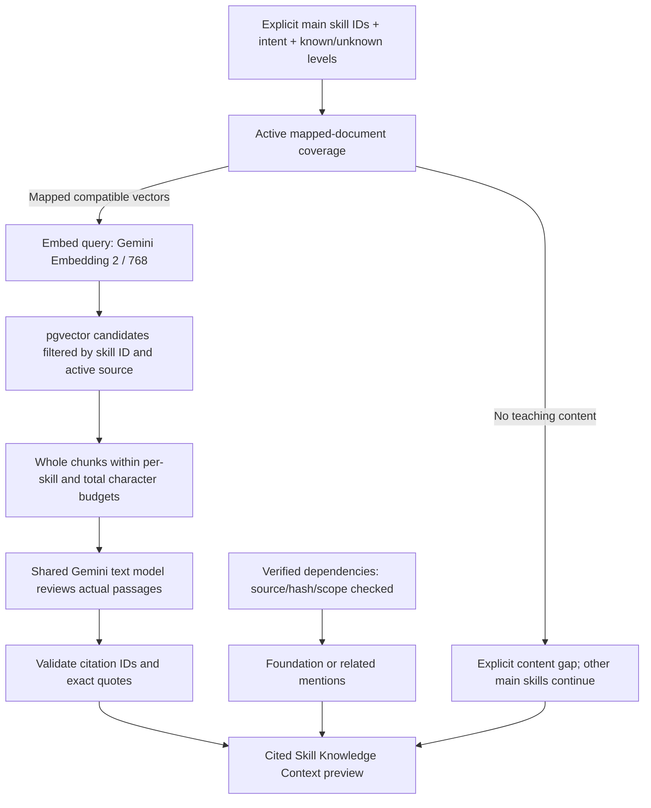

# Preparing cited Skill Knowledge Context

## Scope and current boundary

This stage connects approved canonical skills, stored document embeddings, and
human-reviewed dependencies to a cited knowledge preview for the AI team. It does
not run a Roadmap Agent, change API/UI flows, write database records, or select a
production scoring/ranking policy. Main skills are explicitly selected by the caller.



Only canonical skill names/levels/intent and prepared public document chunks are
sent to Gemini. This CLI does not load or send Resume text, personal information,
profile IDs or optional user answers. Embedding reduces the candidate text first;
the text model receives complete selected chunks, not the 700-character excerpts
shown by the older search prototype. It does not reread every source page.

## CMD commands from the glow-job root

### Prepare a cited preview

```cmd
docker compose run --rm --no-deps -T -e PYTHONDONTWRITEBYTECODE=1 -e PYTHONPATH=/workspace ^
  -v "%CD%:/workspace:ro" ^
  -v "%CD%/rag/data:/output" -w /workspace backend ^
  python -m scripts.rag.prepare_skill_context ^
  --skill "Apache Airflow" --skill RAG --skill Java ^
  --review --output /output/knowledge/my-skill-context.json
```

Use a new output filename if it already exists. Output is local under `rag/data`,
which is Git-ignored. Share selected artifacts explicitly with teammates.

For a local root Python environment with the pipeline dependencies available:

```cmd
python -m scripts.rag.prepare_skill_context --skill "Apache Airflow" --review --output rag/data/knowledge/my-skill-context.json
```

Without `--review`, query embeddings are still requested but retrieved chunks are
returned as `not_reviewed`, with no generated learning claims. `--review` additionally
sends the budgeted retrieved text to the existing shared Gemini text client.
Opening a saved result does not make model calls; this CLI is an explicit prepare/replan operation.

### Main options

| Option | Meaning |
|---|---|
| Repeated `--skill` | Explicit main canonical names or exact normalized aliases, up to 8 distinct IDs |
| `--intent` | fundamentals (default), level_improvement, or practice |
| `--current-level`, `--target-level` | unknown (default), beginner, intermediate, advanced, expert |
| `--candidate-limit` | Up to 20 candidates per query; default 12 |
| `--selected-limit` | Up to 5 cited chunks selected by the text model; default 5 |
| `--per-skill-chars` | Full retrieved document characters available per main skill; default 16,000 |
| `--total-chars` | Full document characters available across the request; default 48,000 |
| `--min-similarity` | Optional experimental cutoff; no calibrated default is assumed |

Unknown levels remain unknown. A fundamentals request does not assert that the
learner is a beginner. If level_improvement lacks levels, a text-model response
must preserve that limitation rather than claim a measured proficiency transition.

Character budgets are not exact token budgets. Query/prompt metadata adds overhead;
these defaults require evaluation before production. Oversize chunks are skipped
and counted rather than silently truncated. Repeated candidate content is deduplicated
within a query. Cross-skill retrievals are separate evidence-review requests and can
contain the same chunk; their repeated text counts against the total budget.
The character counts describe each skill payload once. Response repairs/provider
retries can resend that payload; these limits are not a cap on cumulative API billing.

## Result files and statuses

- `.json`: validated `knowledge-context-preview-1` payload.
- `.md`: readable skill explanations, quotes, source URLs, foundation mentions and limitations.
- `.schema.json`: the Pydantic-generated contract for the preview JSON.
- `.partial.json`: checkpoint after each completed skill, retained if interrupted.
- `.responses/`: raw text-model responses before citation validation.

Existing final JSON outputs are not overwritten. This version checkpoints completed
skills for inspection but does not automatically resume a partial retrieval run.

| Status | Meaning |
|---|---|
| supported | The text model judges supplied passages useful for the requested intent; not complete skill coverage or independent fact verification |
| partial | Some cited context is useful; limitations remain |
| insufficient_evidence | No usable content/matching vectors, budget/threshold excludes it, or the text model found the passages insufficient |
| not_reviewed | Retrieval only; no learning claims generated |
| error | A provider/retrieval/response validation operation failed; no invented fallback claims |

Each claim cites one or more supplied chunk IDs and exact quotes. The selected chunk
set must equal the cited chunk set. IDs outside the request, altered quotes, duplicate
selected IDs and inconsistent status/claims are rejected; one response repair is allowed.
Valid IDs and quotes do not independently establish that the paraphrased claim follows
from the passage. Semantic relevance is judged by the text model and still needs evaluation.

Claims distinguish `support_kind=instructional` (substantive explanation/example)
from `topic_outline` (topics named in an outline). A table of contents cannot be
classified as ready teaching content: any outline-only claim makes the response
partial. `teaching_content_status` is available, outline_only, unavailable, or
not_reviewed. Explanations must be Thai; direct quotes preserve their original
language. The current local combined sample is `rag/data/knowledge/examples/knowledge-context-demo-v3.json`
with `.md`, `.schema.json`, and an `.assembly.json` recording which per-skill results
were reused. Earlier v1/v2 examples are superseded. Airflow and RAG have partial
instructional coverage; Java currently has topic outlines only. No DB data was changed.

The current corpus is filtered through `knowledge_chunk_skills`, active sources,
and matching `gemini-embedding-2` vectors. Similarity is a ranking score, not truth
probability. Navigation menus and unrelated API indexes must not become teaching content.

## Foundations without their own teaching documents

Dependencies come only from the verified DB lookup, which checks live source/chunk
hashes and quotes. Each relationship retains type, scope, condition and applicability.
No missing dependency is inferred from model general knowledge in this stage.

Referenced skills are mentions, not automatically selected learning activities:

- `foundation_mention`: preparation advice with its actual scope preserved.
- `related_mention`: informative association, never a mandatory learning step.
- `learning_content_status=unavailable`: no active chunks mapped to that skill ID;
  the notice is **พบพื้นฐานที่เกี่ยวข้อง แต่เนื้อหายังไม่พร้อม**.
- `learning_content_status=not_requested`: mapped content exists but this request
  has not retrieved/reviewed a separate foundation lesson.
- `creates_learning_activity=false`: no automatic module, exercise or learning-hour estimate.
- `learner_satisfaction=not_assessed`: no claim that a learner has passed the prerequisite.

The current missing mappings are JSON, object-oriented design, Database Systems,
and vector databases. An accepted dependency quote is relationship evidence, not
proof of sufficient content to teach that foundation. Other main skills continue
when one skill has a coverage gap. A verified general hard prerequisite is flagged
`blocks_unconditional_progress=true` until the consuming AI team confirms the
learner's foundation; it is not silently bypassed or presumed satisfied.

Scoped dependencies remain `context_only`; document context or learner conditions
must not be assumed satisfied. Multiple rows may describe the same canonical skill
under different source/learner conditions. A UI/Agent should group the mention by
canonical skill ID while preserving those relationship conditions, not create a
separate activity for every row.

## Ownership and remaining work

- Pipeline: `src/documents/retrieval/skill_context.py` and
  `src/documents/schemas/skill_context.py` own retrieval/evidence contracts.
- Root: `scripts/rag/prepare_skill_context.py` is the application-facing CLI adapter.
- Shared Gemini credential/client and database settings are reused.
- Existing `search_chunks` remains a lightweight excerpt-search prototype.

This is phase 4's bounded knowledge preview, not final personalized Agent Context.
The [Agent Context assembler](agent-context-guide.md) now combines saved knowledge
with User/Goal/Market inputs and a deduplicated evidence registry. Remaining work
includes evaluation/calibrated retrieval policies, automatic main-skill selection,
gap/priority/score policy decisions, and the downstream team's Roadmap Agent/UI/persistence.
The explicit/inferred dependency classification remains in the review/handoff
artifact; the current dependency DB schema has no basis column. This preview
therefore does not invent that classification from DB rows or convert a reviewed
recommendation into a hard prerequisite.
