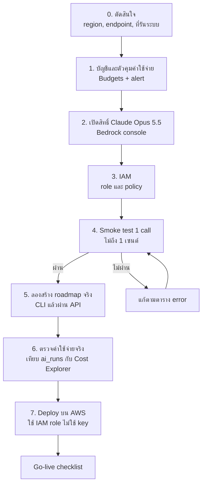

# เตรียมเชื่อม AWS (Amazon Bedrock) สำหรับ Roadmap

**ข้อมูลตรวจเมื่อ 2026-10-22** จากเอกสารของ Anthropic และ AWS รายการที่ตรวจไม่ได้อยู่ในหัวข้อ "สิ่งที่ยังไม่ได้ยืนยัน" ท้ายเอกสาร

โค้ดฝั่งเรา**พร้อมแล้ว** (`ROADMAP_PROVIDER=bedrock` ใช้ `AnthropicBedrockMantle`) ที่เหลือคืองานฝั่ง AWS: เปิดสิทธิ์โมเดล, สิทธิ์ IAM, ทดสอบ, ตั้งตัวคุมค่าใช้จ่าย และตัดสินใจเรื่อง region กับที่รันระบบ



## 0. ตัดสินใจก่อนเริ่ม

| เรื่อง | ตัวเลือกที่แนะนำ | เหตุผลและข้อควรระวัง |
|---|---|---|
| Region | `ap-southeast-1` (Singapore) เว้นแต่ทีมมีเหตุผลอื่น | ใกล้ผู้ใช้ในไทยที่สุดในตารางที่ Anthropic ระบุ (ตารางไม่มี Thailand) และรองรับ Global endpoint ของ Opus 5.5 ราคา instance ใน Singapore สูงกว่า us-east-1 เล็กน้อย |
| ชนิด endpoint | **Global** | Anthropic ระบุว่า Global ไม่มีส่วนเพิ่มราคา ส่วน Regional (เลือก region เดียวเพื่อ data residency) **แพงกว่า 10%** ข้อแลกเปลี่ยน: Global อาจประมวลผลนอก region ดูหัวข้อความเป็นส่วนตัว |
| ที่รัน backend | ตัดสินใจแยกต่างหาก ดูหัวข้อที่ 7 | มีผลต่อค่าใช้จ่ายรายเดือนมากกว่าค่า Claude |
| เจ้าของบัญชี AWS | ระบุคนเดียวที่ทำ Phase 1–3 | ต้องมีสิทธิ์สร้าง IAM, Budgets และเปิด Bedrock |
| งบ | เพดาน $150 ต่อเดือน (ตามที่ทีมกำหนด) | AWS **ไม่มีเพดานแบบตัดอัตโนมัติ** Budgets แค่แจ้งเตือน เพดานจริงคือตัวคุมในแอป (Phase 5) |

## 1. บัญชีและตัวคุมค่าใช้จ่าย (ทำก่อนเรียกโมเดลครั้งแรก)

1. เปิด MFA ให้ root และ**ไม่ใช้ root ทำงานประจำ** สร้างผู้ใช้หรือกลุ่มสำหรับทีมผ่าน IAM Identity Center
2. **AWS Budgets** (Billing → Budgets) สร้าง 2 อัน:
   - Cost budget รวมทั้งบัญชี $150 ต่อเดือน แจ้งเตือนที่ 50%, 80% (จริง) และ 100% (คาดการณ์) ไปอีเมลทีม
   - Cost budget กรอง Service = Amazon Bedrock $50 ต่อเดือน แจ้งเตือน 80% และ 100%
3. เปิด **Cost Anomaly Detection** และตั้ง tag `project=glowjob` กับทุก resource เพื่อแยกค่าใช้จ่าย
4. ตรวจหน้า **Billing → Credits** ว่าเครดิตที่ได้รับ (ที่ทีมมี $350) ใช้กับบริการไหนได้ และหมดอายุเมื่อไร

## 2. เปิดสิทธิ์ Claude Opus 5.5

1. Bedrock console → เลือก region จาก Phase 0 → **Model access** → ตรวจ **Claude Opus 5.5**
   - เอกสารของ Anthropic ระบุว่า Opus 5.5 ต้องดูเงื่อนไขในหน้า Model access ของแต่ละบัญชี (ไม่ได้เปิดให้ทุกบัญชีอัตโนมัติเหมือนบางรุ่น) ถ้ายังไม่เปิด ให้ขอสิทธิ์ตามหน้านั้น
2. ตรวจ **Quotas** ของโมเดล ค่าเริ่มต้นตามเอกสารคือ 2 ล้าน input token ต่อนาที ซึ่งเกินพอสำหรับเรา
3. **เครดิต:** ผลค้นหาระบุว่าเครดิตโปรโมชันของ AWS ใช้กับโมเดลของ Anthropic บน Bedrock ได้ แต่แหล่งข้อมูลเป็นข่าวและบล็อก และมีรายงานว่าบางประเภทบัญชีสมัครไม่ผ่านด้วยเครดิต จึง**ยืนยันด้วยการทดสอบจริง**: หลัง smoke test ใน Phase 4 ดู Cost Explorer ว่ารายการ Bedrock ถูกหักด้วยเครดิตหรือเป็นเงินจริง ก่อนใช้ต่อ

## 3. IAM

### สิทธิ์ที่ต้องมี

| สิ่งที่ต้องการ | Action | หมายเหตุ |
|---|---|---|
| เรียก Claude ผ่าน Messages API | `bedrock-mantle:CreateInference` | เอกสาร Anthropic ระบุ action นี้ และบอกให้จำกัดเฉพาะ ARN ของโมเดลที่อนุญาต |

Policy เริ่มต้น (ใช้กับ role ที่สร้างไว้ใช้เรียกโมเดลเท่านั้น):

```json
{
  "Version": "2012-10-17",
  "Statement": [
    {
      "Sid": "InvokeClaudeForRoadmaps",
      "Effect": "Allow",
      "Action": "bedrock-mantle:CreateInference",
      "Resource": "*"
    }
  ]
}
```

เริ่มด้วย `Resource: "*"` เพื่อทดสอบให้ผ่านก่อน แล้วค่อยจำกัดเป็น ARN ของโมเดลตามรูปแบบที่ AWS ระบุ (ผมไม่ได้เดารูปแบบ ARN ในเอกสารนี้) ถ้าติดสิทธิ์ ข้อความ error ของ AWS และ CloudTrail จะระบุ action และ resource ที่ถูกปฏิเสธ

### วิธีมี credentials

| ที่ไหน | วิธี | หมายเหตุ |
|---|---|---|
| เครื่อง dev (ทดสอบ) | IAM Identity Center: `aws configure sso` แล้ว `aws sso login` | ต้องติดตั้ง AWS CLI v2 ก่อน (เครื่องนี้ยังไม่มี: `winget install Amazon.AWSCLI`) session หมดอายุเอง |
| เครื่อง dev (ทางเลือก) | Bedrock bearer token อายุสั้น (สูงสุด 12 ชั่วโมง) ใส่ใน `AWS_BEARER_TOKEN_BEDROCK` | สะดวกที่สุดสำหรับ smoke test เอกสารระบุว่าเป็นวิธีที่ควรเลือกน้อยที่สุด ใช้เฉพาะตอนทดสอบ |
| บน AWS (จริง) | **IAM role** ผูกกับ EC2 instance หรือ ECS task | ไม่มี key ในไฟล์ใด ๆ SDK อ่านจาก credential chain เอง |

**ห้าม** commit key หรือ token ลง repo และห้ามใส่ key ถาวรใน `.env` บนเครื่องที่ deploy

## 4. Smoke test (1 call)

ใช้สคริปต์ [bedrock_smoke_test.py](../../scripts/roadmap/bedrock_smoke_test.py) เรียก Claude 1 ครั้ง (ประมาณ 30 input token และตอบสั้น ๆ ที่ effort ต่ำ ค่าใช้จ่ายไม่ถึง 1 เซนต์) สคริปต์ไม่ทำงานถ้าไม่ใส่ `--allow-spend`

```cmd
:: ถ้าใช้ SSO
aws sso login --profile glowjob
set AWS_PROFILE=glowjob

:: ถ้าใช้ bearer token: set AWS_BEARER_TOKEN_BEDROCK=<token>

backend\.venv\Scripts\python -m scripts.roadmap.bedrock_smoke_test --region ap-southeast-1 --allow-spend
```

ผลที่ต้องเห็น: บรรทัด `OK`, คำตอบ `'OK'`, จำนวน token และค่าประมาณ จากนั้นอีก 1 วัน ดู Cost Explorer ว่ารายการนี้โผล่ และดูว่าเครดิตถูกใช้หรือไม่

| อาการ | น่าจะเป็นเพราะ | แก้ที่ |
|---|---|---|
| `Could not resolve AWS credentials` | ไม่มี credentials | login SSO, ตั้ง token หรือรันบนเครื่องที่มี role |
| 401 AuthenticationError | token หรือ session หมดอายุ | ขอใหม่ |
| 403 PermissionDeniedError | role ไม่มี `bedrock-mantle:CreateInference` หรือยังไม่ได้เปิดสิทธิ์ Opus 5.5 | Phase 2–3 |
| 404 NotFoundError | region ไม่มีโมเดล หรือ model ID ผิด (`anthropic.claude-opus-5-5`) | ตรวจตาราง region |
| 429 RateLimitError | โควตา | รอหรือขอเพิ่ม |

## 5. ตั้งค่าแอปและทดสอบ roadmap จริง

ตั้งค่าเริ่มต้นแบบ**ตึงมาก** สำหรับสัปดาห์แรก แล้วค่อยผ่อน

| ตัวแปร | ค่าแนะนำตอนเริ่ม | ความหมาย |
|---|---|---|
| `ROADMAP_PROVIDER` | `bedrock` | |
| `ROADMAP_AWS_REGION` | `ap-southeast-1` | |
| `ROADMAP_MODEL_ID` | (ว่าง) | ค่าเริ่มต้น `anthropic.claude-opus-5-5` |
| `ROADMAP_EFFORT` | `medium` | ขึ้นเป็น `high` เฉพาะเมื่อวัดแล้วดีขึ้นจริง |
| `ROADMAP_PRICE_INPUT_PER_MTOK` / `OUTPUT` | `4` / `20` สำหรับ Global | ถ้าใช้ Regional บวก 10% (`4.4` / `22`) ตรวจกับหน้าราคา Bedrock ก่อน |
| `ROADMAP_MONTHLY_BUDGET_USD` | `10` | ตัวคุมในแอป หยุดสร้างแผนเมื่อประมาณการเดือนนี้ถึงค่านี้ |
| `ROADMAP_DAILY_LIMIT` / `..._PER_PROFILE` | `10` / `2` | |

ลำดับทดสอบ (ทุกขั้นเสียเงินจริง ทำทีละขั้น):

1. **CLI 1 ครั้ง** (~$0.12–0.25 ตามประมาณการ ยังไม่ได้วัดจริง):
   ```cmd
   set PYTHONPATH=.;data-pipeline
   backend\.venv\Scripts\python -m ai.roadmap.cli --context ai/roadmap/fixtures/agent-context-demo-student.json --output rag/data/roadmap-bedrock.json --provider bedrock --aws-region ap-southeast-1 --allow-spend --save-draft
   ```
   ดู `usage`, `estimated_cost_usd`, `validation_warnings` และอ่านผลตาม checklist ใน [test-plan.md](test-plan.md) ชั้นที่ 6
2. **ผ่าน API ใน Docker** ด้วย [compose.bedrock-local.yaml](../../compose.bedrock-local.yaml):
   ```cmd
   set ROADMAP_AWS_REGION=ap-southeast-1
   set AWS_BEARER_TOKEN_BEDROCK=<token>
   docker compose -f compose.yaml -f compose.bedrock-local.yaml up --build -d
   ```
   ไฟล์นี้ส่งตัวแปร AWS เข้า container เฉพาะตัวที่ตั้งค่าไว้ เพราะ SDK ถือว่าตัวแปรที่เป็นค่าว่างคือ "มีค่า" และจะใช้ API key ว่างทำให้ล้มเหลว ห้ามเขียน `${AWS_BEARER_TOKEN_BEDROCK:-}` ใน compose
3. ตรวจว่า budget guard ทำงาน: ตั้ง `ROADMAP_MONTHLY_BUDGET_USD=0.01` ชั่วคราว ควรได้ `ROADMAP_BUDGET_REACHED` ก่อนมีการเรียกโมเดลครั้งที่สอง
4. เทียบตัวเลข: token ใน `system.ai_runs` (SQL อยู่ใน [roadmap-generation.md](roadmap-generation.md)) กับหน้า Bedrock และ Cost Explorer หลังผ่านไป 1 วัน ถ้าต่างกันมาก ให้ปรับราคาใน `ROADMAP_PRICE_*`

## 6. ตรวจค่าใช้จ่ายจริงก่อนเปิดให้ผู้ใช้

- บันทึก token เฉลี่ยต่อ roadmap จาก 3–5 ครั้งแรก แล้วคำนวณ: งบ guard ($) ÷ ต้นทุนต่อแผน = จำนวนแผนต่อเดือนที่รับได้
- ถ้าต้นทุนต่อแผนสูงกว่าประมาณการ ลดก่อนด้วยลำดับนี้: ลด `ROADMAP_EFFORT`, ตัด context เพิ่ม (`ai/roadmap/compact.py`), ลดลิมิตต่อผู้ใช้ แล้วค่อยพิจารณา Sonnet 5.5 (ราคาครึ่งหนึ่ง) ซึ่งต้องทดสอบคุณภาพใหม่
- ต้นทุนของระบบที่รันตลอดเวลา (หัวข้อถัดไป) มักสูงกว่าค่า Claude จึงตรวจทั้งสองส่วน

## 7. รันระบบบน AWS (ต้องตัดสินใจแยก)

ตอนนี้ระบบรันบน Docker ในเครื่อง ถ้าจะ deploy ต้องมี backend, PostgreSQL (พร้อม pgvector) และ frontend ราคาด้านล่างเป็น**ประมาณการคร่าว ๆ จากความรู้ทั่วไป ไม่ได้ตรวจกับ AWS ตอนนี้** ให้เช็กใน AWS Pricing Calculator ก่อนเลือก

| ตัวเลือก | ส่วนประกอบ | ประมาณต่อเดือน | ข้อสังเกต |
|---|---|---|---|
| A ถูกที่สุด | EC2 1 เครื่อง (เช่น t4g.small) รัน docker compose (Postgres + backend), frontend บน S3 + CloudFront | ราว $20–30 | ต้องดูแล backup เอง ใช้ IAM role ผูกกับ instance ได้ ขนาด DB (ข้อมูล market และ embeddings) ต้องดูก่อนเลือกขนาดดิสก์ |
| B | EC2 รัน backend + RDS PostgreSQL ขนาดเล็ก | ราว $40–55 | backup จัดการให้ รองรับ pgvector |
| C | ECS Fargate + Application Load Balancer + RDS | ราว $70–100 | จัดการง่ายขึ้น แต่ ALB มีค่าคงที่รายเดือน |

**ค่าที่มักลืม:** NAT Gateway (ราว $30+ ต่อเดือนต่อตัว ควรเลี่ยงด้วยการวาง backend ใน public subnet ที่จำกัด security group), public IPv4 (คิดเงินรายชั่วโมง), ALB, ข้อมูลออกอินเทอร์เน็ต และ CloudWatch logs

ที่ต้องทำเมื่อเลือกแล้ว (ยังไม่ได้ทำ):
1. ย้ายฐานข้อมูล: ใช้ [full-database-dump-restore.md](../db/full-database-dump-restore.md) แล้วรัน migration ให้ครบ (โปรดอ่านปัญหา migration 009 ใน PR #13 ก่อน)
2. แนบ IAM role (Phase 3) ให้ instance หรือ task และ**ไม่ตั้ง** `AWS_BEARER_TOKEN_BEDROCK` หรือ key ใด ๆ
3. ตั้ง `CORS_ORIGINS`, `PUBLIC_BASE_URL` และ `DB_*` ตามที่อยู่จริง, ใส่ `DB_PASSWORD` ใน Secrets Manager หรือ Parameter Store (ไม่ใส่ใน repo)
4. ปิดพอร์ต PostgreSQL จากภายนอก, เปิดเฉพาะพอร์ตที่จำเป็น และใช้ HTTPS
5. เก็บ log ของ backend ใน CloudWatch (ระวังไม่ log ข้อมูล CV)

## Go-live checklist

- [ ] Budgets และ alert ทำงาน (ทดสอบส่งอีเมลได้)
- [ ] Smoke test ผ่าน และเห็นรายการใน Cost Explorer
- [ ] ยืนยันแล้วว่าเครดิตถูกใช้กับ Bedrock หรือรู้ว่าเป็นเงินจริง
- [ ] ต้นทุนต่อ roadmap วัดจากการใช้จริงอย่างน้อย 3 ครั้ง และตั้ง `ROADMAP_PRICE_*` ตามนั้น
- [ ] ค่า limit ตึง (งบ $10, ต่อวัน 10, ต่อ profile 2) ในสัปดาห์แรก
- [ ] ไม่มี key ถาวรใน `.env`, repo หรือ image
- [ ] ข้อความขอความยินยอมระบุว่าข้อความสั้น ๆ จาก CV ถูกส่งไปประมวลผลโดยโมเดล AI
- [ ] ทดสอบ rollback ด้านล่างแล้ว

## Rollback (ทำได้ภายในไม่กี่นาที)

1. ตั้ง `ROADMAP_PROVIDER=mock` แล้ว restart backend ผู้ใช้จะได้แผนจาก mock ซึ่งไม่เรียก AI และไม่มีค่าใช้จ่าย (แผนที่บันทึกไว้แล้วยังอ่านได้ตามปกติ)
2. ถ้าสงสัยว่ามีการใช้ผิดปกติ ถอด policy `bedrock-mantle:CreateInference` ออกจาก role ทันที
3. ตรวจ `system.ai_runs` ว่าใครเรียกมากผิดปกติ

## ความเป็นส่วนตัวของข้อมูล

- Roadmap ส่งไปให้โมเดล: ภูมิหลัง, เป้าหมาย, ชื่อและระดับ skill, ข้อความสั้นจากหลักฐานใน CV ไม่เกิน 3 ข้อความ ข้อความละ 300 ตัวอักษร, และสถิติตลาด ไม่ส่งชื่อ อีเมล เบอร์โทร ลิงก์ หรือ CV ฉบับเต็ม
- **Global endpoint อาจประมวลผลนอก region ที่เลือก** ถ้าทีมต้องการให้ข้อมูลอยู่ใน geography ที่กำหนด ต้องใช้ Regional/Geo (แพงกว่า 10% และต้องตรวจว่ามีตัวเลือกใน region นั้น)
- Anthropic ระบุว่า Claude บน Bedrock ไม่มีบุคลากรของ Anthropic เข้าถึงโครงสร้างที่ให้บริการ และการจัดการข้อมูลเป็นไปตาม Amazon Bedrock ถ้าทีมมีข้อกำหนดตาม PDPA ควรให้ผู้รับผิดชอบด้านนี้อ่านหน้า Data protection ของ Bedrock

## สิ่งที่ยังไม่ได้ยืนยัน

| เรื่อง | สถานะ |
|---|---|
| Opus 5.5 เปิดให้บัญชีเราหรือยัง | ต้องดูใน Model access ของบัญชีจริง |
| เลือก Global หรือ Regional ในการเรียก `bedrock-mantle` อย่างไร | เอกสารที่อ่านบอกว่ามีสองแบบและ Regional แพงกว่า 10% แต่ไม่ได้บอกวิธีเลือกในการเรียกผ่าน SDK ให้ดูใบแจ้งหนี้หลัง smoke test ว่าคิดราคาแบบไหน |
| เครดิตครอบคลุม Anthropic บน Bedrock สำหรับบัญชีเรา | ผลค้นหาเป็นไปในทางบวกแต่ไม่ใช่เอกสารทางการของโปรแกรมที่ทีมได้เครดิต ยืนยันด้วย Cost Explorer |
| รูปแบบ ARN สำหรับจำกัด Resource ใน IAM | ยังไม่ได้ตรวจ ใช้ `*` ก่อน |
| ราคา Bedrock จริงต่อ region | บทความของบุคคลที่สามรายงาน $4.40 / $22 ต่อล้าน token ที่ Tokyo (Geo/In-region) ซึ่งสอดคล้องกับส่วนเพิ่ม 10% จากราคา $4 / $20 ตรวจกับหน้าราคาของ AWS |
| ค่าใช้จ่ายต่อ roadmap | ประมาณ $0.12–0.25 ยังไม่เคยวัดจากการเรียกจริง |
| ราคาโฮสต์ติ้งในหัวข้อที่ 7 | ประมาณการ ไม่ได้ตรวจกับ AWS |

## ใครทำอะไร

| งาน | ผู้ทำ |
|---|---|
| Phase 0 ตัดสินใจ | ทีม |
| Phase 1–3 (บัญชี, Budgets, Model access, IAM) | คนที่ดูแลบัญชี AWS (ต้องมีสิทธิ์ admin) |
| Phase 4–6 รันและอ่านผล | คุณหรือผม (ผมรันให้ได้เมื่อมี credentials และคุณอนุมัติค่าใช้จ่าย) |
| Phase 7 Deploy | ตัดสินใจตัวเลือกก่อน แล้วแบ่งงาน |
| โค้ดฝั่งแอป (provider, ลิมิต, บันทึก token) | เสร็จแล้ว |

## แหล่งข้อมูล

- [Claude in Amazon Bedrock (Anthropic)](https://platform.claude.com/docs/en/build-with-claude/claude-in-amazon-bedrock): region, วิธียืนยันตัวตน, สิทธิ์ `bedrock-mantle:CreateInference`, โควตา
- [Claude Opus 5 model card (AWS)](https://docs.aws.amazon.com/bedrock/latest/userguide/model-card-anthropic-claude-opus-5.html)
- [Opus 5.5 บน Bedrock (Classmethod)](https://dev.classmethod.jp/en/articles/bedrock-claude-opus-5-5/): ตัวอย่างราคาและ inference profile
- [Amazon Bedrock Mantle (AWS)](https://docs.aws.amazon.com/bedrock/latest/userguide/bedrock-mantle.html)
