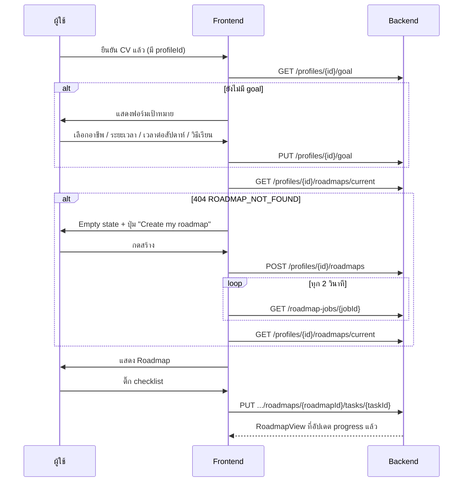

# Roadmap: งานที่ส่งต่อ Frontend

**สถานะ Backend (2026-10-19):** API ของ goal, การสร้าง roadmap, การอ่าน roadmap และการบันทึก progress พร้อมใช้งาน
ค่าเริ่มต้นเป็น `mock` provider ซึ่งไม่เรียก AI และไม่มีค่าใช้จ่าย Frontend จึงพัฒนาและทดสอบได้เต็มที่
เมื่อสลับเป็น Claude ภายหลัง ข้อมูลยังมีรูปแบบเดิม ไม่ต้องแก้ Frontend

- สัญญา API: [api-contract.md](api-contract.md)
- Types: [shared/contracts/api/roadmap/roadmap.ts](../../shared/contracts/api/roadmap/roadmap.ts)
- ตัวอย่าง response ครบทุกสถานะ: [shared/contracts/api/roadmap/examples/](../../shared/contracts/api/roadmap/examples/)
  (สร้างใหม่ได้ด้วย `python -m ai.roadmap.export_contract`)

## Flow ของผู้ใช้

## งานของ Frontend

| # | งาน | หมายเหตุ |
|---|---|---|
| 1 | **ฟอร์มเป้าหมาย (Career goal)** | ฟิลด์ตาม `CareerGoalInput` ดึงรายการอาชีพจาก `GET /career-profiles` ซึ่งมีอยู่แล้ว เสนอให้ต่อท้าย `CvOnboardingPage` หลังผู้ใช้เลือกอาชีพ |
| 2 | **API client + hooks** | สร้าง `features/roadmap/api.ts` ตามแบบ `features/resume/api.ts` (ส่ง `X-Session-Id` ทุกครั้ง) และใช้ `@tanstack/react-query` ที่ติดตั้งไว้แล้ว |
| 3 | **Generate + polling** | ปุ่มสร้าง แสดงข้อความตาม `stage` และ poll job ทุก 2 วินาที (ใช้รูปแบบเดียวกับ `extractCv`) |
| 4 | **เปลี่ยน mock เป็นข้อมูลจริงใน RoadmapPage** | เลิกใช้ `roadmapMockData.ts` และใช้ [adapter.ts](../../frontend/src/features/roadmap/adapter.ts) (`toRoadmapScreen(view)`) ที่แปลง API เป็น `RoadmapNodeData` / `RoadmapConnection` / `RoadmapSummary` ที่ component เดิมใช้อยู่แล้ว |
| 5 | **Canvas** | ใช้ grid 4 คอลัมน์ × 6 แถวเดิมได้เลย เพราะ API ส่ง `position` เป็นเลขเต็มและรับประกันไม่เกิน 6 แถว (ถ้าแผนจากโมเดลเกิน backend จะให้โมเดลแก้เอง) แก้แค่ badge "You are here" ให้ใช้ `currentNodeId` แทน `status === 'in-progress'` และเพิ่ม badge "Best next step" ตาม design |
| 6 | **Node detail** | แสดง `estimatedHours`, citations (ลิงก์และ quote), `notice` และ checklist ที่ติ๊กแล้วบันทึกจริง |
| 7 | **ส่วนประกอบรอบ roadmap** | `nextAction` (การ์ด "Start here"), `deferred` ("Next roadmap" พร้อมเหตุผล), `confirmations`, `contentNotices`, `limitations` |
| 8 | **Sidebar / header** | ใช้ goal และ `progress` จริงแทน `workspaceMockData` และ `roadmapSummary` |

## เทียบกับ design ใน Figma (glowjob_ui)

ไฟล์: https://www.figma.com/design/BlKmPhPQpvInuEdXXIcR3i/glowjob_ui — frame ที่เกี่ยวข้อง:
`My Roadmap dashboard` (105:2196), `My Roadmap · Python completed` (161:5612),
`My Roadmap · Docker in progress` (161:5909) และ `Glow Job · Career roadmap` (112:1041)

โค้ด FE ปัจจุบัน (`RoadmapPage`, `RoadmapCanvas`, `NodeDetailPanel`) ทำตาม 3 frame แรกอยู่แล้ว
(layout 4 คอลัมน์ มี side panel) frame สุดท้าย (112:1041) เป็น layout แนวตั้งคอลัมน์เดียวที่ sidebar ต่างออกไป
น่าจะเป็นแบบร่างรุ่นเก่า ควรให้ designer ยืนยัน API รองรับได้ทั้งสองแบบเพราะส่งทั้ง `position` และ `layer`

| ส่วนใน design | ข้อมูลจาก API | หมายเหตุ |
|---|---|---|
| "Data Engineer Internship · 4 months" ใต้หัวเรื่อง | `summary.targetRole` · `summary.durationLabel` | |
| Legend: Skill / Project / Career Activity / Upcoming | `nodes[].kind` และ `status` | มีชนิดเพิ่ม `foundation-check` (adapter วาดเป็น skill ที่ subtitle "Quick check") |
| Badge "64% complete · On track" | `progress.percent` · `progress.label` | **ไม่มี "On track"** เพราะระบบไม่ได้ประเมิน ใช้ "1 of 9 tasks done" แทน |
| การ์ด Current goal ใน sidebar (ชื่อ, แถบ %, "4 months remaining") | `summary.targetRole`, `progress.percent`, `progress.label`, `summary.timeRemainingLabel` | `toRoadmapScreen(view).goal` ส่งให้ `CurrentGoalCard` ได้ตรง ๆ |
| ข้อความใต้ชื่อ node (Completed / In progress / Upcoming project / Career activity) | `nodes[].subtitle` | คำนวณใหม่ทุกครั้งที่อ่าน ตามความคืบหน้า |
| Badge "You are here" | `currentNodeKey` | ขั้นที่ in progress ก่อน ถ้าไม่มีใช้ขั้นถัดไปที่ควรทำ |
| Badge "Best next step" | `nextAction.nodeKey`, `nextAction.text` | เลื่อนไปข้างหน้าเองเมื่อขั้นนั้นเสร็จหรือถูกข้าม |
| เส้นประ (เส้นทางที่แนะนำแต่ไม่บังคับ) | `edges[].optional` | ใช้กับเส้นจาก `foundation-check` |
| Node สุดท้าย "Data Engineer · Job-ready in 4 months" | subtitle `Target: Jan 18, 2027` | **ไม่ใช้ "Job-ready"** เพราะระบบไม่ได้ประเมินความพร้อมรับงาน |
| Panel: ชื่อ, chip Skill / In progress | `title`, `kind`, `status`/`subtitle` | |
| "Current confidence 42%" | **ไม่คำนวณ** | FE ใช้ "Not assessed" อยู่แล้ว ซึ่งถูกต้อง แนะนำแสดง `skill.profileLabel` เช่น "Not in your profile yet" ใต้หัวข้อนี้ |
| คำอธิบาย / Why it matters / What this unlocks | `summary` / `whyItMatters` / `unlockIds` (adapter คำนวณจาก `edges`) | |
| Learning checklist "0 / 4 completed" | `checklist[]` | ติ๊กแล้วเรียก `PUT .../tasks/{id}` |
| "Estimated time: 2 weeks at 8 hrs/week" | `extras[id].timeText` เช่น "8 to 14 hours · at 2 to 5 hrs/week" | เป็นช่วงเพราะผู้ใช้ระบุเวลาเป็นช่วง ไม่ได้แปลงเป็นสัปดาห์ให้ เพื่อไม่ให้เลขดูแม่นเกินจริง |
| ปุ่ม "Start learning" / "Mark as completed" | `PUT .../steps/{stepKey}` ด้วย `in_progress` / `completed` | **FE ปัจจุบันใช้ "Review skill" / "Manage evidence"** ต่างจาก design ต้องตกลงกับ designer ว่าใช้ชุดไหน API รองรับได้ทั้งหมด |
| "Evidence you can add" (GitHub project / Certificate / Self report) | **ยังไม่มี API** | ตอนนี้ FE เก็บใน state เฉพาะหน้า ข้อมูลหายเมื่อรีเฟรช ถ้าต้องบันทึกจริงต้องออกแบบ endpoint ใหม่ (ตาราง `app.user_skill_evidence` มีอยู่แล้ว) |
| Market Updates, ชื่อผู้ใช้ ใน sidebar | ไม่เกี่ยวกับ Roadmap API | |

### สิ่งที่ API มี แต่ design ยังไม่มีที่แสดง (ต้องขอ design เพิ่ม)

| ข้อมูล | เสนอให้ไปอยู่ที่ |
|---|---|
| `nodes[].citations` และ `checklist[].citations` (แหล่งอ้างอิง) | หัวข้อ "Sources" ใต้ checklist ใน panel (ชื่อเอกสาร, ลิงก์, quote สั้น ๆ) |
| `nodes[].notice` (เช่น "learning content is not ready yet") | แถบข้อความใน panel |
| `deferred` (skill ที่เลื่อนไปรอบหน้า พร้อมเหตุผล) | การ์ด "Next roadmap" ใต้ canvas |
| `confirmations` (เช่น "How comfortable are you with Docker?") | การ์ดคำถามใต้ canvas |
| `contentNotices`, `limitations` | ข้อความเล็กใต้ canvas |
| ปุ่ม Create / Regenerate, สถานะกำลังสร้าง, error, ฟอร์ม goal | หน้า Roadmap ตอนว่าง และ dialog ยืนยันตอน Regenerate |

### Mapping จาก type เดิม (`features/roadmap/type.ts`)

| ของเดิม | ใช้จาก API |
|---|---|
| `position.row / column` | `position.row / column` ใช้ได้ตรง ๆ (เลขเต็ม คอลัมน์ 1-4 แถว 1-6) |
| `kind` | เพิ่มชนิด `'foundation-check'` (การเช็กพื้นฐานสั้น ๆ ไม่ใช่บทเรียน) |
| `status: completed / in-progress / upcoming` | `completed` / `in_progress` / `not_started` และมี `skipped` เพิ่ม |
| `subtitle` | `subtitle` ใช้ได้ตรง ๆ |
| `description` | `summary` |
| `unlockIds` | คำนวณจาก `edges` (`from === node.key`) |
| `checklist[].label/completed` | เหมือนเดิม และมี `detail`, `taskKind`, `citations` เพิ่ม |
| `RoadmapSummary.completion` | `progress.percent` |
| `RoadmapSummary.statusText` ("On track") | **เลิกใช้** เพราะระบบไม่ได้คำนวณ ใช้ `progress.label` ("X of Y tasks done") |
| `RoadmapSummary.duration` | `summary.durationLabel` |

### สถานะหน้าจอที่ต้องมี (มีไฟล์ตัวอย่างครบ)

| สถานะ | ไฟล์ตัวอย่าง | UI |
|---|---|---|
| ยังไม่มี goal | `goal.get.empty.json`, `error.goal-not-found.json` | ฟอร์มเป้าหมาย |
| ยังไม่มี roadmap | `error.roadmap-not-found.json` | Empty state + ปุ่มสร้าง |
| กำลังสร้าง | `job.queued.json`, `job.running.json` | Loading และข้อความตาม stage (ใช้เวลา 30–120 วินาทีเมื่อใช้ Claude) |
| สร้างไม่สำเร็จ | `job.failed.json` | ถ้า `retryable` เป็น true แสดงปุ่ม Try again |
| ถึงลิมิตรายวันหรืองบประมาณ | `error.limit-reached.json`, `error.budget-reached.json` | ข้อความแจ้ง และไม่มีปุ่ม retry |
| เนื้อหาอาชีพยังไม่พร้อม | `error.knowledge-not-ready.json` | ข้อความแจ้ง |
| มี roadmap | `roadmap.current.json`, `roadmap.in-progress.json` | หน้า Roadmap |

## กติกาการแสดงผล (สำคัญ)

- **ห้ามแสดง `progress.percent` เป็น "ความพร้อมสมัครงาน"** ค่านี้คือสัดส่วน task ที่ทำเสร็จเท่านั้น
- ข้อความ "Not in your profile yet" หมายถึง CV ไม่ได้แสดงหลักฐาน ไม่ได้แปลว่าผู้ใช้ทำไม่เป็น ห้ามเขียนว่า "You lack ..."
- ปุ่ม **Regenerate** (`force: true`) ต้องมี dialog ยืนยัน เพราะเรียก AI ใหม่ทุกครั้งและมีค่าใช้จ่าย
  การกด Create ซ้ำโดยที่ข้อมูลไม่เปลี่ยนจะได้แผนเดิมกลับมาโดยไม่เสียเงิน (`reused: true`)
- Citation แสดงชื่อเอกสารและลิงก์ (`url`) พร้อม quote สั้น ๆ
- UI ทั้งหมดเป็นภาษาอังกฤษ และข้อความจาก API ก็เป็นภาษาอังกฤษ

## รัน Backend ในเครื่อง (ไม่มีค่าใช้จ่าย)

1. ในไฟล์ `.env` ที่ root ตั้ง `ROADMAP_PROVIDER=mock` และ
   `ROADMAP_CONTEXT_FIXTURE=/app/ai/roadmap/fixtures/agent-context-demo-student.json`
   (ใช้ context ตัวอย่างไปก่อนจนกว่า knowledge จริงจะพร้อม)
2. Apply migration ล่าสุด (016) ตาม [migrations/README.md](../../migrations/README.md)
3. `docker compose up --build -d`
4. ใช้ profile ตัวอย่างจาก seed (`prf_demo_student_data` คู่กับ `X-Session-Id: glowjob-demo-v1:student-data`)
   หรือ profile ที่สร้างผ่านหน้า CV (ใช้ session ใน localStorage ตามปกติ)

## ลำดับการทำงานร่วมกัน

1. **Kickoff (30–60 นาที):** อ่าน api-contract.md ด้วยกัน และตอบคำถามด้านล่าง
2. **FE ทำ UI จากไฟล์ตัวอย่าง:** import JSON ใน `examples/` แทน mock เดิม ไม่ต้องรอ backend
3. **FE เชื่อม API จริง (mock provider):** ทดสอบ flow ทั้งหมดใน Docker
4. **Backend เปิด Claude ชั่วคราว** กับ profile ตัวอย่าง 2–3 ครั้ง เพื่อดูความยาวข้อความจริงในการ์ด
5. **รีวิวร่วมกัน:** ถ้อยคำ, สถานะ error และการแสดง citation

### การตัดสินใจที่ตกลงแล้ว (2026-10-22)

| เรื่อง | ข้อสรุป |
|---|---|
| Layout ของ canvas | ใช้ตามโค้ดจริงใน `RoadmapCanvas` (grid 4 คอลัมน์ × 6 แถว) ไม่ใช้ frame `Glow Job · Career roadmap` (112:1041, แนวตั้ง) |
| ปุ่มใน panel | ใช้ตามโค้ดปัจจุบัน: "Review skill" และ "Manage evidence" API ระดับ step (`PUT .../steps/{stepKey}`) ยังอยู่ ไว้ใช้เมื่อต้องการปุ่ม "Start learning / Mark as completed" ภายหลัง |
| API บันทึก "Evidence you can add" | เลื่อนไปก่อน ตอนนี้ยังเป็น state ในหน้า |
| ตำแหน่งแสดง citations, "Next roadmap", คำถามยืนยันพื้นฐาน, ข้อจำกัดของแผน | **ยังไม่ตัดสินใจ** ดูภาพเปรียบเทียบตัวเลือก A/B ใน [Roadmap Screen Preview](https://claude.ai/artifact/GJUMWFQoVjqyqYqFFg1LGX) แล้วเลือก ตัวเลือกที่แนะนำคือ A ของทุกข้อ |

Label ภาษาคนของ `deferred[].reasonCode`:

| reasonCode | ข้อความบนหน้าจอ |
|---|---|
| `OUTSIDE_TIME_BUDGET` | Doesn't fit your weekly time yet |
| `CONTENT_OUTLINE_ONLY` | Only an outline exists so far |
| `LOW_MARKET_SIGNAL` | Rarely asked for in job posts |
| `NEEDS_CONFIRMATION` | Confirm your level first |

### คำถามที่ยังเปิดอยู่

1. ฟอร์ม goal จะอยู่ต่อท้าย CV onboarding หรือเป็นหน้าแยก (Settings)
2. ตำแหน่งแสดงเนื้อหาใหม่ 4 อย่างข้างบน (หลังเลือกจากภาพเปรียบเทียบแล้ว)
3. ต้องการให้ข้าม step ได้ใน UI หรือไม่ (API รองรับ `skipped` แล้ว)
