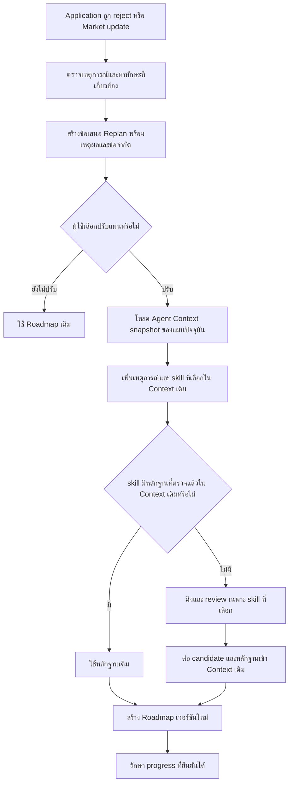

# แผนงาน Replan Roadmap จากผลสมัครงานและข้อมูลตลาด

**สถานะ:** Phase 1 (ผลสมัครงานถูก reject) และ Phase 2 (market update แบบ demo จาก snapshot ล่าสุด) implement บน branch `feature/roadmap-replan-rejection`; การตรวจ trend จากหลายช่วงตลาดยังไม่อยู่ในขอบเขต

เอกสารนี้อธิบายว่าเมื่อผู้ใช้มี Roadmap อยู่แล้ว ระบบจะเสนอให้ปรับแผนจาก (1) ผลสมัครงานที่ถูกปฏิเสธ หรือ (2) ข้อมูลทักษะในตลาดที่เปลี่ยนไปอย่างไร โดยยังใช้ข้อมูลผู้ใช้จริงและเอกสารที่มีอยู่ ไม่เติม skill หรือประสบการณ์ให้ผู้ใช้เอง

## ผลลัพธ์ที่ต้องการ

- ผู้ใช้เห็น **เหตุผลที่เสนอให้ปรับแผน** และเลือกเองว่าจะสร้างแผนใหม่หรือไม่
- Roadmap ใหม่อ้างอิงโปรไฟล์ เป้าหมาย ความคืบหน้า ข้อมูลตลาด และเอกสาร ณ เวลาที่สร้าง
- แผนเก่ายังคงอยู่เป็นประวัติ และแผนใหม่บอกได้ว่าเกิดจากเหตุการณ์ใด
- ทักษะที่ผู้ใช้มีอยู่แล้วและงานที่ทำสำเร็จไม่หายไปโดยไม่ทราบสาเหตุ
- ข้อมูลจำลองสำหรับ demo ถูกระบุชัดว่าเป็นตัวอย่าง และไม่ปะปนกับสถิติตลาดจริง

## สิ่งที่ระบบมีอยู่แล้ว

| ส่วน | สถานะปัจจุบัน |
|---|---|
| Application tracker | บันทึกสถานะ `rejected`, หมวด `rejectionCategory`, ข้อความ `rejectionReason`, รายละเอียดงาน และประวัติการเปลี่ยนสถานะได้ ดู [Applications API](../../backend/app/features/applications/router.py) |
| Agent Context | อ่านโปรไฟล์ที่ยืนยันแล้ว เป้าหมาย สถิติตลาดล่าสุดสำหรับอาชีพที่เลือก และค้นเอกสารของ skill ที่คัดเลือก ดู [ตัวสร้าง Context](../../rag/context/build.py) |
| Roadmap | สร้างจาก Agent Context, เก็บ Context ที่ใช้จริงพร้อมผล AI ใน DB, เก็บเวอร์ชันและ `previous_roadmap_id` ดู [Roadmap repository](../../backend/app/features/roadmap/repository.py) |
| สร้างใหม่ | API รับ `force: true` ได้ แต่บันทึกเหตุผลเพียง `regenerate` และยังไม่ส่งเหตุการณ์ application/market เข้า Context ดู [Roadmap service](../../backend/app/features/roadmap/service.py) |
| ความคืบหน้า | Progress ผูกกับ step/task ของ Roadmap แต่ละเวอร์ชัน Phase 1 คัดลอกงานที่ตรงกันทุกเงื่อนไขเมื่อ replan จาก reject; การ regenerate ทั่วไปยังใช้พฤติกรรมเดิม |

คำสั่ง `force: true` ยังเป็นการสร้างใหม่ทั่วไป ส่วน Phase 1 ใช้ application และ skill ที่ผู้ใช้เลือกเป็น trigger แยกต่างหาก

## Flow หลักที่เสนอ

**จุดที่ต้องแยกกัน:** เหตุการณ์เป็นเหตุผลในการ *พิจารณา* skill ไม่ใช่หลักฐานอัตโนมัติว่าผู้ใช้ไม่มี skill นั้น ความสามารถของผู้ใช้ยังอ่านจากโปรไฟล์และหลักฐานของผู้ใช้ ส่วนเนื้อหาการเรียนยังมาจากเอกสาร RAG

### A. Replan หลังถูกปฏิเสธจากงาน

1. ผู้ใช้บันทึก application เป็น `rejected` และใส่หมวด/เหตุผลที่ทราบจริง หากเป็นงานในระบบให้เก็บ `jobId` ไว้ด้วย
2. Backend ตรวจว่า application เป็นของผู้ใช้นั้น หากผูกกับประกาศงานในระบบ ประกาศต้องตรงกับเป้าหมายอาชีพปัจจุบัน; ชื่อ skill ที่ระบุในเหตุผลจะได้รับความสำคัญก่อนข้อกำหนดงานหรือ gap ทั่วไป
3. ถ้าเหตุผลเป็น `skill-gap` ให้อ่านชื่อ skill ที่ระบุชัดในข้อความ แล้วจับกับชื่อ/alias ของ `core.skills` เท่านั้น เช่น `SQL` กับ `Python`; ไม่อนุมานว่า `JOIN` เป็น skill อื่น และไม่เสนอ MLOps แทนข้อความนั้น
4. ตัวเลือกต้องเป็น skill ในตลาดอาชีพปัจจุบันที่เป็น gap หรือ skill ที่ผู้ใช้ยืนยันไว้แล้วและต้องการทบทวน หากข้อความมีชื่อ skill แต่ยังไม่พร้อมทำแผน ให้แสดงว่าไม่มีตัวเลือกที่ใช้ได้ แทนการเติม gap อื่น หากข้อความว่างจึงใช้ market gap เป็นตัวเลือกทั่วไป และคัดตาม requirement ของประกาศงานเมื่อมีข้อมูล
5. UI แสดงข้อความที่ผู้ใช้บันทึกเองแยกจาก skill ที่ระบบจับชื่อได้ ผู้ใช้เลือก 1–3 skill ด้วยตนเอง; การจับชื่อไม่พิสูจน์ว่าเป็นสาเหตุจริงของการถูกปฏิเสธ
6. เมื่อผู้ใช้กดปรับแผน Backend โหลด Agent Context snapshot ของ Roadmap ปัจจุบัน แล้วเพิ่ม `trigger=application_rejection`, `applicationId` และ skill ที่ผู้ใช้เลือก
7. ถ้า skill ที่เลือกมีหลักฐาน RAG ที่ผ่านการตรวจใน snapshot แล้ว ให้ใช้หลักฐานเดิมและข้ามการ retrieve/review ซ้ำ; ถ้าขาด skill หรือหลักฐานไม่พร้อม จึงใช้ flow สร้าง Context/RAG ใหม่
8. ส่ง Context ที่ปรับแล้วให้ AI สร้าง Roadmap เวอร์ชันใหม่ พร้อมรักษาความคืบหน้าที่ตรงกับแผนเดิม

หาก rejection เป็น `position-filled`, `not-specified` หรือข้อความคลุมเครือ ระบบไม่ควรเพิ่ม skill gap โดยอัตโนมัติ และไม่ควรสร้าง Roadmap ใหม่ที่อ้างว่าแก้สาเหตุการถูกปฏิเสธได้ ส่วนเหตุผลด้านการสัมภาษณ์อาจใช้เสนอการฝึกสัมภาษณ์ในระยะต่อไป โดยแยกจากการคำนวณ skill gap

### B. Replan จาก skill ที่ตลาดต้องการเพิ่มขึ้น

**เมื่อมีข้อมูลตลาดจริง:** เก็บผลการสรุปตลาดเป็นช่วงเวลา แล้วเปรียบเทียบ skill เดียวกันในอาชีพเดียวกันอย่างน้อยสองช่วง ตรวจจำนวนประกาศงานและความใหม่ของข้อมูลก่อนใช้คำว่า “กำลังมาแรง” หากผ่านเกณฑ์จึงสร้างข้อเสนอให้ผู้ใช้ที่มีเป้าหมายอาชีพนั้น

**สำหรับ demo ที่ยังไม่มีรอบข้อมูลเปรียบเทียบ:** ใช้เหตุการณ์สาธิตที่ระบุ `careerProfileId`, `skillId`, ข้อความ และ `isDemo=true` โดยเลือก skill จาก catalog จริงและข้อมูลตลาดที่ Context ปัจจุบันรู้จัก UI ใช้คำว่า “ตัวอย่างการอัปเดตตลาด” ไม่อ้างว่าเป็นแนวโน้มจริง ห้ามแก้คะแนนตลาดหรือเติม skill ลงโปรไฟล์เพื่อให้ดูเหมือนเกิด gap

1. News alerts ใน Sidebar เลือก skill ที่ยังไม่อยู่ใน Roadmap จาก market snapshot ที่บันทึกไว้ แล้วเล่าเป็นข้อความ demo พร้อมจำนวนประกาศงานที่พบ และลิงก์ไปหน้า Market Insights
2. หน้า Market Insights แสดงรายการให้ผู้ใช้เลือกหนึ่ง skill; เอกสารการเรียนเป็นข้อมูลประกอบ ไม่ใช่เงื่อนไขที่ทำให้กดเลือกไม่ได้
3. เมื่อยืนยัน Backend โหลด Agent Context ของ Roadmap ปัจจุบัน เพิ่ม `trigger=market_update` และ skill ที่เลือก โดยคง user/market snapshot และ candidates เดิม
4. ถ้า skill อยู่ใน Agent Context เดิมแล้ว ให้ reuse evidence; ถ้ายังไม่มี ให้ RAG retrieve/review เฉพาะ skill นั้น แล้วต่อ candidate กับหลักฐานเข้าบริบทเดิม ไม่ rebuild ทุก skill
5. สร้าง Roadmap เวอร์ชันใหม่ หากเอกสารที่ตรวจแล้วไม่มี ให้เพิ่มเป็น placeholder ที่ระบุว่าเนื้อหายังไม่พร้อม

ถ้าต้องการจำลอง skill ที่ **ไม่มีอยู่ใน snapshot ตลาดปัจจุบันเลย** จะต้องขยายสัญญา Agent Context ก่อน เพราะ candidate ปัจจุบันต้องสัมพันธ์กับรายการ skill ใน snapshot ตลาด การสาธิตระยะแรกจึงควรเลือก skill ที่มีใน snapshot แต่ยังไม่ถูกเลือกเข้า Roadmap

## Agent Context และการเลือก skill สำหรับ Replan

Phase 1 เก็บ `replan_trigger` ใน Context โดยระบุชนิดเหตุการณ์, application ID, ตำแหน่งงาน, หมวด/ข้อความเหตุผลที่ผู้ใช้บันทึก, skill IDs ที่ผู้ใช้เลือก และที่มาว่าเป็นข้อมูลที่ผู้ใช้รายงาน **โดยไม่เปลี่ยนสถานะ skill ของผู้ใช้** ส่วน trigger ตลาดและ `isDemo` เป็นงาน Phase 2

กฎเลือก skill ที่เสนอ:

- คำนวณ match score และ gap เดิมจากโปรไฟล์กับสถิติตลาดตามสูตรเดิม เหตุการณ์ไม่เปลี่ยนคะแนนย้อนหลัง
- กันตำแหน่งให้ skill ที่ผู้ใช้เลือกเข้า candidate หากอยู่ในตลาดของอาชีพนั้นและเป็น gap หรือเป็น skill ที่ยืนยันไว้แล้ว; skill ที่เคย complete สามารถมีบททบทวนใหม่ โดยยังเก็บสถานะเดิมไว้ใน Roadmap เวอร์ชันเก่า
- ตรวจเอกสารของ skill ที่เพิ่ม ถ้าเนื้อหาไม่พร้อม แสดง node ว่า “Content not ready” ตามแนวทาง Roadmap ปัจจุบัน โดยไม่สร้าง checklist หรือคำอธิบายที่ไม่มีหลักฐาน
- ระบุใน prompt/ผลลัพธ์ว่าเหตุการณ์ใดทำให้เกิดการปรับแผน และให้ AI จัดแผนภายใต้ dependency และเวลาเรียนที่มีอยู่
- ไม่ส่งข้อความเหตุผลการถูกปฏิเสธที่ยาวหรือข้อมูลส่วนตัวของนายจ้างเข้า AI ทั้งก้อน; คัดเฉพาะข้อเท็จจริงที่จำเป็นและติดป้ายที่มา

> หมายเหตุ: Phase 1 เพิ่ม `focusSkillIds` ให้ตัวสร้าง Context แล้ว โดยให้ skill ที่เลือกอยู่ก่อน gap ตามอันดับเดิม ภายใต้จำนวนสูงสุด 8 skill; การเรียก `force: true` ยังไม่ส่งเหตุการณ์ reject เข้า Context

## Roadmap เวอร์ชันใหม่และ progress

1. สร้าง Roadmap ใหม่ในสถานะ active พร้อม `generation_reason` ที่แยก `application_rejection` และ `market_update`, อ้าง `previous_roadmap_id` และเก็บ snapshot ของเหตุการณ์ที่ผู้ใช้เลือก
2. เก็บ Agent Context, draft และ view ที่ใช้สร้างเวอร์ชันใหม่ใน `app.roadmap_generations` เช่นเดิม เพื่ออธิบายย้อนหลังได้ว่าแผนนี้มาจากข้อมูลใด
3. แผนเดิมเปลี่ยนเป็น `replaced` แต่ยังอ่านเป็นประวัติได้ ขณะที่หน้าใช้งานหลักแสดงเวอร์ชันล่าสุด
4. จับคู่ skill ระหว่างสองแผนด้วย canonical `skill_id` ไม่จับคู่ด้วยชื่อ node หรือเลข step
5. สำหรับ Phase 1 skill ที่ผู้ใช้เลือกโฟกัสเริ่ม checklist ใหม่ แม้เคย complete แล้ว ส่วน skill อื่นคัดลอกงานที่เสร็จเฉพาะเมื่อ `skill_id`, ระดับเป้าหมาย และข้อความ/ชนิด checklist ตรงกันทุกส่วน
6. ถ้างานทุกข้อของ skill เดิมตรงและ step เดิมยืนยัน complete แล้ว ให้ step ใหม่ complete ตาม; งานเดิมที่ไม่ตรงยังดูได้จากแผนก่อนหน้า

การย้าย progress แบบนี้ตั้งใจให้ปลอดภัยก่อน งานที่ AI เขียนใหม่ด้วยถ้อยคำอื่นแม้เนื้อหาอาจคล้ายกันจะยังไม่ถูกทำเครื่องหมาย complete อัตโนมัติ

ก่อนสร้างแผนใหม่ UI แสดงได้เพียง **ข้อเสนอเบื้องต้น** เช่น skill ที่อาจเพิ่มและเหตุผล เพราะยังไม่รู้ว่า AI จะวาง node และ checklist อย่างไร หลังสร้างสำเร็จผู้ใช้สลับดูสองเวอร์ชันได้ หากการสร้างล้มเหลว แผนเดิมยัง active อยู่

## API สำหรับ Replan

ทุก endpoint ตรวจเจ้าของโปรไฟล์ด้วย `X-Session-Id` ตาม Roadmap API เดิม

| API | หน้าที่ |
|---|---|
| `GET /profiles/{profileId}/applications/{applicationId}/replan-options` | จับชื่อ skill จากเหตุผลที่บันทึกไว้และคืนตัวเลือกที่มีเอกสาร รวม skill ที่เคย complete; เมื่อเหตุผลว่างจึงเสนอ market gap ทั่วไป |
| `POST /profiles/{profileId}/roadmaps` พร้อม `rejectionApplicationId` และ `focusSkillIds` | ผู้ใช้ยืนยัน 1–3 skill แล้ว Backend ตรวจ application/skill อีกครั้ง ใช้ Agent Context/RAG snapshot เดิมเมื่อมีหลักฐานที่ผ่านการตรวจ; หากไม่มีจึงสร้างใหม่ แล้วเรียก AI และบันทึก Roadmap เวอร์ชันใหม่ |
| `GET /profiles/{profileId}/market-replan-options` | แสดง gap ที่ยังไม่อยู่ใน roadmap จาก snapshot ตลาดล่าสุดของอาชีพ พร้อม demand count, วันของ snapshot และสถานะเอกสาร; ระบุว่าเป็น demo trigger ไม่ใช่การวัดแนวโน้ม |
| `POST /profiles/{profileId}/roadmaps` พร้อม `marketFocusSkillIds` | ผู้ใช้ยืนยัน 1–3 skill; Backend ตรวจ snapshot/gap/เอกสารซ้ำ แล้วสร้าง Agent Context ใหม่จาก snapshot ปัจจุบันและบันทึก trigger `market_update` |
| `GET /profiles/{profileId}/roadmaps/history` | คืนรายการเวอร์ชัน เหตุผลการสร้าง และ trigger ที่บันทึกไว้ |
| `GET /profiles/{profileId}/roadmaps/{roadmapId}` | เปิดแผนเก่าแบบอ่านอย่างเดียว พร้อม progress เดิม |

เมื่อ Context/โมเดล/คำสั่งเหมือนกับ Roadmap active ระบบใช้ input hash เดิมเพื่อ reuse; `force: true` ยังเป็นคำสั่ง regenerate ทั่วไป ไม่ใช้แทนเหตุการณ์ reject

### วิธีตรวจ Phase 1 ใน UI

1. สร้าง Roadmap จาก onboarding ให้เรียบร้อย และบันทึก application ที่เป็นงานในอาชีพเป้าหมาย
2. เปลี่ยนสถานะ application เป็น `Rejected`, ตั้ง category เป็น `Skill Gap` และบันทึกเหตุผลที่ทราบจริง
3. เปิดรายละเอียด application แล้วกด **Review skills for re-plan** เลือก skill ที่มีเอกสาร 1–3 รายการ
4. กด **Create revised roadmap** แล้วรอ job เสร็จ ระบบพาไปหน้า Roadmap
5. ใช้ตัวเลือก **Roadmap version** สลับดูแผนปัจจุบันกับแผนก่อนหน้า; แผนเก่าเป็นแบบอ่านอย่างเดียว

### วิธีตรวจ Phase 2 ใน UI

1. ใช้ **News alerts** ใน Sidebar; ข้อความบอกชื่อ skill ที่เลือกจาก DB เพื่อใช้เป็น mock alert และระบุชัดว่าไม่ใช่ trend จริง
2. กด **View insights**; หน้า Market Insights เปิดพร้อมส่ง skill ID จาก alert ไปให้ตัวเลือก replan
3. skill จาก alert จะถูกเลือกไว้ล่วงหน้า; ตรวจช่วงวันที่ snapshot/หลักฐาน แล้วเปลี่ยน skill ได้ก่อนยืนยัน
4. กด **Add selected skills to a new roadmap version**; ระบบสร้าง Agent Context/RAG ใหม่และนำ skill ที่เลือกไว้ก่อน gap อื่น
5. หลังสร้างสำเร็จ ตรวจ trigger `market_update` และสลับดู Roadmap เวอร์ชันก่อนหน้าได้

Market alert ใช้ skill จริงจาก DB เป็นตัวอย่างเท่านั้น ไม่ได้เทียบหลายช่วงเวลา จึงไม่ควรตีความว่า skill นั้นกำลังมาแรงหรือ demand เพิ่มขึ้น

ข้อมูลเหตุผลเป็นสิ่งที่ผู้ใช้บันทึกเอง ระบบไม่สรุปว่า skill ที่เลือกเป็นสาเหตุจริงของการ reject ถ้า skill ไม่มี embedding ของเอกสาร ตัวเลือกนั้นจะกดเลือกไม่ได้ใน Phase 1

## งานที่ทำใน Phase 1 และงานถัดไป

| ส่วน | งาน |
|---|---|
| Backend: เหตุการณ์ | Phase 1 อ่าน application ที่ถูก reject ตรวจเจ้าของและอาชีพของประกาศงาน; event ตลาดเป็น Phase 2 |
| Backend: API | Phase 1 เพิ่ม endpoint ดูตัวเลือก เริ่ม replan ด้วย application ID และ skill IDs ที่เลือก แล้วตรวจข้อมูลซ้ำฝั่ง server |
| RAG/Context | เพิ่ม trigger และจัด skill ที่ผู้ใช้เลือกไว้ก่อน gap อื่น; replan ใช้หลักฐานที่ผ่านการตรวจจาก snapshot เดิมเมื่อใช้ได้ และค้นใหม่เฉพาะกรณีที่ snapshot ไม่มีหลักฐานของ skill ที่เลือก |
| AI Roadmap | Phase 1 รับเหตุผล replan เป็นข้อมูลจากผู้ใช้ ให้ความสำคัญกับ skill ที่เลือกภายใต้ dependency/เวลาเรียน; ยังไม่มีสรุป diff อัตโนมัติ |
| DB | Phase 1 ใช้ version, `previous_roadmap_id`, `generation_reason` และ snapshot ใน `agent_context` ที่มีอยู่ จึงไม่มี migration ใหม่ |
| Progress | Phase 1 คัดลอกงานที่ complete เฉพาะ canonical skill, ระดับ และ checklist ที่ตรงกันทั้งหมด; แผนเก่าอ่านย้อนหลังได้ |
| Frontend | Phase 1 เพิ่มการ์ด rejection และตัวสลับเวอร์ชัน; Phase 2 ใช้ News alerts ที่ Sidebar ไปยังตัวเลือก skill ในหน้า Market Insights |

## ลำดับการทำสำหรับ demo

1. ทำ **replan จาก application rejection** ก่อน: ใช้ข้อมูล application ที่มีจริง หมวดที่ผู้ใช้เลือกต้องเป็น `skill-gap`; ชื่อ skill ที่ระบุในข้อความเป็นตัวเลือกหลัก โดยผู้ใช้ยืนยันเองว่าจะเรียนหรือทบทวนตัวใด
2. เพิ่ม Context trigger และการกันตำแหน่ง skill ที่ผู้ใช้เลือก โดยยังใช้สูตร gap และ RAG ปัจจุบัน
3. สร้าง Roadmap เวอร์ชันใหม่และแก้เรื่อง progress/ประวัติก่อนเปิดให้ผู้ใช้กดยืนยันใน UI
4. Market demo อ่าน skill ที่ยังไม่อยู่ใน roadmap จาก Agent Context/market snapshot ล่าสุด แสดงเรื่องราวพร้อมจำนวนประกาศ และเลือกได้แม้เอกสารเรียนยังไม่พร้อม
5. เมื่อมีข้อมูลตลาดหลายช่วงและปริมาณเพียงพอ ค่อยเปลี่ยน event สาธิตเป็นการตรวจ trend จริง

## ตัวอย่างผลที่ผู้ใช้ควรเห็น

> งานที่สมัครถูกบันทึกว่าไม่ผ่านด้วยหมวด Skill Gap และคุณเลือก SQL จากรายการทักษะที่เป็น gap ปัจจุบัน ต้องการให้แผนการเรียนฉบับใหม่เน้น SQL ไหม?

หลังยืนยัน: ผู้ใช้สลับดู Roadmap เวอร์ชันใหม่กับเก่า เพื่อดูว่า SQL ถูกเพิ่มหรือเลื่อนไปตรงไหน, skill ที่ทำสำเร็จแล้วยังอยู่ตรงไหน และอ้างอิงเอกสารใด ข้อความนี้ **ไม่สรุปว่าการเรียน SQL จะทำให้ได้รับงานครั้งถัดไป**

สำหรับตลาดใน demo: “ตัวอย่างการอัปเดตตลาด: อาชีพที่เลือกมี Skill X ให้พิจารณาเพิ่มในแผน” พร้อมป้าย **Demo data** ตลอด flow

## เกณฑ์ว่าทำเสร็จ

- Rejection ที่ไม่มีหลักฐานเรื่อง skill ไม่ทำให้เกิด skill gap ใหม่
- การแจ้งเตือนตลาดจำลองไม่แก้สถิติตลาดจริง ไม่แก้โปรไฟล์ผู้ใช้ และมีป้าย Demo ชัดเจน
- เมื่อผู้ใช้ปฏิเสธข้อเสนอ Roadmap เดิมยัง active; เมื่อยืนยันจึงเกิดเวอร์ชันใหม่ที่อ้างแผนเก่าและเหตุการณ์ต้นทาง
- แผนใหม่ต่อยอด Agent Context เดิม โดยเก็บ user/market snapshot และ candidate เก่าไว้ เพิ่ม RAG เฉพาะ skill ที่เลือก และแสดง placeholder เมื่อเอกสารไม่พร้อม
- Skill ที่ผู้ใช้เลือกทบทวนจะเริ่ม checklist ใหม่อย่างตั้งใจ โดยยังดูสถานะ complete เดิมได้ใน Roadmap เวอร์ชันเก่า; skill อื่นย้าย progress เฉพาะรายการที่ตรงกัน
- Phase 1 ผู้ใช้สลับดูแผนเดิมและแผนใหม่ พร้อมเห็นเหตุผลการปรับแผน; หน้าสรุป diff ระหว่างเวอร์ชันยังไม่ได้ทำ

## ขอบเขตที่ยังไม่ทำใน demo

- Push notification, email หรือการเฝ้าตลาดแบบ real time; ใช้การแจ้งเตือนภายในแอป
- ทำนายโอกาสได้งานจากผล reject หรืออ้างว่าเหตุผลที่ผู้ใช้กรอกเป็น feedback ที่นายจ้างยืนยันแล้ว
- ตรวจ “skill มาแรง” จากข้อมูลตลาดเพียงช่วงเดียว
- ปรับ skill ของผู้ใช้หรือคะแนน match เพียงเพราะมีเหตุการณ์ replan
