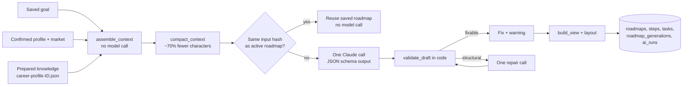

# Roadmap generation

Turns a learner's Agent Context (profile, goal, market gap, cited knowledge) into a
saved, personal learning roadmap. Model: Claude Opus 5.5, via the Anthropic API for
local tests and Amazon Bedrock in production. The default `mock` provider makes no
model call, so development and the frontend integration cost nothing.



## Code map

| Path | Role |
|---|---|
| [ai/roadmap/contracts.py](../../ai/roadmap/contracts.py) | `RoadmapDraft` (model output) and `RoadmapView` (API response) |
| [ai/roadmap/compact.py](../../ai/roadmap/compact.py) | Planning budget from the goal; context reduction; input fingerprint |
| [ai/roadmap/prompt.py](../../ai/roadmap/prompt.py) | System prompt (`PROMPT_VERSION`) and repair message |
| [ai/roadmap/providers.py](../../ai/roadmap/providers.py) | `mock`, `anthropic`, `bedrock` providers |
| [ai/roadmap/validate.py](../../ai/roadmap/validate.py) | Rules checked in code; safe fixes vs fatal issues |
| [ai/roadmap/view.py](../../ai/roadmap/view.py) | View, goal node, layer/order layout, progress |
| [ai/roadmap/generate.py](../../ai/roadmap/generate.py) | Orchestration with at most one repair call |
| [ai/roadmap/cli.py](../../ai/roadmap/cli.py) | Run on a saved Agent Context JSON without backend/DB |
| [backend/app/features/roadmap/](../../backend/app/features/roadmap/) | Goal and roadmap API, jobs, spend guards, persistence |
| [migrations/versions/016_add_roadmap_generation.sql](../../migrations/versions/016_add_roadmap_generation.sql) | Step/task fields, `roadmap_generations`, token columns on `ai_runs` |
| [shared/contracts/api/roadmap/](../../shared/contracts/api/roadmap/) | Schema, TypeScript types and example responses for the frontend |

API reference: [api-contract.md](api-contract.md). Frontend plan: [frontend-handoff.md](frontend-handoff.md).

## What the model may and may not do

The validator enforces these rules in code, so a prompt change cannot weaken them:

- Skill steps only for main skills recommended as `candidate`; each main skill is
  either planned once or deferred with a reason code. A forgotten one is deferred.
- Foundations are never lessons. Only `foundation_check` steps (at most 2 hours,
  `check` tasks) or confirmation questions.
- Every citation must point to a `learning_content` chunk mapped to the step's skill
  and quote it exactly (whitespace-normalized). Invalid citations are removed.
- Dependencies must reference known steps and must not form a cycle.
- Minimum planned hours may exceed the budget's upper bound by at most 25%.
- Levels, gap status, market counts, source titles and URLs are copied from Agent
  Context into the view, never taken from the model.

## Run locally

Free, no database:

```cmd
set PYTHONPATH=.;data-pipeline
backend\.venv\Scripts\python -m ai.roadmap.cli --context ai/roadmap/fixtures/agent-context-demo-student.json --output rag/data/roadmap-mock.json --today 2026-10-19
```

One real Claude call (prints tokens and estimated cost; needs `ANTHROPIC_API_KEY`):

```cmd
backend\.venv\Scripts\python -m ai.roadmap.cli --context ai/roadmap/fixtures/agent-context-demo-student.json --output rag/data/roadmap-claude.json --provider anthropic --allow-spend --save-draft
```

Full API with Docker Compose (mock provider by default):

1. Apply the migration from `data-pipeline/`: `python -m scripts.database.migrate`.
2. Put the prepared knowledge for each career at `rag/data/knowledge/career-profile-<id>.json`
   (the output of `scripts.rag.prepare_skill_context`). Until then, set
   `ROADMAP_CONTEXT_FIXTURE=/app/ai/roadmap/fixtures/agent-context-demo-student.json`
   to develop with the demo context.
3. `docker compose up --build -d`, then call the endpoints in [api-contract.md](api-contract.md).

Tests: `cd backend && .venv\Scripts\python -m pytest tests/test_roadmap_core.py tests/test_roadmap_api.py`.
The full test plan, including the opt-in database test and the paid-model checks, is in
[test-plan.md](test-plan.md).

## Cost controls

Measured on the demo context: the model receives 17,042 characters instead of the
56,815-character Agent Context.

| Control | Where |
|---|---|
| No model call when viewing a saved roadmap | `GET .../roadmaps/current` reads the DB |
| Identical input reuses the active roadmap | `input_sha256` (context + prompt version + model + effort) |
| Context reduction (dependency-only chunks, duplicate excerpts, metadata) | `compact_context` |
| Effort `medium` by default; raise only if evaluation shows a gain | `ROADMAP_EFFORT` |
| Safe fixes in code; at most one repair call | `validate_draft`, `max_repairs=1` |
| Prompt caching off by default (a cache write costs 1.25x input and only pays off when repairs are frequent) | `ROADMAP_CACHE_CONTEXT` |
| Per-profile and global daily limits; monthly budget stop | `ROADMAP_DAILY_LIMIT_PER_PROFILE`, `ROADMAP_DAILY_LIMIT`, `ROADMAP_MONTHLY_BUDGET_USD` |
| Every paid call recorded with tokens and estimated cost | `system.ai_runs` |
| CLI refuses paid providers without `--allow-spend` | `ai/roadmap/cli.py` |

Rough estimate at Anthropic API list prices for Opus 5.5 ($4 input / $20 output per
million tokens): about 6K input and 5-10K output/thinking tokens, so roughly
$0.12-0.25 per new roadmap. Bedrock prices are set per region by AWS. Set
`ROADMAP_PRICE_INPUT_PER_MTOK` and `ROADMAP_PRICE_OUTPUT_PER_MTOK` from the Bedrock
pricing page so the budget guard uses real prices. Measure one real call with the
CLI before relying on these numbers.

Spend this month:

```sql
SELECT model_provider, count(*), sum(input_tokens), sum(output_tokens), sum(estimated_cost_usd)
FROM system.ai_runs
WHERE operation_type = 'roadmap_generation' AND started_at >= date_trunc('month', now())
GROUP BY model_provider;
```

## Moving to Amazon Bedrock

The code is ready (`ROADMAP_PROVIDER=bedrock`, `AnthropicBedrockMantle` from the
`anthropic[bedrock]` SDK). Remaining decisions and setup:

1. Choose a region where Claude Opus 5.5 is offered, and enable model access in the
   Bedrock console for that account and region.
2. Confirm with the program whether the AWS credit covers Anthropic models on Bedrock.
3. Give the backend's runtime role Bedrock invoke permission. Use the instance or
   task role in AWS; never put AWS keys in `.env` for deployment.
4. Set `ROADMAP_PROVIDER=bedrock`, `ROADMAP_AWS_REGION=<region>`, and the Bedrock
   prices. The model ID defaults to `anthropic.claude-opus-5-5`.
5. Run one roadmap and compare `system.ai_runs` tokens with the Bedrock billing page.

Bedrock does not support the server-side refusal fallback. A refusal fails the job
with `MODEL_REFUSAL` and is still recorded with its billed tokens.

## Data sent to the model

Background, goal, confirmed skill names/levels, up to three deduplicated CV evidence
excerpts (300 characters each), market counts for the selected skills, and the cited
public document chunks. Name, email, phone, links and raw CV text are not sent.
Agent Context carries a warning that no personal data is sent to Gemini during its
assembly; that statement still holds, but roadmap generation does send these excerpts
to Claude, so the product's consent text should say so.

## Open items

- Main-skill selection is still the explicit order in the knowledge file
  (`explicit-caller-selection-v1`); the selection policy is pending.
- Migrations 001-016 and the repository SQL pass on a throwaway PostgreSQL
  (`tests/test_roadmap_db.py`, plus an HTTP run through the Docker image). Building
  Agent Context from the team database with real knowledge files is not tested yet.
  See [test-plan.md](test-plan.md).
- No evaluation set yet. Before switching providers or prompts, compare a few real
  outputs with the checks in `validate.py` plus a human read for tone and accuracy.
