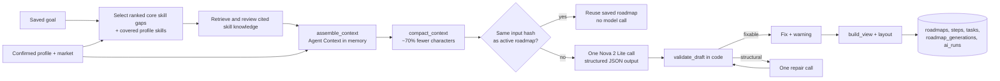

# Roadmap generation

Turns a learner's Agent Context (profile, goal, market gap, cited knowledge) into a
saved, personal learning roadmap. The local Bedrock configuration uses Nova 2 Lite
for roadmap generation and evidence review, with Gemini Embedding 2 for retrieval.
The `mock` provider skips the Roadmap generation call; live RAG still uses embeddings
unless a development fixture is set.



## Code map

| Path | Role |
|---|---|
| [ai/roadmap/contracts.py](../../ai/roadmap/contracts.py) | `RoadmapDraft` (model output) and `RoadmapView` (API response) |
| [ai/roadmap/compact.py](../../ai/roadmap/compact.py) | Planning budget from the goal; context reduction; input fingerprint |
| [ai/roadmap/prompt.py](../../ai/roadmap/prompt.py) | System prompt (`PROMPT_VERSION`) and repair message |
| [ai/roadmap/providers.py](../../ai/roadmap/providers.py) | `mock`, `gemini`, and alternate `anthropic`/`bedrock` providers |
| [ai/roadmap/validate.py](../../ai/roadmap/validate.py) | Rules checked in code; safe fixes vs fatal issues |
| [ai/roadmap/view.py](../../ai/roadmap/view.py) | View, goal node, layer/order layout, progress |
| [ai/roadmap/generate.py](../../ai/roadmap/generate.py) | Orchestration with at most one repair call |
| [ai/roadmap/cli.py](../../ai/roadmap/cli.py) | Run on a saved Agent Context JSON without backend/DB |
| [backend/app/features/roadmap/](../../backend/app/features/roadmap/) | Goal and roadmap API, jobs, spend guards, persistence |
| [migrations/versions/016_add_roadmap_generation.sql](../../migrations/versions/016_add_roadmap_generation.sql) | Step/task fields, `roadmap_generations`, token columns on `ai_runs` |
| [shared/contracts/api/roadmap/](../../shared/contracts/api/roadmap/) | Schema, TypeScript types and example responses for the frontend |

API reference: [api-contract.md](api-contract.md). Frontend plan: [frontend-handoff.md](frontend-handoff.md).

## What the model may and may not do

The validator enforces these rules in code, so a prompt change cannot weaken them:

- Learning skill steps only for main skills recommended as `candidate`; each main skill is
  either planned once or deferred with a reason code. Up to four covered Core skills are also
  shown as baseline-complete cards with cited skill details when reviewed documents are available.
- Baseline-complete cards come only from confirmed profile skills whose assessed level meets
  the market target. They do not have learning tasks, cannot be reset, and do not inflate roadmap
  learning progress. A confirmed skill below the target remains a learning gap.
- Foundations are never lessons. Only `foundation_check` steps (at most 2 hours,
  `check` tasks) or confirmation questions.
- Every citation must point to a `learning_content` chunk mapped to the step's skill
  and quote it exactly (whitespace-normalized). Invalid citations are removed.
- Dependencies must reference known steps and must not form a cycle.
- Minimum planned hours may exceed the budget's upper bound by at most 25%.
- Levels, gap status, market counts, source titles and URLs are copied from Agent
  Context into the view, never taken from the model.

## Run locally

Free, no database:

```cmd
set PYTHONPATH=.;data-pipeline
backend\.venv\Scripts\python -m ai.roadmap.cli --context ai/roadmap/fixtures/agent-context-demo-student.json --output rag/data/roadmap-mock.json --today 2026-10-19
```

One real Gemini call (prints tokens and estimated cost; needs `GEMINI_API_KEY`):

```cmd
backend\.venv\Scripts\python -m ai.roadmap.cli --context ai/roadmap/fixtures/agent-context-demo-student.json --output rag/data/roadmap-gemini.json --provider gemini --allow-spend --save-draft
```

Full API with Docker Compose:

1. Apply the migration from `data-pipeline/`: `python -m scripts.database.migrate`.
2. Configure `GEMINI_API_KEY` for live document retrieval and evidence review. The
   backend selects up to eight ranked core gaps with embedded documents for the saved user, prepares cited
   knowledge and assembles one Agent Context in memory. The mock Roadmap provider
   still performs this live RAG preparation. For isolated UI development, set
   `ROADMAP_CONTEXT_FIXTURE=/app/ai/roadmap/fixtures/agent-context-demo-student.json`.
3. `docker compose up --build -d`, then call the endpoints in [api-contract.md](api-contract.md).

The API uses the same Agent Context assembler as the local RAG command, but selects
the user's gaps and prepares knowledge during the roadmap job. It does not consume
the JSON snapshot saved by that command. The live RAG calls occur before the
roadmap input hash is checked, so repeated requests may repeat those calls and a
different review response may prevent roadmap reuse.

The compact context passes each foundation relationship's `runtime_role` and
`blocks_unconditional_progress` to the Roadmap model. The validator rejects a
planned target skill when an unconfirmed global prerequisite has no earlier check
or skill step. A `learn` task without a valid citation also fails validation.
Hard foundation edges remain required in the saved view and next-action order.
Skipping a required foundation check does not complete the roadmap or count it as
finished progress.

Tests: `cd backend && .venv\Scripts\python -m pytest tests/test_roadmap_core.py tests/test_roadmap_api.py`.
The full test plan, including the opt-in database test and the paid-model checks, is in
[test-plan.md](test-plan.md).

## Cost controls

Measured on the demo context: the model receives 17,042 characters instead of the
56,815-character Agent Context.

| Control | Where |
|---|---|
| No model call when viewing a saved roadmap | `GET .../roadmaps/current` reads the DB |
| Identical input reuses the active roadmap | `input_sha256` (context + prompt version + model + effort) |
| Context reduction (dependency-only chunks, duplicate excerpts, metadata) | `compact_context` |
| Effort `medium` by default; raise only if evaluation shows a gain | `ROADMAP_EFFORT` |
| Safe fixes in code; at most one repair call | `validate_draft`, `max_repairs=1` |
| Prompt caching off by default (a cache write costs 1.25x input and only pays off when repairs are frequent) | `ROADMAP_CACHE_CONTEXT` |
| Per-profile and global daily limits; monthly budget stop | `ROADMAP_DAILY_LIMIT_PER_PROFILE`, `ROADMAP_DAILY_LIMIT`, `ROADMAP_MONTHLY_BUDGET_USD` |
| Roadmap model calls recorded with tokens and estimated cost | `system.ai_runs`; RAG retrieval/review calls are not yet included |
| CLI refuses paid providers without `--allow-spend` | `ai/roadmap/cli.py` |

Gemini 3.8 Flash introductory pricing is $0.75 input / $3.75 output per million
tokens through 2026-12-31; standard pricing is scheduled to become $1.50 / $7.50 on
2027-01-01. At about 6K input and 5-10K output/thinking tokens, estimate roughly
$0.02-0.04 per new roadmap at introductory pricing. The settings default to those
introductory rates; update `ROADMAP_PRICE_INPUT_PER_MTOK` and
`ROADMAP_PRICE_OUTPUT_PER_MTOK` when pricing changes. If selecting Anthropic or
Bedrock instead, set the prices for that provider before relying on the budget guard.

Spend this month:

```sql
SELECT model_provider, count(*), sum(input_tokens), sum(output_tokens), sum(estimated_cost_usd)
FROM system.ai_runs
WHERE operation_type = 'roadmap_generation' AND started_at >= date_trunc('month', now())
GROUP BY model_provider;
```

## Moving to Amazon Bedrock

An alternate Claude-on-Bedrock provider remains available (`ROADMAP_PROVIDER=bedrock`,
`AnthropicBedrockMantle` from the `anthropic[bedrock]` SDK). Its setup, IAM policy,
smoke test, cost controls and rollback are in [aws-setup.md](aws-setup.md) (Thai).
Gemini remains the configured provider for normal Roadmap generation.

1. Choose a region where Claude Opus 5.5 is offered, and enable model access in the
   Bedrock console for that account and region.
2. Confirm with the program whether the AWS credit covers Anthropic models on Bedrock.
3. Give the backend's runtime role Bedrock invoke permission. Use the instance or
   task role in AWS; never put AWS keys in `.env` for deployment.
4. Set `ROADMAP_PROVIDER=bedrock`, `ROADMAP_AWS_REGION=<region>`, and the Bedrock
   prices. The model ID defaults to `anthropic.claude-opus-5-5`.
5. Run one roadmap and compare `system.ai_runs` tokens with the Bedrock billing page.

Bedrock does not support the server-side refusal fallback. A refusal fails the job
with `MODEL_REFUSAL` and is still recorded with its billed tokens.

## Data sent to the model

Background, goal, confirmed skill names/levels, project summaries and linked canonical
skills, up to three deduplicated CV evidence excerpts (300 characters each), market
counts for selected skills, and cited public document chunks are sent to Gemini.
Name, email, phone, links and raw CV text are not sent. The product's consent text
should disclose that these selected profile details are sent to Gemini to create a
Roadmap.

## Open items

- The live API selects up to eight ranked core gaps with embedded documents from the
  user's market comparison. The standalone knowledge-file workflow retains its explicit
  selection for local review.
- Migrations 001-016 and the repository SQL pass on a throwaway PostgreSQL
  (`tests/test_roadmap_db.py`, plus an HTTP run through the Docker image). Building
  Building Agent Context from the current database was inspected read-only, but a live
  user job with Gemini and a roadmap database write has not been run yet.
  See [test-plan.md](test-plan.md).
- No evaluation set yet. Before switching providers or prompts, compare a few real
  outputs with the checks in `validate.py` plus a human read for tone and accuracy.
